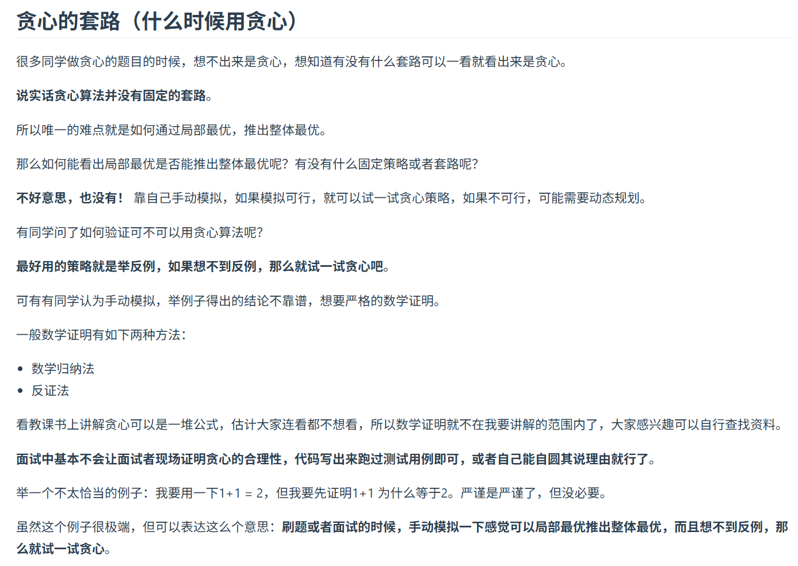
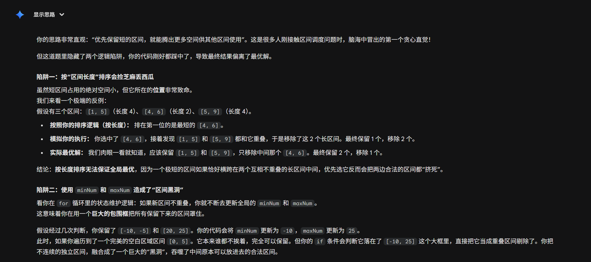

# 算法汇总（基础）

## 1. 数组

### 1.1 二分查找

1. 循环不变量

    > 大家写二分法经常写乱，主要是因为**对区间的定义没有想清楚，区间的定义就是不变量**。要在二分查找的过程中，保持不变量，就是在while寻找中每一次边界的处理都要坚持根据区间的定义来操作，这就是**循环不变量**规则。
    >
    > 写二分法，区间的定义一般为两种，左闭右闭即[left, right]，或者左闭右开即[left, right)。
    >
    > 下面我用这两种区间的定义分别讲解两种不同的二分写法。

2. 溢出问题
    取中间指针可以改为：
    `middlePtr = left + (right - left) / 2`，从而防止 `right + left` 的溢出问题。

3. https://programmercarl.com/0704.%E4%BA%8C%E5%88%86%E6%9F%A5%E6%89%BE.html

4. 代码：
    ```java
    class Solution {
        public int search(int[] nums, int target) {
            // 双指针来做
            int frontPtr = 0;
            int endPtr = nums.length - 1;
            while (frontPtr <= endPtr) {
                // 1. 先取中间位置，注意这个是向下取的
                int middlePtr = (frontPtr + endPtr) / 2;
                // 2. 判断中间位置的值和目标值的关系
                if (nums[middlePtr] < target) {
                    frontPtr = middlePtr + 1;
                    
                }
                else if (nums[middlePtr] > target) {
                    endPtr = middlePtr - 1;
                }
                else {
                    return middlePtr;
                }
            }
            return -1;
        }
    }
    ```

### 1.2 移除元素

1. 双指针/快慢指针
    双指针的本质作用在于**在一个 `for` 循环下完成两个 `for` 循环的工作。**从而可以在空间复杂度不变的情况下缩短时间复杂度。

2. https://programmercarl.com/0027.%E7%A7%BB%E9%99%A4%E5%85%83%E7%B4%A0.html#%E7%AE%97%E6%B3%95%E5%85%AC%E5%BC%80%E8%AF%BE

3. 代码：
    ```java
    class Solution {
    
        // 用 -1 来替代被移除的元素
        private static final int PLACEHOLDER = -1;
    
        public int removeElement(int[] nums, int val) {
            // 用双指针来做
            int frontPtr = 0;
            int endPtr = nums.length - 1;
            // 用于交换的中间值
            int temp;
            // 用于记录个数
            int count = 0;
            while (frontPtr <= endPtr) {
                // 先是尾指针一直向前移动，直到遇到非相同值，再轮到头指针
                while (endPtr >= 0 && nums[endPtr] == val && frontPtr <= endPtr) {
                    nums[endPtr--] = PLACEHOLDER;
                    count++;
                }
                // 头指针向后移动，遇到相同值则和尾指针交换。
                while (frontPtr <= nums.length - 1 && nums[frontPtr] != val && frontPtr <= endPtr) {
                    frontPtr++;
                }
                if (frontPtr <= nums.length - 1 && nums[frontPtr] == val) {
                    // 先将相同值去掉且计数 +1
                    nums[frontPtr] = PLACEHOLDER;
                    count++;
                    temp = nums[endPtr];
                    nums[endPtr] = nums[frontPtr];
                    nums[frontPtr] = temp;
                    endPtr--;
                }
            }
            return nums.length - count;
        }
    }
    ```

### 1.3 有序数组的平方

1. 双指针还可以从业务/数学的角度出发使用。例如平方的函数是单调函数，最大值必定在两边。
2. https://programmercarl.com/0977.%E6%9C%89%E5%BA%8F%E6%95%B0%E7%BB%84%E7%9A%84%E5%B9%B3%E6%96%B9.html#%E7%AE%97%E6%B3%95%E5%85%AC%E5%BC%80%E8%AF%BE

### 1.4 长度最小的子数组

1. `while` 循环用的不熟练，导致边界出错。

2. https://programmercarl.com/0209.%E9%95%BF%E5%BA%A6%E6%9C%80%E5%B0%8F%E7%9A%84%E5%AD%90%E6%95%B0%E7%BB%84.html

3. 代码
    ```java
    class Solution {
        public int minSubArrayLen(int target, int[] nums) {
            // 1. 用双指针定义滑动窗口
            // 尾指针用 for 循环的 index
            int frontPtr = 0;
            // 2. 定义滑动窗口的相关参数
            int sum = 0;
            int minLen = Integer.MAX_VALUE;
            // 3. 外层遍历
            for (int endPtr = 0; endPtr < nums.length; endPtr++) {
                // 1. 尾指针向后移动
                // 2. 计算总和，如果总和不够还需要接着向后移动
                sum += nums[endPtr];
                if (sum < target) {
                    continue;
                }
                // 3. 判断总和与 target 关系，如果大于就要头指针向前移动
                while (sum >= target) {
                    sum -= nums[frontPtr];
                    frontPtr++;
                }
                minLen = Math.min(minLen, endPtr - frontPtr + 2);
            }
            return minLen == Integer.MAX_VALUE ? 0 : minLen;
        }
    }
    ```

### 1.5 螺旋矩阵 2

1. 循环不变量左闭右开时，左闭右开只有一个元素时是取开的，因此还需要手动补上。

2. https://programmercarl.com/0059.%E8%9E%BA%E6%97%8B%E7%9F%A9%E9%98%B5II.html

3. 代码：
    ```java
    class Solution {
        public int[][] generateMatrix(int n) {
            int[][] result = new int[n][n];
            // 计数器
            int counter = 1;
            // 1. 一共循环 2n - 1 次，从圈数走的话，就是 n/2 圈（向上取整）
            // 2. 填充遵循左闭右开的原则
            for (int i = 0; i < (int) Math.ceil((double) n / 2); i++) {
                // 上，第 i 个数组从第 i 个位子开始填充，填充到第 n - i - 2 的位置（右开）
                for (int upperIndex = i; upperIndex < (n - 1 - i); upperIndex++) {
                    result[i][upperIndex] = counter;
                    counter++;
                }
                // 右，第 n - i - 1 个列开始，上面是 i，往下到 n - i - 2 的位置
                for (int rightIndex = i; rightIndex < (n - 1 - i); rightIndex++) {
                    result[rightIndex][n - 1 - i] = counter;
                    counter++;
                }
                // 底，和上的方向相反
                for (int bottomIndex = n - 1 - i; bottomIndex > i; bottomIndex--) {
                    result[n - 1 - i][bottomIndex] = counter;
                    counter++;
                }
                // 左边，和右的方向相反，列不动行动
                for (int leftIndex = n - 1 - i; leftIndex > i; leftIndex--) {
                    result[leftIndex][i] = counter;
                    counter++;
                }
            }
            // 如果是奇数，最后还得补上
            if ((n & 1) == 1) {
                result[n/2][n/2] = counter;
            }
            return result;
        }
    }
    ```

## 2. 链表

### 2.1 移除链表元素

1. 可以添加虚拟头节点，这样可以统一删除逻辑。

2. https://programmercarl.com/0203.%E7%A7%BB%E9%99%A4%E9%93%BE%E8%A1%A8%E5%85%83%E7%B4%A0.html

3. 代码：
    ```java
    /**
     * Definition for singly-linked list.
     * public class ListNode {
     *     int val;
     *     ListNode next;
     *     ListNode() {}
     *     ListNode(int val) { this.val = val; }
     *     ListNode(int val, ListNode next) { this.val = val; this.next = next; }
     * }
     */
    class Solution {
        public ListNode removeElements(ListNode head, int val) {
            // 指针初始化
            ListNode ptr = head;
            // 使用单个节点，看它的下一个节点。
            // 先保证首节点不是被删除的节点
            while (ptr != null && ptr.val == val) {
                // 首节点向后移动
                head = head.next;
                // 移除元素
                ptr.next = null;
                // 再次指向首节点
                ptr = head;
            }
            // 如果首节点为空，直接返回
            if (head == null) {
                return null;
            }
            while (ptr.next != null) {
                if (ptr.next.val == val) {
                    // 1. 获取被删除元素
                    ListNode removedElement = ptr.next;
                    // 2. 先链接
                    ptr.next = removedElement.next;
                    // 3. 再孤立被删除元素
                    removedElement.next = null;
                } else {
                    // 4. 如果下一个元素不是被删除元素则向后移动
                    ptr = ptr.next;
                }
            }
            return head;
        }
    }
    ```

### 2.2 设计链表

1. 注意类内定义了统计变量时记得同步更新。

2. https://programmercarl.com/0707.%E8%AE%BE%E8%AE%A1%E9%93%BE%E8%A1%A8.html

3. 代码：
    ```java
    // 带虚拟头节点的单链表
    class MyLinkedList {
    
        // 定义内部节点
        class MyNode {
            private int val;
            private MyNode next;
    
            public MyNode() {}
            public MyNode(int val) {
                this.val = val;
            }
            public MyNode(int val, MyNode next) {
                this.val = val;
                this.next = next;
            }
        }
    
        // 链表长度
        private int length;
        // 虚拟头节点
        private MyNode headNode = new MyNode(-1);
        // 其实还可以再创建尾节点辅助，这样尾节点插入和尾节点查找可能会有优化。
    
        // 初始化虚拟节点
        public MyLinkedList() {
    
        }
        
        public int get(int index) {
            // 1. 先处理下标无效的情况
            if (index >= length) {
                return -1;
            }
    
            // 2. 初始化相关变量
            MyNode ptr = headNode;
    
            // 3. 循环得到元素
            for (int i = 0; i <= index; i++) {
                ptr = ptr.next;
            }
    
            return ptr.val;
        }
        
        public void addAtHead(int val) {
            // 1. 创建待插入节点
            MyNode newNode = new MyNode(val, headNode.next);
    
            // 2. 虚拟头节点链接到新插入节点
            headNode.next = newNode;
    
            // 3. 长度变化
            this.length++;
        }
        
        public void addAtTail(int val) {
            // 所需变量
            MyNode ptr = headNode;
            // 1. 首先遍历到尾节点
            for (int i = 0; i < this.length; i++) {
                ptr = ptr.next;
            }
            
            // 2. 创建新节点
            ptr.next = new MyNode(val);
    
            // 3. 长度增加
            this.length++;
        }
        
        // 单链表前插逻辑改为后插
        public void addAtIndex(int index, int val) {
            // 异常处理
            if (index > length) {
                return;
            }
    
            // 所需变量
            MyNode ptr = headNode;
    
            // 遍历到所需位置
            for (int i = 0; i < index; i++) {
                ptr = ptr.next;
            }
    
            // 向后插入元素
            MyNode newNode = new MyNode(val, ptr.next);
            ptr.next = newNode;
    
            // 长度增加
            this.length++;
        }
        
        public void deleteAtIndex(int index) {
            // 异常处理
            if (index >= length) {
                return;
            }
            
            // 所需变量
            MyNode ptr = headNode;
    
            // 遍历到前一个节点
            for (int i = 0; i < index; i++) {
                ptr = ptr.next;
            }
    
            // 直接删除
            MyNode removedNode = ptr.next;
            ptr.next = ptr.next.next;
            removedNode.next = null;
    
            // 长度缩小
            this.length--;
        }
    }
    
    /**
     * Your MyLinkedList object will be instantiated and called as such:
     * MyLinkedList obj = new MyLinkedList();
     * int param_1 = obj.get(index);
     * obj.addAtHead(val);
     * obj.addAtTail(val);
     * obj.addAtIndex(index,val);
     * obj.deleteAtIndex(index);
     */
    ```

### 2.3 翻转链表

1. 头节点单独处理或统一向前挪一位。

2. https://programmercarl.com/0206.%E7%BF%BB%E8%BD%AC%E9%93%BE%E8%A1%A8.html

3. 代码：
    ```java
    /**
     * Definition for singly-linked list.
     * public class ListNode {
     *     int val;
     *     ListNode next;
     *     ListNode() {}
     *     ListNode(int val) { this.val = val; }
     *     ListNode(int val, ListNode next) { this.val = val; this.next = next; }
     * }
     */
    class Solution {
        public ListNode reverseList(ListNode head) {
            // 1. 特殊情况处理，无节点或单节点直接返回即可
            if (head == null || head.next == null) {return head;}
    
            // 2. 双指针将链接过程反转
            ListNode prePtr = head;
            ListNode ptr = head.next;
    
            // 3. 首节点要置空
            head.next = null;
    
            // 4. 循环遍历，创建临时指针用于暂存下一个节点
            while(ptr != null) {
                // 临时节点
                ListNode tempNextPtr = ptr.next;
                // 反转
                ptr.next = prePtr;
                // 指针移动
                prePtr = ptr;
                ptr = tempNextPtr;
            }
    
            return prePtr;
        }
    }
    ```

### 2.4 两两交换链表中的节点

1. 递归的三个要素：

    1. 出口：也就是终止条件，感觉一般是业务中无法处理的特殊情况（经典的就是为 `null`）。
    2. 返回值：根据具体情况来，一般是当前轮需要从下一轮获取的值。
    3. 方法内容：需要根据情况传入下一次递归需要的值，同时完成一轮操作。

2. https://programmercarl.com/0024.%E4%B8%A4%E4%B8%A4%E4%BA%A4%E6%8D%A2%E9%93%BE%E8%A1%A8%E4%B8%AD%E7%9A%84%E8%8A%82%E7%82%B9.html#%E5%85%B6%E4%BB%96%E8%AF%AD%E8%A8%80%E7%89%88%E6%9C%AC

3. 代码：
    ```java
    /**
     * Definition for singly-linked list.
     * public class ListNode {
     *     int val;
     *     ListNode next;
     *     ListNode() {}
     *     ListNode(int val) { this.val = val; }
     *     ListNode(int val, ListNode next) { this.val = val; this.next = next; }
     * }
     */
    class Solution {
        public ListNode swapPairs(ListNode head) {
            return swap(head);
        }
    
        // 每次交换都可以看成一组两个节点交换，然后尾节点链接到头节点上
        // 递归：1. 终止条件。 2. 返回值。 3. 单次过程
        // 1. 终止条件：没有下一组了
        // 2. 返回值：交换后的头节点
        // 3. 单次过程：交换
        public ListNode swap(ListNode head) {
            // 1. 特殊情况判断/终止条件
            if (head == null || head.next == null) {return head;}
    
            // 2. 组内交换
            // 定义第二个交换的指针和下一组的头指针
            ListNode ptr = head.next;
            ListNode nextHead = ptr.next;
            // 交换
            ptr.next = head;
    
            // 3. 递归调用
            head.next = swap(nextHead);
    
            // 4. 返回头节点
            return ptr;
        }
    }
    ```

### 2.5 删除链表的倒数第N个节点

1. 双指针的应用：快慢指针。

2. https://programmercarl.com/0019.%E5%88%A0%E9%99%A4%E9%93%BE%E8%A1%A8%E7%9A%84%E5%80%92%E6%95%B0%E7%AC%ACN%E4%B8%AA%E8%8A%82%E7%82%B9.html#%E6%80%9D%E8%B7%AF

3. 代码：
    ```java
    /**
     * Definition for singly-linked list.
     * public class ListNode {
     *     int val;
     *     ListNode next;
     *     ListNode() {}
     *     ListNode(int val) { this.val = val; }
     *     ListNode(int val, ListNode next) { this.val = val; this.next = next; }
     * }
     */
    class Solution {
        public ListNode removeNthFromEnd(ListNode head, int n) {
            if (head == null) {return null;}
    
            // 1. 不用判断给的数是否溢出，那先塞入虚拟头节点
            ListNode virtualHead = new ListNode(-1, head);
    
            // 2. 创建相关变量.因为是倒数，所以使用快慢指针，当快指针到尾部时，慢指针就到所删节点的前驱了。
            ListNode slowPtr = virtualHead;
            ListNode fastPtr = virtualHead;
            for (int i = 0; i < n; i++) {
                fastPtr = fastPtr.next;
            }
    
            // 3. 移动到指定位置
            while(fastPtr.next != null) {
                fastPtr = fastPtr.next;
                slowPtr = slowPtr.next;
            }
    
            // 4. 后继删除
            ListNode toBeRemovedNode = slowPtr.next;
            slowPtr.next = toBeRemovedNode.next;
            toBeRemovedNode.next = null;
    
            return virtualHead.next;
        }
    }
    ```

### 2.6 面试题 02.07. 链表相交

1. 链表优先关注节点本身，再考虑下一个节点。

2. 链表优先判断是否为空等边界情况，再做业务判断。

3. https://programmercarl.com/%E9%9D%A2%E8%AF%95%E9%A2%9802.07.%E9%93%BE%E8%A1%A8%E7%9B%B8%E4%BA%A4.html#%E5%85%B6%E4%BB%96%E8%AF%AD%E8%A8%80%E7%89%88%E6%9C%AC

4. 代码：
    ```java
    /**
     * Definition for singly-linked list.
     * public class ListNode {
     *     int val;
     *     ListNode next;
     *     ListNode(int x) {
     *         val = x;
     *         next = null;
     *     }
     * }
     */
    public class Solution {
        // 让两个链表的判断指针位于同一个起跑线上即可
        public ListNode getIntersectionNode(ListNode headA, ListNode headB) {
            if (headA == null || headB == null ) {return null;} 
            // 创建虚拟节点，方便首节点的情况
            ListNode aVirtualNode = new ListNode(-1);
            aVirtualNode.next = headA;
            ListNode bVirtualNode = new ListNode(-1);
            bVirtualNode.next = headB;
    
            // 1. 获取两个链表长度
            int aLength = 0;
            int bLength = 0;
            ListNode aPtr = aVirtualNode;
            ListNode bPtr = bVirtualNode;
            while(aPtr.next != null) {
                aPtr = aPtr.next;
                aLength++;
            }
            while(bPtr.next != null) {
                bPtr = bPtr.next;
                bLength++;
            }
    
            // 2. 获取差值，将指针移动到同一起跑线
            aPtr = aVirtualNode;
            bPtr = bVirtualNode;
            int gap = aLength - bLength;
            if (gap > 0) {
                for (int i = 0; i < gap; i++) { 
                        aPtr = aPtr.next;
                }
            }
            if (gap < 0) {
                for (int i = 0; i < -gap; i++) { 
                        bPtr = bPtr.next;
                }
            }
    
            // 3. 循环判断
            // todo 这里应该先判断是否为空，然后再比较，同时可以不用 next 作比较，直接看两者指针是否相同就行
            while(aPtr.next != bPtr.next && aPtr.next != null) {
                aPtr = aPtr.next;
                bPtr = bPtr.next;
            }
            
            return aPtr.next;
        }
    }
    ```

### 2.7 环形链表2

1. 判断链表是否有环：通过快慢指针，快指针比慢指针多走一步（快指针相对慢指针来说，其相对追赶速度为 1，因此两者必定能相遇）。

2. 环的入口：三元变量算关系式，最终得出结论：**从头结点出发一个指针，从相遇节点也出发一个指针，这两个指针每次只走一个节点， 那么当这两个指针相遇的时候就是环形入口的节点**。
    最终时间复杂度最多就是 2n，因此是 O(n)。

3. https://programmercarl.com/0142.%E7%8E%AF%E5%BD%A2%E9%93%BE%E8%A1%A8II.html#%E6%80%9D%E8%B7%AF

4. 代码：
    ```java
    /**
     * Definition for singly-linked list.
     * class ListNode {
     *     int val;
     *     ListNode next;
     *     ListNode(int x) {
     *         val = x;
     *         next = null;
     *     }
     * }
     */
    public class Solution {
        public ListNode detectCycle(ListNode head) {
            // 特殊情况处理
            if (head == null || head.next == null) {return null;}
            
            ListNode slowPtr = head;
            ListNode fastPtr = head;
            while(fastPtr != null) {
                // 快指针走两步，不过中间一步也需要先判空
                fastPtr = fastPtr.next;
                // 连走两步也要考虑为空的情况，只要出现为空就是没有环
                if (fastPtr == null) {
                    return null;
                }
                fastPtr = fastPtr.next;
                slowPtr = slowPtr.next;
    
                // 1. 先用双指针定位到相见的地方
                if (slowPtr == fastPtr) {
                    // 2. 首指针再和相见的地方一起走，直到遇到为止。
                    ListNode lastPtr = head;
                    while(lastPtr != slowPtr) {
                        lastPtr = lastPtr.next;
                        slowPtr = slowPtr.next;
                    }
                    return lastPtr;
                }
            }
            return null;
        }
    }
    ```

## 3. 哈希表

1. 空间换时间，建立哈希函数从而保证和数组下标的联系。
2. **如果在做面试题目的时候遇到需要判断一个元素是否出现过的场景也应该第一时间想到哈希法！**

### 3.1 有效的字母异位词

1. 尽量使用一个 Hash 表来完成操作。

2. 注意一下 Java 的字符串操作。

3. https://programmercarl.com/0242.%E6%9C%89%E6%95%88%E7%9A%84%E5%AD%97%E6%AF%8D%E5%BC%82%E4%BD%8D%E8%AF%8D.html

4. 代码（还有可优化的空间）：
    ```java
    class Solution {
        public boolean isAnagram(String s, String t) {
            // 特殊情况处理
            if (s.length() != t.length()) {return false;}
    
            // 定义 Hash 函数：ascii - ascii(a)，建立与 index 的关系
            // todo 优化点：只用一个表，一个先加，另外一个减，最后看这个表是否是全零表
            // 1. 先获取 s 和 t 的字母表
            int[] sTable = getAlphabetArray(s);
            int[] tTable = getAlphabetArray(t);
    
            // 2. 循环遍历两者是否相同
            for (int i = 0; i < sTable.length; i++) {
                if (sTable[i] != tTable[i]) {
                    return false;
                }
            }
    
            return true;
        }
    
        public int hashCode(char c) {
            return Integer.valueOf(c) - Integer.valueOf('a');
        }
    
        public int[] getAlphabetArray(String s) {
            int[] sTable = new int[26];
            for (int i = 0; i < s.length(); i++) {
                sTable[hashCode(s.charAt(i))]++;
            }
            return sTable;
        }
    }
    ```

### 3.2 两个数组的交集

1. 可以使用一些 `Collection` 对象来实现题目。一些 `Collection` 对象底层就是用 Hash 实现的，例如 `HashSet`、`HashMap` 等等。

2.  注意事项：

    > 那有同学可能问了，遇到哈希问题我直接都用 set 不就得了，用什么数组啊。
    >
    > 直接使用 set 不仅占用空间比数组大，而且速度要比数组慢，set 把数值映射到key 上都要做 hash 计算的。
    >
    > 不要小瞧 这个耗时，在数据量大的情况，差距是很明显的。

3. `Stream` 的接口使用：
    `stream().mapToInt(Integer::intValue).toArray()`。

4. https://programmercarl.com/0349.%E4%B8%A4%E4%B8%AA%E6%95%B0%E7%BB%84%E7%9A%84%E4%BA%A4%E9%9B%86.html#%E5%85%B6%E4%BB%96%E8%AF%AD%E8%A8%80%E7%89%88%E6%9C%AC

5. 代码：

    ```java
    class Solution {
        // hash 函数就一一对应，看看能不能过
        public int[] intersection(int[] nums1, int[] nums2) {
            // 定义统计数组
            int[] convergeArray = new int[1001];
    
            // nums1 先来做统计
            for (int i = 0; i < nums1.length; i++) {
                // 保证出现过的数字先记为 1
                if (convergeArray[nums1[i]] < 1) {convergeArray[nums1[i]]++;}
            }
            // nums2 再做加法
            for (int i = 0; i < nums2.length; i++) {
                // 保证已经出现过的数字记为 2
                if(convergeArray[nums2[i]] == 1) {convergeArray[nums2[i]]++;}
            }
    
            // 创建 ArrayList 获取数字
            ArrayList<Integer> resultList = new ArrayList<>();
    
            for (int i = 0; i < convergeArray.length; i++) {
                if (convergeArray[i] == 2) {
                    resultList.add(i);
                }
            }
    
            return resultList.stream().mapToInt(Integer::intValue).toArray();
        }
    }
    ```

6. 额外使用 `Collection` 重写（Leetcode 可以使用 `import`）：
    ```java
    import java.util.Set;
    import java.util.HashSet;
    
    class Solution {
        
        public int[] intersection(int[] nums1, int[] nums2) {
            Set<Integer> num1Set = new HashSet<>();
            Set<Integer> resultSet = new HashSet<>();
    
            // num1 先塞入
            for (int i = 0; i < nums1.length; i++) {
                num1Set.add(nums1[i]);
            }
    
            // nums2 需要判断，如果已经在里面的，就往 resultSet 里面塞入
            for (int i = 0; i < nums2.length; i++) {
                if (num1Set.contains(nums2[i])) {
                    resultSet.add(nums2[i]);
                }
            }
    
            return resultSet.stream().mapToInt(Integer::intValue).toArray();
        }
    }
    ```

### 3.3 快乐数

1. **如果在做面试题目的时候遇到需要判断一个元素是否出现过的场景也应该第一时间想到哈希法！**

2. 如何获取一个数的每一位数字，最简单的方法就是一直除以 10，直到最终的数变成 0。自己写的时候用字符串做中转，取每位数和 `0` 的差值，感觉内存消耗了很多。

3. https://programmercarl.com/0202.%E5%BF%AB%E4%B9%90%E6%95%B0.html#%E6%80%9D%E8%B7%AF

4. 代码：
    ```java
    class Solution {
        // 最多不超过 10 位数，最大值不会超过 81 * 10 = 810
        public boolean isHappy(int n) {
            int[] hashList = new int[810];
    
            int newHappyNum = n;
    
            // 结束条件为：两次得到同一个数字
            while(true) {
                newHappyNum = getHappyNum(newHappyNum);
                if (newHappyNum == 1) {return true;}
                if (hashList[newHappyNum] == 1) {return false;}
                hashList[newHappyNum]++;
            }
        }
    
        // 获取总和
        public int getHappyNum(int num) {
            // 1. 数字转字符串
            String numStr = num + "";
    
            // 2. 用数组来接取每一位
            char[] numCharList = numStr.toCharArray();
    
            // 3. 计算总和
            int result = 0;
            for (int i = 0; i < numCharList.length; i++) {
                result += Math.pow(numCharList[i] - '0', 2);
            }
    
            // 4. 返回
            return result;
        }
    }
    ```

### 3.4 两数之和

1. 大量的数据下就不要自己考虑定义数组、想 Hash 函数和碰撞冲突问题了，直接调用 Java `Collection` 用 Hash 实现的工具，这些工具的访问元素的时间复杂度基本都是 O(1)。

2. 注意 `HashMap` 的操作方法。

3. https://programmercarl.com/0001.%E4%B8%A4%E6%95%B0%E4%B9%8B%E5%92%8C.html#%E6%80%9D%E8%B7%AF

4. 代码：
    ```java
    import java.util.Map;
    import java.util.HashMap;
    
    class Solution {
        // 大量数据不适合自己去想 Hash 函数和碰撞问题，直接用 Collection
        public int[] twoSum(int[] nums, int target) {
            // 1. 创建 HashMap 用于寻找
            Map<Integer, Integer> numsMap = new HashMap<>();
    
            // 2. 遍历数组
            for (int i = 0; i < nums.length; i++) {
                int searchTarget = target - nums[i];
                // 从 HashMap 中找（用 HashMap 的寻找函数，因为他底层是通过 HashCode 的，因此复杂度为 O(1)）
                if (numsMap.containsKey(searchTarget)) {
                    return new int[] {i, numsMap.get(searchTarget)};
                }
    
                // 如果没找到，当前元素进入 HashMap
                numsMap.put(nums[i], i);
            }
    
            return null;
        }  
    }
    ```

### 3.5 四数相加 2

1. 经典题目，想法先硬记下来。

2. 尽可能减少 `Collection` 的使用个数。

3. https://programmercarl.com/0454.%E5%9B%9B%E6%95%B0%E7%9B%B8%E5%8A%A0II.html#%E7%AE%97%E6%B3%95%E5%85%AC%E5%BC%80%E8%AF%BE

4. 代码：
    ```java
    import java.util.HashMap;
    import java.util.Map;
    
    class Solution {
        public int fourSumCount(int[] nums1, int[] nums2, int[] nums3, int[] nums4) {
            // 四数之和拆成 3 次两数之和。
            // 定义两个 HashMap，key 为和，value 为出现的次数（他最后只要求有多少个，没要求具体的下标）
            Map<Integer, Integer> sumMap1 = new HashMap<>();
            Map<Integer, Integer> sumMap2 = new HashMap<>();
    
            for (int i = 0; i < nums1.length; i++) {
                for(int j = 0; j < nums1.length; j++) {
                    int sum1 = nums1[i] + nums2[j];
                    if (!sumMap1.containsKey(sum1)) {
                        sumMap1.put(sum1, 1);
                    } else {
                        sumMap1.put(sum1, sumMap1.get(sum1) + 1);
                    }
                    int sum2 = nums3[i] + nums4[j];
                    if (!sumMap2.containsKey(sum2)) {
                        sumMap2.put(sum2, 1);
                    } else {
                        sumMap2.put(sum2, sumMap2.get(sum2) + 1);
                    }
                }
            }
    
            int count = 0;
            for (Map.Entry<Integer, Integer> entry : sumMap1.entrySet()) {
                if (sumMap2.containsKey(-entry.getKey())) {
                    count += (entry.getValue() * sumMap2.get(-entry.getKey()));
                }
            }
            return count;
            // todo 空间优化思路：sumMap2 没有必要，直接遍历 sum3，sum4，反向去查找 sumMap1 中是否存在即可。
        }
    }
    ```

### 3.6 赎金信

1. 和 [3.1 有效的字母异位词](# 3.1 有效的字母异位词)相似，注意字符串字符的获取 `string.CharAt()`。

2. https://programmercarl.com/0383.%E8%B5%8E%E9%87%91%E4%BF%A1.html#%E6%80%9D%E8%B7%AF

3. 代码：
    ```java
    class Solution {
        public boolean canConstruct(String ransomNote, String magazine) {
            // 统计 magazine 每个字母出现的次数
            // 遍历 ransomNote，遇到一个就将 magazine 统计的次数 -1，如果不够减了，说明不能构成
            int[] magazineCount = getAlphabetArray(magazine);
    
            for (int i = 0; i < ransomNote.length(); i++) {
                if (magazineCount[hashCode(ransomNote.charAt(i))] == 0) {return false;}
                magazineCount[hashCode(ransomNote.charAt(i))]--;
            }
            
            return true;
        }
        public int hashCode(char c) {
            return Integer.valueOf(c) - Integer.valueOf('a');
        }
    
        public int[] getAlphabetArray(String s) {
            int[] sTable = new int[26];
            for (int i = 0; i < s.length(); i++) {
                sTable[hashCode(s.charAt(i))]++;
            }
            return sTable;
        }
    }
    ```

### 3.7 三数之和（todo 难题）

1. Hash 在去重方面比较棘手，todo 如果排序后，封装到 `ArrayList` 再用 `Set` 可能可以过，因为保证顺序过后，塞入 `Set` 的话可以不考虑组内顺序问题，但可能超时？

2. 题目没有要求返回下标，因此可以排序（快排）后 + 双指针来优化时间。

3. 这题的去重操作是需要额外思考的，很难，容易陷入“三元组的元素不可以重复的陷阱”（其实是算法的逻辑是先去重后判断，既然先去重的话，就得考虑会不会导致边界别删掉）。

4. 注意 `List` 的相关方法使用。

5. https://programmercarl.com/0015.%E4%B8%89%E6%95%B0%E4%B9%8B%E5%92%8C.html#%E6%80%9D%E8%B7%AF

6. 代码：
    ```java
    import java.util.List;
    import java.util.ArrayList;
    import java.util.Arrays;
    
    class Solution {
        // 注意：题目要求返回的是满足条件的数，而不是下标。同时要去重。
        // 所以这题比较特殊，可以使用排序 + 双指针法。使用 Hash 的话，则需要去剪枝来保证通过，不然容易超时。
        public List<List<Integer>> threeSum(int[] nums) {
            // 1. 创建结果 List，同时给原来数组排序
            List<List<Integer>> numsList = new ArrayList<>();
            Arrays.sort(nums);
    
            // 极端情况处理
            if (nums[nums.length - 1] < 0) {return numsList;}
    
            // 2. 双指针
            // 一直想的思路不对，应该每次都固定最小值，让两个双指针去变化
            for (int minPtr = 0; minPtr < nums.length; minPtr++) {
                // 如果当前的最小值都大于 0 了，那么就直接返回
                if (nums[minPtr] > 0) {return numsList;}
    
                // 最小值的去重，保证每轮最小值要不重复，同时还要考虑三元组内是可以有重复元素的（思路就是保证有一个元素在里面，双指针也可以有至少一个相同元素，从而形成至少 2 个相同的重复元素）。
                // 先去重，后判断
                if (minPtr > 0 && nums[minPtr - 1] == nums[minPtr]) {continue;}
    
                int rightPtr = nums.length - 1;
                int leftPtr = minPtr + 1;
    
                // 先保证每轮的动指针不越过静指针
                while(leftPtr < rightPtr) {
                    int sum = nums[minPtr] + nums[leftPtr] + nums[rightPtr];
                    if (sum < 0) {
                        leftPtr++;
                    }
                    else if (sum > 0) {
                        rightPtr--;
                    }
                    else {
                        numsList.add(Arrays.asList(nums[minPtr], nums[leftPtr], nums[rightPtr]));
                        // 加进去之后，除了最小值外，另外两位也要去重，也就是让左右指针都移动
                        while (leftPtr < rightPtr && nums[leftPtr] == nums[leftPtr + 1]) {leftPtr++;}
                        while (leftPtr < rightPtr && nums[rightPtr] == nums[rightPtr - 1]) {rightPtr--;}
                        // 最后还需要一次移动
                        leftPtr++;
                        rightPtr--;
                    }
                }
            }
    
            return numsList;
        }
    }
    ```

### 3.8 四数之和（todo 难题）

1. 三数之和套循环，不要进行深入考虑。

2. 注意目标数不为 0 的考虑。

3. 最小数和次小数之间有空隙，需要额外考虑。

4. https://programmercarl.com/0018.%E5%9B%9B%E6%95%B0%E4%B9%8B%E5%92%8C.html#%E6%80%9D%E8%B7%AF

5. 代码：
    ```java
    import java.util.List;
    import java.util.ArrayList;
    import java.util.Arrays;
    
    class Solution {
        public List<List<Integer>> fourSum(int[] nums, int target) {
            // 1. 创建结果 List，同时给原来的数组排序
            List<List<Integer>> result = new ArrayList<>();
            Arrays.sort(nums);
    
            // 2. 极端情况处理
            if (nums.length < 4 || 
                (target > 0 && nums[nums.length - 1] < 0) || 
                (target < 0 && nums[0] > 0)
            ) {return result;}
    
            // 3. 双指针，但是需要先定下来两个最小数
            for (int minPtr = 0; minPtr < nums.length - 3; minPtr++) {
                // 先做特殊情况处理，因为引入的正负号，所以在负数情况下，多个小于 target 的值相加反而可以凑到 target，因此需要分符号讨论
                if ((target > 0 && nums[minPtr] > target) || (target < 0 && nums[nums.length - 1] < target)) {return result;}
    
                // 先去重，这里原来是考虑两位数的，但是既然多引入一轮循环，那么一轮循环保证一个数就行，不要考虑太多
                if (minPtr > 0 && nums[minPtr - 1] == nums[minPtr]) {
                    continue;
                }
    
                // 第一个数定完后，接着是第二个数
                for (int subminPtr = minPtr + 1; subminPtr < nums.length - 2; subminPtr++) {
                    // 特殊情况处理，注意最小数和次最小数之间可能有间隙，所以不能直接 return
                    if ((target - nums[minPtr] > 0 && nums[subminPtr] > target - nums[minPtr]) || 
                        (target - nums[minPtr] < 0 && nums[nums.length - 1] < target - nums[minPtr])
                    ) {break;}
    
                    // 去重，此时要排除掉 minPtr
                    if (subminPtr > minPtr + 1 && nums[subminPtr - 1] == nums[subminPtr]) {
                        continue;
                    }
    
                    // 定义双指针
                    int leftPtr = subminPtr + 1;
                    int rightPtr = nums.length - 1;
    
                    // 循环遍历
                    while (leftPtr < rightPtr) {
                        int sum = nums[minPtr] + nums[subminPtr] + nums[leftPtr] + nums[rightPtr];
                        // 如果值不够或过大，双指针对应移动
                        if (sum < target) {
                            leftPtr++;
                        }
                        else if (sum > target) {
                            rightPtr--;
                        }
                        // 如果相同，则需要双指针去重
                        else {
                            result.add(Arrays.asList(nums[minPtr], nums[subminPtr], nums[leftPtr], nums[rightPtr]));
                            while (leftPtr < rightPtr && nums[leftPtr + 1] == nums[leftPtr]) {leftPtr++;}
                            while (leftPtr < rightPtr && nums[rightPtr - 1] == nums[rightPtr]) {rightPtr--;}
                            // 注意最后还需要移动一位来确保下次是不同值
                            leftPtr++;
                            rightPtr--;
                        }
                    }
                }
            }
            return result;
        }
    }
    ```


## 4. 字符串

### 4.1 反转字符串

1. 双指针即可，交换数值还有通过位运算的，不过不想增加记忆负担了，就这样吧。

2. https://programmercarl.com/0344.%E5%8F%8D%E8%BD%AC%E5%AD%97%E7%AC%A6%E4%B8%B2.html#%E6%80%9D%E8%B7%AF

3. 代码：
    ```java
    class Solution {
        public void reverseString(char[] s) {
            // 特殊情况处理
            if (s == null || s.length < 2) {return;}
    
            // 双指针反转
            int frontPtr = 0;
            int endPtr = s.length - 1;
            while (frontPtr < endPtr) {
                char swapChar = s[frontPtr];
                s[frontPtr] = s[endPtr];
                s[endPtr] = swapChar;
                frontPtr++;
                endPtr--;
            }
        }
    }
    ```

### 4.2 反转字符串 2

1. 注意 Java 的“引用传递”和“值传递”，基本数据类型和 `String` 是值传递，其他类型是名义上的“引用传递”（传的是“地址”的复印件，本质应该算是值传递）。

2. https://programmercarl.com/0541.%E5%8F%8D%E8%BD%AC%E5%AD%97%E7%AC%A6%E4%B8%B2II.html#%E5%85%B6%E4%BB%96%E8%AF%AD%E8%A8%80%E7%89%88%E6%9C%AC

3. 代码：
    ```java
    class Solution {
        public String reverseStr(String s, int k) {
            // 分组，获取组数和余数
            int groupCount = s.length() / (2 * k);
            int remainCount = s.length() % (2 * k);
            boolean isLessK = (remainCount < k) ? true : false;
    
            char[] sCharList = s.toCharArray();
            // 先是正常反转
            for (int i = 0; i < groupCount; i++) {
                int frontPtr = i * 2 * k;
                int endPtr = i * 2 * k + k - 1;
                reverse(sCharList, frontPtr, endPtr);
            }
    
            // 剩最后一组
            int frontPtr = groupCount * 2 * k;
            int endPtr = s.length() - 1;
            if (!isLessK) {
                endPtr = groupCount * 2 * k + k - 1;
            }
            reverse(sCharList, frontPtr, endPtr);
            return new String(sCharList);
        }
    
        public void reverse(char[] sCharList, int frontPtr, int endPtr) {
            while (frontPtr < endPtr) {
                char temp = sCharList[frontPtr];
                sCharList[frontPtr] = sCharList[endPtr];
                sCharList[endPtr] = temp;
                frontPtr++;
                endPtr--;
            }
        }
    }
    ```

### 4.3 替换空格

1. Java 的 `String` 算是基本数据类型，不能修改，因此需要额外的辅助空间 `StringBuilder`。
    PS：`StringBuilder` 不是线程安全的，但是 `StringBuffer` 是。

2. 如果是其他语言，可以扩充 + 双指针来高效实现，是很好的思路：
    https://programmercarl.com/%E5%89%91%E6%8C%87Offer05.%E6%9B%BF%E6%8D%A2%E7%A9%BA%E6%A0%BC.html

3. 代码：
    ```java
    class Solution {
        public String pathEncryption(String path) {
            return path.replace(".", " ");
        }
    }
    ```

### 4.4 左旋转字符串

1. `string` 取子串是 `substring()` 不是 `subString()`。

2. 我用了 `StringBuilder`，其实可以不用。

3. 如果是其他语言，则通过全局反转 + 局部反转来实现：
    https://programmercarl.com/%E5%89%91%E6%8C%87Offer58-II.%E5%B7%A6%E6%97%8B%E8%BD%AC%E5%AD%97%E7%AC%A6%E4%B8%B2.html

4. 代码：
    ```java
    class Solution {
        // public String dynamicPassword(String password, int target) {
        //     // 额外空间辅助
        //     StringBuilder sb = new StringBuilder();
        //     sb.append(password.substring(target));
        //     sb.append(password.substring(0, target));
        //     return sb.toString();
        // }
    
        public String dynamicPassword(String password, int target) {
            return password.substring(target) + password.substring(0, target);
        }
    }
    ```

### 4.5 KMP （TODO 先刷 Hot100，如果遇到了再补充）

## 5. 栈与队列

### 5.1 有效的括号

1. 没啥难的，注意括号的使用和边界判断。

2. https://programmercarl.com/0020.%E6%9C%89%E6%95%88%E7%9A%84%E6%8B%AC%E5%8F%B7.html#%E6%80%9D%E8%B7%AF

3. 代码：
    ```java
    import java.util.Stack;
    
    class Solution {
        public boolean isValid(String s) {
            Stack<Character> bracketStack = new Stack<>();
            if (s.length() % 2 != 0 || s.charAt(0) == ')' || s.charAt(0) == ']' || s.charAt(0) == '}') {return false;}
    
            // 遍历字符串
            for (int i = 0; i < s.length(); i++) {
                // 判断括号类型，如果是左括号，则入栈
                char bracket = s.charAt(i);
                if (bracket == '(' || bracket == '[' || bracket == '{') {
                    bracketStack.push(bracket);
                    continue;
                }
    
                // 如果是右括号，那么就需要判断（出栈前判断栈是否还有数据，如果没有说明左括号不够
                if (bracketStack.size() == 0) {return false;}
                char popElement = bracketStack.pop();
                if ((bracket == ')' && popElement != '(') ||
                    (bracket == ']' && popElement != '[') ||
                    (bracket == '}' && popElement != '{')
                    ) {
                    return false;
                }
            }
    
            // 最后要保证栈为空
            if (bracketStack.size() != 0) {return false;}
    
            return true;
        }
    }
    ```

### 5.2 删除字符串中的所有相邻重复项

1. 可以直接把字符串当栈用，只需要 `StringBuilder` + 栈顶指针即可。

2. Java `Stack` 的 for-each 是 FIFO 的。同时 `Stack` 的 `toString()` 会塞入额外数据，因此不适合用。

3. https://programmercarl.com/1047.%E5%88%A0%E9%99%A4%E5%AD%97%E7%AC%A6%E4%B8%B2%E4%B8%AD%E7%9A%84%E6%89%80%E6%9C%89%E7%9B%B8%E9%82%BB%E9%87%8D%E5%A4%8D%E9%A1%B9.html#%E5%85%B6%E4%BB%96%E8%AF%AD%E8%A8%80%E7%89%88%E6%9C%AC

4. 代码：
    ```java
    import java.util.Stack;
    
    class Solution {
        public String removeDuplicates(String s) {
            // todo 可以直接拿字符串（StringBuilder）作栈
            Stack<Character> cs = new Stack<>();
            
            // 遍历字符串
            for (int i = 0; i < s.length(); i++) {
                char currentChar = s.charAt(i);
                // 出栈判断
                // 如果栈为空，直接进栈
                if (cs.isEmpty()) {
                    cs.push(currentChar);
                    continue;
                }
                // 如果栈不为空，那么比对。不一样进栈，一样就出栈
                char peekChar = cs.peek();
                if (peekChar != currentChar) {
                    cs.push(currentChar);
                    continue;
                } else {
                    cs.pop();
                }
            }
    
            StringBuilder result = new StringBuilder();
            // stack 的 for-each 是 FIFO 的，估计是 stack 底层也是双端队列实现的。
            for (char element : cs) {
                result.append(element);
            }
            return result.toString();
        }
    }
    ```

### 5.3 逆波兰表达式求值

1. 字符串转数字时，如果不是数字会抛出错误，比较麻烦的。

2. 字符串判断相同尽量用 `"".equals()` 而不是 `==`。

3. https://programmercarl.com/0150.%E9%80%86%E6%B3%A2%E5%85%B0%E8%A1%A8%E8%BE%BE%E5%BC%8F%E6%B1%82%E5%80%BC.html#%E6%80%9D%E8%B7%AF

4. 代码：
    ```java
    import java.util.Stack;
    
    class Solution {
        // 数入栈，遇到运算符就取两个数计算，再入栈。
        public int evalRPN(String[] tokens) {
            Stack<Integer> numberStack = new Stack<>();
    
            // todo 可以使用 for-each 优化
            for (int i = 0; i < tokens.length; i++) {
                // 先判断是不是运算符，不是运算符的一律当数组处理
                int calcResult = 0;
                int calcNum1 = 0;
                int calcNum2 = 0;
                switch (tokens[i]) {
                    case "+":
                        calcResult = numberStack.pop() + numberStack.pop();
                        numberStack.push(calcResult);
                        continue;
                    case "*":
                        calcResult = numberStack.pop() * numberStack.pop();
                        numberStack.push(calcResult);
                        continue;
                    case "-":
                        // todo 这里可以先出栈的取反
                        calcNum1 = numberStack.pop();
                        calcNum2 = numberStack.pop();
                        calcResult = calcNum2 - calcNum1;
                        numberStack.push(calcResult);
                        continue;
                    case "/":
                        calcNum1 = numberStack.pop();
                        calcNum2 = numberStack.pop();
                        calcResult = calcNum2 / calcNum1;
                        numberStack.push(calcResult);
                        continue;
                    default: 
                        break;
                }
                // 数字的话就入栈
                numberStack.push(Integer.parseInt(tokens[i]));
            }
    
            return numberStack.pop();     
        }
    }
    ```

### 5.4 滑动窗口最大值

1. 难点在于，根据这题单调队列思路，新来的元素要将先前小于它的元素剔除。

2. 双端队列 `Deque` 和 `List` 的相关接口。

3. https://programmercarl.com/0239.%E6%BB%91%E5%8A%A8%E7%AA%97%E5%8F%A3%E6%9C%80%E5%A4%A7%E5%80%BC.html#%E6%80%9D%E8%B7%AF

4. 代码：
    ```java
    import java.util.Deque;
    import java.util.ArrayDeque;
    import java.util.List;
    import java.util.ArrayList;
    
    class Solution {
        public int[] maxSlidingWindow(int[] nums, int k) {
            // 维护一个单调递减队列
            // 用双指针来表示这个滑动窗口
            // 每次移动时，查看其被移除的那一位是否是队列的头值，如果是则相应移除
            // 然后将新加入的元素与最大值比较
    
            // 单调队列，只维护最大值和次最大值。
            Deque<Integer> maxDeque = new ArrayDeque<>();
            List<Integer> result = new ArrayList<>();
    
            maxDeque.addFirst(nums[0]);
    
            // 第一轮单独处理
            for (int i = 1; i < k; i++) {
                push(maxDeque, nums[i]);
            }
            result.add(maxDeque.peekFirst());
            
            // 后面的每一次循环都要处理
            for (int i = k; i < nums.length; i++) {
                pop(maxDeque, nums[i - k]);
                push(maxDeque, nums[i]);
                result.add(maxDeque.peekFirst());
            }
            
            return result.stream().mapToInt(Integer::intValue).toArray();
        }
    
        // 定义每次入队逻辑
        public void push(Deque<Integer> maxDeque, int num) {
            // 特殊情况处理
            if (maxDeque.isEmpty()) {
                maxDeque.addLast(num);
                return;
            }
    
            // 如果后进来的元素比最大值大，那么清空当前队列并塞入。
            if (num > maxDeque.peekFirst()) {
                maxDeque.clear();
                maxDeque.addFirst(num);
                return;
            }
            
            // 后进来的元素如果大小在中间，那么比他小的要移除，然后它进
            // 相同大小的不行，因为人家是老资历，滑动窗口出队时也是先剔除老资历
            while (num > maxDeque.peekLast()) {
                maxDeque.removeLast();
            }
            maxDeque.addLast(num);
    
            // 其余什么都不会操作。
        }
    
        // 定义出队操作，当传入的值是最大值时，才会出队
        public void pop(Deque<Integer> maxDeque, int num) {
            if (num == maxDeque.peekFirst()) {
                maxDeque.removeFirst();
            }
        }
    }
    ```

### 5.5 前 K 个高频元素（下次用小顶堆实现）

1. 优先级队列（`PriorityQueue`）和 `Entry` 的相关接口。
    需要注意的是，如果想要构建大顶堆，比较的取值还要取反：

    ```java
    class CountComparator implements Comparator<Entry<Integer, Integer>> {
        @Override
        public int compare(Entry<Integer, Integer> entry1, Entry<Integer, Integer> entry2) {
            // 注意这里取反，默认是小顶堆
            return -Integer.compare(entry1.getValue(), entry2.getValue());
        }
    }
    ```

2. 这题用小顶堆反而更有效率，大顶堆需要维护所有的元素，但是小顶堆可以只维护 K 个。每次插入大于最小值的元素同时将最小值剔除，新的元素加入，直到最后留在小顶堆的 K 个元素就是题目所需。

3. https://programmercarl.com/0347.%E5%89%8DK%E4%B8%AA%E9%AB%98%E9%A2%91%E5%85%83%E7%B4%A0.html#%E5%85%B6%E4%BB%96%E8%AF%AD%E8%A8%80%E7%89%88%E6%9C%AC

4. 大顶堆的代码：
    ```java
    import java.util.Map.Entry;
    
    class Solution {
        public int[] topKFrequent(int[] nums, int k) {
            // 使用 PriorityQueue 堆
            Map<Integer, Integer> numsCountMap = new HashMap<>();
            PriorityQueue<Entry<Integer, Integer>> resultQueue = new PriorityQueue(new CountComparator());
    
            for (int element : nums) {
                if (numsCountMap.containsKey(element)) {
                    numsCountMap.put(element, numsCountMap.get(element) + 1);
                } else {
                    numsCountMap.put(element, 1);
                }
            }
    
            for (Entry<Integer, Integer> element : numsCountMap.entrySet()) {
                resultQueue.add(element);
            }
    
            int[] result = new int[k];
            for (int i = 0; i < k; i++) {
                result[i] = resultQueue.poll().getKey();
            }
    
            return result;
        }
    }
    
    class CountComparator implements Comparator<Entry<Integer, Integer>> {
        @Override
        public int compare(Entry<Integer, Integer> entry1, Entry<Integer, Integer> entry2) {
            return -Integer.compare(entry1.getValue(), entry2.getValue());
        }
    }
    ```

## 6. 二叉树

### 6.1 前序、中序、后序的递归遍历

1. 关键点：

    > 这里帮助大家确定下来递归算法的三个要素。**每次写递归，都按照这三要素来写，可以保证大家写出正确的递归算法！**
    >
    > 1. **确定递归函数的参数和返回值：** 确定哪些参数是递归的过程中需要处理的，那么就在递归函数里加上这个参数， 并且还要明确每次递归的返回值是什么进而确定递归函数的返回类型。
    > 2. **确定终止条件：** 写完了递归算法, 运行的时候，经常会遇到栈溢出的错误，就是没写终止条件或者终止条件写的不对，操作系统也是用一个栈的结构来保存每一层递归的信息，如果递归没有终止，操作系统的内存栈必然就会溢出。
    > 3. **确定单层递归的逻辑：** 确定每一层递归需要处理的信息。在这里也就会重复调用自己来实现递归的过程。

2. 二叉树遍历的关键点：

    1. 中间节点的顺序就是所谓的遍历方式
    2. 左右遍历实际上是左子树遍历和右子树遍历，中间节点只是访问。

3. https://programmercarl.com/%E4%BA%8C%E5%8F%89%E6%A0%91%E7%9A%84%E9%80%92%E5%BD%92%E9%81%8D%E5%8E%86.html#%E7%AE%97%E6%B3%95%E5%85%AC%E5%BC%80%E8%AF%BE

4. 代码：

    ```java
    import java.util.List;
    import java.util.ArrayList;
    /**
     * Definition for a binary tree node.
     * public class TreeNode {
     *     int val;
     *     TreeNode left;
     *     TreeNode right;
     *     TreeNode() {}
     *     TreeNode(int val) { this.val = val; }
     *     TreeNode(int val, TreeNode left, TreeNode right) {
     *         this.val = val;
     *         this.left = left;
     *         this.right = right;
     *     }
     * }
     */
    class Solution {
        public List<Integer> preorderTraversal(TreeNode root) {
            List<Integer> result = new ArrayList<>();
    
            oneTimeTraversal(root, result);
    
            return result;
        }
    
        // 1. 确定递归函数的参数和返回值
        //    参数：子树的根指针和记录遍历的队列。
        //    返回值：不需要，上层不需要下层的值
        // 2. 确定终止条件
        //    如果当前为空节点，那么就 return
        // 3. 确定单层递归的逻辑
        //    先将中节点的数据统计到队列，然后针对左右子树调用递归函数
    
        public void oneTimeTraversal(TreeNode root, List<Integer> result) {
            if (root == null) {return;}
    
            // 这里中间节点访问顺序更改就是对应不同的遍历
            result.add(root.val);
            oneTimeTraversal(root.left, result);
            oneTimeTraversal(root.right, result);
        }
    }
    ```

### 6.2 前序、中序、后序的迭代遍历

1. 迭代的特殊之处：

    > ### 1. 为什么传统的迭代法下，中序遍历与前序、后序截然不同？
    >
    > 在树的遍历中：
    >
    > - **访问（Visit）**：指针顺着树的结构走到了这个节点。
    > - **处理（Process）**：真正将这个节点的值放入结果集（或者打印出来）。
    >
    > **前序遍历（根-左-右）的特点是：访问和处理是同步的。** 当你顺着指针来到“根节点”时，你立刻就可以把它加入结果集。所以前序遍历的迭代代码很直观：遇到节点 -> 记录节点的值 -> 把右孩子压栈 -> 把左孩子压栈。你访问的节点就是你要处理的节点。
    >
    > **中序遍历（左-根-右）的特点是：访问和处理是分离的。** 当你顺着指针来到“根节点”时，你**不能**处理它。你必须把它先存起来（压入栈中），然后一路向左走到黑。直到左边没有节点了，你才能回过头来处理刚刚存起来的节点。 正是因为**最先访问的节点（根），并不是最先处理的节点**，导致传统中序遍历的代码逻辑必须写成嵌套循环（外层控制出栈，内层控制一路向左），这与前序遍历直接压栈出栈的代码结构完全不同。

2. 迭代的思想：

    > ### 2. 统一迭代法的核心思想：空指针标记法
    >
    > 既然前中后序在传统迭代法下无法统一的原因是“访问和处理的时机不一致”，那么只要我们能**在栈中明确区分‘只是暂存的节点’和‘可以立刻处理的节点’**，问题就迎刃而解了。
    >
    > 统一迭代法（也叫标记法）巧妙地引入了一个**空指针 (`null`)** 作为标记。
    >
    > **核心规则：**
    >
    > 每次从栈顶弹出一个元素：
    >
    > - 如果弹出的**不是** `null`：说明这个节点我们只是“访问”到了，还需要展开它的子节点。我们就按逆序把它的子节点和它自己重新压栈，并在它自己后面跟一个 `null`。我们将节点按照**想要处理的逆序**压入栈中（因为栈是先进后出 LIFO）。
    > - 如果弹出的**是** `null`：说明遇到了标记！紧挨着 `null` 下面的那个节点，就是现在立刻、马上要“处理”的节点。直接弹出它并加入结果集。

3. https://programmercarl.com/%E4%BA%8C%E5%8F%89%E6%A0%91%E7%9A%84%E7%BB%9F%E4%B8%80%E8%BF%AD%E4%BB%A3%E6%B3%95.html

4. 中序代码，注意特殊情况处理：

    ```java
    /**
     * Definition for a binary tree node.
     * public class TreeNode {
     *     int val;
     *     TreeNode left;
     *     TreeNode right;
     *     TreeNode() {}
     *     TreeNode(int val) { this.val = val; }
     *     TreeNode(int val, TreeNode left, TreeNode right) {
     *         this.val = val;
     *         this.left = left;
     *         this.right = right;
     *     }
     * }
     */
    class Solution {
        public List<Integer> inorderTraversal(TreeNode root) {
            List<Integer> result = new ArrayList<>();
            
            // 特殊情况处理
            if (root == null) {return result;}
            
            Stack<TreeNode> visitedStack = new Stack<>();
            visitedStack.push(root);
    
            // 循环遍历栈
            while (!visitedStack.empty()) {
                // 先弹出节点，判断其是否是需要处理的节点
                TreeNode node = visitedStack.pop();
                // 如果不为空，那么说明该节点只是访问到了，但是还需要考虑他的子节点，这时就需要处理它了（塞入 null）
                if (node != null) {
                    // 前序，后序按照流程，对应位置更改即可。
                    if (node.right != null) {visitedStack.push(node.right);}
                    visitedStack.push(node);
                    visitedStack.push(null);
                    if (node.left != null) {visitedStack.push(node.left);}
                } else {
                    // 如果为空，需要再弹出节点处理
                    TreeNode toBeHandledNode = visitedStack.pop();
                    result.add(toBeHandledNode.val);
                }
            }
    
            return result;
        }
    }
    ```

### 6.3 层序遍历

1. 判断每一层的方式可以通过 `size()`，因为每层都会出完，陷入了塞入空节点的误区。

2. 使用 `LinkedList` 作为单队列，比 `Deque` 更省空间。

3. https://programmercarl.com/0102.%E4%BA%8C%E5%8F%89%E6%A0%91%E7%9A%84%E5%B1%82%E5%BA%8F%E9%81%8D%E5%8E%86.html#_102-%E4%BA%8C%E5%8F%89%E6%A0%91%E7%9A%84%E5%B1%82%E5%BA%8F%E9%81%8D%E5%8E%86

4. 代码：
    ```java
    /**
     * Definition for a binary tree node.
     * public class TreeNode {
     *     int val;
     *     TreeNode left;
     *     TreeNode right;
     *     TreeNode() {}
     *     TreeNode(int val) { this.val = val; }
     *     TreeNode(int val, TreeNode left, TreeNode right) {
     *         this.val = val;
     *         this.left = left;
     *         this.right = right;
     *     }
     * }
     */
    class Solution {
        public List<List<Integer>> levelOrder(TreeNode root) {
            List<List<Integer>> result = new ArrayList<>();
            if (root == null) {return result;}
    
            Deque<TreeNode> treeNodeList = new ArrayDeque<>();
            treeNodeList.addLast(root);
    
            // 每一层根据当前队列的长度进行循环
            // 根节点先进入队列，然后出来，然后将其左右节点进入，每次都是先出来，然后左右孩子进入
            while (!treeNodeList.isEmpty()) {
                List<Integer> oneTurnList = new ArrayList<>();
                int size = treeNodeList.size();
                for (int i = 0; i < size; i++) {
                    TreeNode node = treeNodeList.pollFirst();
                    if (node.left != null) {treeNodeList.addLast(node.left);}
                    if (node.right != null) {treeNodeList.addLast(node.right);}
                    oneTurnList.add(node.val);
                }
                result.add(oneTurnList);
            }
    
            return result;
        }
    }
    ```

### 6.4 翻转二叉树

1. 基本思想：在学会遍历之后，将处理节点的部分改成具体的业务操作。

2. 注意点：改成具体的业务操作后，还得判断所使用的遍历操作行不行，这题非统一迭代法中序遍历会导致翻转两次的情况（因为对于根节点来说，递归/双指针遍历的中序遍历会先翻转左子树，导致遍历的指针也会跟着翻过去，从而导致右子树没被翻转，左子树翻转了 2 次）。
    用统一迭代法的中序就没有该问题，因为用栈来存储遍历的顺序和处理顺序，不会像其他方法一样，导致遍历的顺序发生改变。

3. https://programmercarl.com/0226.%E7%BF%BB%E8%BD%AC%E4%BA%8C%E5%8F%89%E6%A0%91.html#%E6%8B%93%E5%B1%95

4. 代码（统一迭代法的前序遍历）：
    ```java
    /**
     * Definition for a binary tree node.
     * public class TreeNode {
     *     int val;
     *     TreeNode left;
     *     TreeNode right;
     *     TreeNode() {}
     *     TreeNode(int val) { this.val = val; }
     *     TreeNode(int val, TreeNode left, TreeNode right) {
     *         this.val = val;
     *         this.left = left;
     *         this.right = right;
     *     }
     * }
     */
    class Solution {
        public TreeNode invertTree(TreeNode root) {
            if (root == null) {return root;}
    
            // 先写出迭代法前序遍历
            Stack<TreeNode> nodeStack = new Stack<>();
            nodeStack.push(root);
            
            while(!nodeStack.empty()) {
                TreeNode node = nodeStack.pop();
                if (node != null) {
                    if (node.right != null) {nodeStack.push(node.right);}
                    if (node.left != null) {nodeStack.push(node.left);}
                    nodeStack.push(node);
                    nodeStack.push(null);
                } else {
                    // 为空就要处理，遍历只是入队，这里就是要翻转
                    TreeNode toBeHandledNode = nodeStack.pop();
                    TreeNode tempNode = toBeHandledNode.left;
                    toBeHandledNode.left = toBeHandledNode.right;
                    toBeHandledNode.right = tempNode;
                }
            }
    
            return root;
        }
    }
    ```

### 6.5 对称二叉树

1. 非递归的最优解为：双子树层序遍历 + 双端队列（双端队列模拟双栈，省空间）/双栈（或单个栈，一次性出两个元素）。同时在插入的时候额外判断：如果对应的孩子数不相同的话（也就是一个不为空，一个为空），就直接返回即可。每次遍历时比较数值就行。

2. https://programmercarl.com/0101.%E5%AF%B9%E7%A7%B0%E4%BA%8C%E5%8F%89%E6%A0%91.html#%E6%80%9D%E8%B7%AF

3. 代码（非递归，写的很啰嗦）：
    ```java
    /**
     * Definition for a binary tree node.
     * public class TreeNode {
     *     int val;
     *     TreeNode left;
     *     TreeNode right;
     *     TreeNode() {}
     *     TreeNode(int val) { this.val = val; }
     *     TreeNode(int val, TreeNode left, TreeNode right) {
     *         this.val = val;
     *         this.left = left;
     *         this.right = right;
     *     }
     * }
     */
    class Solution {
        public boolean isSymmetric(TreeNode root) {
            // 特殊情况处理
            if (root.left == null && root.right == null) {return true;}
            if ((root.left == null && root.right != null) ||
                (root.left != null && root.right == null)) {return false;}
    
            Stack<TreeNode> nodeStack1 = new Stack<>();
            Stack<TreeNode> nodeStack2 = new Stack<>();
            nodeStack1.push(root.left);
            nodeStack2.push(root.right);
    
            // 两颗子树同时遍历，处理的时候比对节点是否相同
            while (!nodeStack1.empty() && !nodeStack2.empty()) {
                TreeNode node1 = nodeStack1.pop();
                TreeNode node2 = nodeStack2.pop();
                if ((node1 == null && node2 != null) || (node1 != null && node2 == null)) {return false;}
                if (node1 != null && node2 != null) {
                    if (node1.val != node2.val) {return false;}
                    // 保证对应位子节点存在
                    if ((node1.left == null && node2.right != null) || (node1.left != null && node2.right == null)) {return false;}
                    if ((node1.right == null && node2.left != null) || (node1.right != null && node2.left == null)) {return false;}
    
                    // node1 左中右
                    if (node1.right != null) {nodeStack1.push(node1.right);}
                    nodeStack1.push(node1);
                    nodeStack1.push(null);
                    if (node1.left != null) {nodeStack1.push(node1.left);}
                    
                    // node2 右中左
                    if (node2.left != null) {nodeStack2.push(node2.left);}
                    nodeStack2.push(node2);
                    nodeStack2.push(null);
                    if (node2.right != null) {nodeStack2.push(node2.right);}
                } else {
                    node1 = nodeStack1.pop();
                    node2 = nodeStack2.pop();
                    if (node1.val != node2.val) {return false;}
                }
    
            }
    
            return true;
        }
    }
    ```

### 6.6 最大高度和最小深度

1. 深度和高度的定义时不同的：

    > 二叉树节点的深度：指**从根节点到指定节点**的最长简单路径边的条数或者节点数（取决于深度从0开始还是从1开始）
    >
    > 二叉树节点的高度：指**从指定节点到叶子节点**的最长简单路径边的条数或者节点数（取决于高度从0开始还是从1开始）
    >
    > **而根节点的高度就是二叉树的最大深度**，所以本题中我们通过后序求的根节点高度来求的二叉树最大深度。

2. https://programmercarl.com/0104.%E4%BA%8C%E5%8F%89%E6%A0%91%E7%9A%84%E6%9C%80%E5%A4%A7%E6%B7%B1%E5%BA%A6.html#%E7%AE%97%E6%B3%95%E5%85%AC%E5%BC%80%E8%AF%BE
    https://programmercarl.com/0111.%E4%BA%8C%E5%8F%89%E6%A0%91%E7%9A%84%E6%9C%80%E5%B0%8F%E6%B7%B1%E5%BA%A6.html#%E7%AE%97%E6%B3%95%E5%85%AC%E5%BC%80%E8%AF%BE

3. 代码（层序）：
    ```java
    // 最大高度
    /**
     * Definition for a binary tree node.
     * public class TreeNode {
     *     int val;
     *     TreeNode left;
     *     TreeNode right;
     *     TreeNode() {}
     *     TreeNode(int val) { this.val = val; }
     *     TreeNode(int val, TreeNode left, TreeNode right) {
     *         this.val = val;
     *         this.left = left;
     *         this.right = right;
     *     }
     * }
     */
    class Solution {
        public int maxDepth(TreeNode root) {
            if (root == null) {return 0;}
            // 层序遍历
            Deque<TreeNode> nodeDeque = new ArrayDeque<>();
            nodeDeque.addLast(root);
            int level = 0;
    
            while (!nodeDeque.isEmpty()) {
                int round = nodeDeque.size();
                for (int i = 0; i < round; i++) {
                    TreeNode node = nodeDeque.pollFirst();
                    if (node.left != null) {nodeDeque.addLast(node.left);}
                    if (node.right != null) {nodeDeque.addLast(node.right);}
                }
                level++;
            }
    
            return level;
        }
    }
    
    // 最小深度
    /**
     * Definition for a binary tree node.
     * public class TreeNode {
     *     int val;
     *     TreeNode left;
     *     TreeNode right;
     *     TreeNode() {}
     *     TreeNode(int val) { this.val = val; }
     *     TreeNode(int val, TreeNode left, TreeNode right) {
     *         this.val = val;
     *         this.left = left;
     *         this.right = right;
     *     }
     * }
     */
    class Solution {
        public int minDepth(TreeNode root) {
            if (root == null) {return 0;}
            // 层序遍历
            Deque<TreeNode> nodeDeque = new ArrayDeque<>();
            nodeDeque.addLast(root);
            int level = 0;
    
            while (!nodeDeque.isEmpty()) {
                level++;
                int round = nodeDeque.size();
                for (int i = 0; i < round; i++) {
                    TreeNode node = nodeDeque.pollFirst();
                    if (node.left == null && node.right == null) {return level;}
                    if (node.left != null) {nodeDeque.addLast(node.left);}
                    if (node.right != null) {nodeDeque.addLast(node.right);}
                }
            }
    
            return level;
        }
    }
    ```

### 6.7 完全二叉树的节点

1. 通解可以做，不过完全二叉树的部分子树是完全二叉树的，那么最优解依旧是递归，如果子树是完全二叉树（同时记录层数），则直接调用公式计算子树节点而不是接着递归。

2. 递归比迭代的好处在于：

    1. 高度好求。
    2. 可以较为简单的中断遍历。
    3. 迭代不好回溯

    迭代在有些题目中比较难写，所以还是优先考虑递归。

3. https://programmercarl.com/0222.%E5%AE%8C%E5%85%A8%E4%BA%8C%E5%8F%89%E6%A0%91%E7%9A%84%E8%8A%82%E7%82%B9%E4%B8%AA%E6%95%B0.html#%E6%80%9D%E8%B7%AF

4. 代码（暴力，能过 leetcode，但是面试不行）：
    ```java
    /**
     * Definition for a binary tree node.
     * public class TreeNode {
     *     int val;
     *     TreeNode left;
     *     TreeNode right;
     *     TreeNode() {}
     *     TreeNode(int val) { this.val = val; }
     *     TreeNode(int val, TreeNode left, TreeNode right) {
     *         this.val = val;
     *         this.left = left;
     *         this.right = right;
     *     }
     * }
     */
    class Solution {
        // 复习一遍二叉树中序遍历
        public int countNodes(TreeNode root) {
            if (root == null) {return 0;}
    
            Stack<TreeNode> nodeStack = new Stack<>();
            nodeStack.push(root);
            int count = 0;
    
            while (!nodeStack.empty()) {
                TreeNode node = nodeStack.pop();
                // 如果不为空，则按需入栈
                if (node != null) {
                    // 左中右取反
                    if (node.right != null) {nodeStack.push(node.right);}
                    nodeStack.push(node);
                    nodeStack.push(null);
                    if (node.left != null) {nodeStack.push(node.left);}
                } else {
                    node = nodeStack.pop();
                    count++;
                }
            }
    
            return count;
        }
    }
    ```

5. 代码 - 最优解
    ```java
    
    ```

### 6.8 平衡二叉树

1. 依旧是求高度的题，因此还是适合用递归，和上题的思路比较像，如果满足条件可以中断递归次数（剪枝），从而提高效率。

2. 这题迭代写比较困难，迭代很容易求深度，但是求高度就得再反过来。

3. https://programmercarl.com/0110.%E5%B9%B3%E8%A1%A1%E4%BA%8C%E5%8F%89%E6%A0%91.html#%E6%9C%AC%E9%A2%98%E6%80%9D%E8%B7%AF

4. 代码（递归）：
    ```java
    /**
     * Definition for a binary tree node.
     * public class TreeNode {
     *     int val;
     *     TreeNode left;
     *     TreeNode right;
     *     TreeNode() {}
     *     TreeNode(int val) { this.val = val; }
     *     TreeNode(int val, TreeNode left, TreeNode right) {
     *         this.val = val;
     *         this.left = left;
     *         this.right = right;
     *     }
     * }
     */
    class Solution {
        public boolean isBalanced(TreeNode root) {
            if (root == null) {return true;}
    
            return getMaxDepth(root) != -1 ? true : false;
        }
    
        // 递归的参数和返回值：参数：遍历的节点。返回值：最大深度或 -1
        // 终止条件：左右孩子都为 null
        // 每轮递归所需的操作：返回左右子树的最大深度，如果是 -1，则中断递归。
        // 其中需要剪枝
        public int getMaxDepth(TreeNode treeNode) {
            if (treeNode.left == null && treeNode.right == null) {return 1;}
    
            int leftDepth = 0;
            int rightDepth = 0;
    
            if (treeNode.left != null) {leftDepth = getMaxDepth(treeNode.left);}
            // 添加左子树的剪枝
            if (leftDepth == -1) {return -1;}
    
            if (treeNode.right != null) {rightDepth = getMaxDepth(treeNode.right);}
            // 添加右子树的剪枝
            if (rightDepth == -1) {return -1;}
    
            // 后续遍历体现在 return 的 +1
            return Math.abs(leftDepth - rightDepth) > 1 ? -1 : Math.max(leftDepth, rightDepth) + 1;
        }
    }
    ```

### 6.9 二叉树的所有路径

1. 做这题的时候没考虑到回溯：如果每次递归传入的参数变量是连续记录的，那么在经过子树遍历的时候，会修改传入的值。因此每次子树遍历完后，得将子树对变量的修改退回，从而不影响另一子树和祖先节点其他子树的结果。
    如果传入的是局部变量的话，实际没有对参数变量进行修改，换个角度看，相当于是回溯了。

2. 回溯和递归是相伴相生的，只不过有些题没有涉及到回溯。

3. https://programmercarl.com/0257.%E4%BA%8C%E5%8F%89%E6%A0%91%E7%9A%84%E6%89%80%E6%9C%89%E8%B7%AF%E5%BE%84.html#%E6%80%9D%E8%B7%AF

4. 代码：
    ```java
    /**
     * Definition for a binary tree node.
     * public class TreeNode {
     *     int val;
     *     TreeNode left;
     *     TreeNode right;
     *     TreeNode() {}
     *     TreeNode(int val) { this.val = val; }
     *     TreeNode(int val, TreeNode left, TreeNode right) {
     *         this.val = val;
     *         this.left = left;
     *         this.right = right;
     *     }
     * }
     */
    class Solution {
    
        private List<String> result = new ArrayList<>();
    
        public List<String> binaryTreePaths(TreeNode root) {
            if (root.left == null && root.right == null) {
                result.add(root.val + "");
                return result;
            }
            traverse(root, "");
            return result;
        }
    
        // 参数和返回值：传路径和节点，不需要返回值
        // 终止条件：左右孩子为空
        // 每一轮的操作：到叶子时，将当前路径塞入结果中
        public void traverse(TreeNode node, String path) {
            // 先序遍历提前写了
            path = path + node.val;
            
            if (node.left == null && node.right == null) {
                result.add(path);
                return;
            }
    
            if (node.left != null) {
                traverse(node.left, path + "->");
            }
            if (node.right != null) {
                traverse(node.right, path + "->");
            }
        }
    }
    ```

### 6.10 路径总和

1. 感觉没啥特殊点

2. https://programmercarl.com/0112.%E8%B7%AF%E5%BE%84%E6%80%BB%E5%92%8C.html#%E5%85%B6%E4%BB%96%E8%AF%AD%E8%A8%80%E7%89%88%E6%9C%AC

3. 代码：
    ```java
    /**
     * Definition for a binary tree node.
     * public class TreeNode {
     *     int val;
     *     TreeNode left;
     *     TreeNode right;
     *     TreeNode() {}
     *     TreeNode(int val) { this.val = val; }
     *     TreeNode(int val, TreeNode left, TreeNode right) {
     *         this.val = val;
     *         this.left = left;
     *         this.right = right;
     *     }
     * }
     */
    class Solution {
    
        private int targetSum;
    
        public boolean hasPathSum(TreeNode root, int targetSum) {
            this.targetSum = targetSum;
    
            if (root == null) {return false;}
            
            return traverse(root, 0);
        }
    
        // 参数和返回值：节点和总和，boolean 
        // 终止条件：到叶节点终止
        // 每轮的处理逻辑：如果子树返回 true，直接快速返回 true，否则就是 false
        public boolean traverse(TreeNode node, int sum) {
            // 前序遍历
            sum += node.val;
    
            if (node.left == null && node.right == null) {
                return sum == this.targetSum;
            }
    
            boolean leftResult = false;
            boolean rightResult = false;
    
            // 左
            if (node.left != null) {
                leftResult = traverse(node.left, sum);
            }
            // 剪枝
            if (leftResult) {return true;}
    
            // 右
            if (node.right != null) {
                rightResult = traverse(node.right, sum);
            }
            if (rightResult) {return true;}
    
            return false;
        }
    }
    ```

### 6.11 从中序遍历和后序遍历序列构造二叉树

1. 难点在于后序遍历也需要拆分，同时还要考虑左右区间拆分逻辑。
    中序可以直接定义到具体的元素，然后拆分左右区间。后序最一开始想的思路是遍历，但是显然效率低。但是**后序区间长度 == 中序区间长度**，从而提高后序区间拆分效率。

2. 终止的条件是区间越界而不是相等，这个当时没考虑清楚。

3. https://programmercarl.com/0106.%E4%BB%8E%E4%B8%AD%E5%BA%8F%E4%B8%8E%E5%90%8E%E5%BA%8F%E9%81%8D%E5%8E%86%E5%BA%8F%E5%88%97%E6%9E%84%E9%80%A0%E4%BA%8C%E5%8F%89%E6%A0%91.html#%E6%80%9D%E8%B7%AF

4. 代码：
    ```java
    /**
     * Definition for a binary tree node.
     * public class TreeNode {
     *     int val;
     *     TreeNode left;
     *     TreeNode right;
     *     TreeNode() {}
     *     TreeNode(int val) { this.val = val; }
     *     TreeNode(int val, TreeNode left, TreeNode right) {
     *         this.val = val;
     *         this.left = left;
     *         this.right = right;
     *     }
     * }
     */
    class Solution {
    
        // key 为节点的值（因为都是不重复的），value 为节点所在下标
        private HashMap<Integer, Integer> inorderHashMap = new HashMap<>();
    
        // 递归切割区间，区间按照左臂右闭的准则切。最终返回根节点
        public TreeNode buildTree(int[] inorder, int[] postorder) {
            for (int i = 0; i < inorder.length; i++) {
                inorderHashMap.put(inorder[i], i);
            }
    
            return traverse(0, inorder.length - 1, 0, postorder.length - 1, inorder, postorder);
        }
    
        // 流程总结：
        // 1. 后序遍历从中序遍历区间确立子树父节点（后序遍历也需要切割区间，从而才能找到根节点
        // 2. 所得根节点到中序分割区间，分割的区间传给后序遍历。如果区间长度为 1，则加入
        // 递归的参数和返回值：
        // 终止条件：
        // 每一层的逻辑：
        public TreeNode traverse(int inFrontPtr, int inEndPtr, int postFrontPtr, int postEndPtr, int[] inorder, int[] postorder) {
            // 终止条件
            if (inFrontPtr > inEndPtr || postFrontPtr > postEndPtr) {return null;}
    
            // 父节点
            TreeNode node = new TreeNode(postorder[postEndPtr]);
            
            int inorderIdx = inorderHashMap.get(node.val);
            // 分割区间，其中中序好分割，但是后序需要中序的区间长度辅助分割
            // 后序左区间 
            node.left = traverse(
                inFrontPtr, 
                inorderIdx - 1, 
                postFrontPtr, 
                postFrontPtr + (inorderIdx - inFrontPtr - 1), 
                inorder, 
                postorder
            );
            // 后序右区间
            node.right = traverse(
                inorderIdx + 1,
                inEndPtr,
                postFrontPtr + (inorderIdx - inFrontPtr - 1) + 1,
                postEndPtr - 1,
                inorder,
                postorder
            );
            return node;
        }
    }
    ```

### 6.12 二叉搜索树的搜索

1. 没啥特别需要注意的。

2. https://programmercarl.com/0700.%E4%BA%8C%E5%8F%89%E6%90%9C%E7%B4%A2%E6%A0%91%E4%B8%AD%E7%9A%84%E6%90%9C%E7%B4%A2.html#%E6%80%9D%E8%B7%AF

3. 代码：
    ```java
    /**
     * Definition for a binary tree node.
     * public class TreeNode {
     *     int val;
     *     TreeNode left;
     *     TreeNode right;
     *     TreeNode() {}
     *     TreeNode(int val) { this.val = val; }
     *     TreeNode(int val, TreeNode left, TreeNode right) {
     *         this.val = val;
     *         this.left = left;
     *         this.right = right;
     *     }
     * }
     */
    class Solution {
        private int target;
    
        public TreeNode searchBST(TreeNode root, int val) {
            this.target = val;
            return traverse(root);
        }
    
        // 参数和返回值
        // 终止条件
        // 每轮逻辑
        public TreeNode traverse(TreeNode node) {
            TreeNode result = null;
    
            // 终止条件
            if ((node.left == null && node.val > this.target) || (node.right == null && node.val < this.target)) {return result;}
    
            // 中
            if (node.val == this.target) {result = node;}
            // 左
            if (node.left != null && node.val > target) {result = traverse(node.left);}
            // 右
            if (node.right != null && node.val < target) {result = traverse(node.right);}
    
            return result;
        }
    }
    ```

### 6.13 验证二叉搜索树

1. 二叉搜索树的中序遍历是单调递增的。

2. 这题标准解就是中序遍历获取数组并判断其是否是单调递增的。统一迭代法的效率好像有点低，可能用递归会快一点。

3. https://programmercarl.com/0098.%E9%AA%8C%E8%AF%81%E4%BA%8C%E5%8F%89%E6%90%9C%E7%B4%A2%E6%A0%91.html#%E6%80%9D%E8%B7%AF

4. 代码：
    ```java
    /**
     * Definition for a binary tree node.
     * public class TreeNode {
     *     int val;
     *     TreeNode left;
     *     TreeNode right;
     *     TreeNode() {}
     *     TreeNode(int val) { this.val = val; }
     *     TreeNode(int val, TreeNode left, TreeNode right) {
     *         this.val = val;
     *         this.left = left;
     *         this.right = right;
     *     }
     * }
     */
    class Solution {
        // 中序遍历 + 判断结果是否单调递增
        public boolean isValidBST(TreeNode root) {
            if (root == null) {return true;}
            List<Integer> traverseList = new ArrayList<>();
            Stack<TreeNode> nodeStack = new Stack<>();
            nodeStack.push(root);
    
            while (!nodeStack.empty()) {
                TreeNode node = nodeStack.pop();
                if (node != null) {
                    // 左中右取反
                    if (node.right != null) {nodeStack.push(node.right);}
                    nodeStack.push(node);
                    nodeStack.push(null);
                    if (node.left != null) {nodeStack.push(node.left);}
                } else {
                    node = nodeStack.pop();
                    // 剪枝，如果期间不满足就直接 return
                    // todo 还可以优化，实际上只需要记录前一个节点就行
                    if (traverseList.size() > 0 && traverseList.get(traverseList.size() - 1) >= node.val) {
                        return false;
                    }
                    traverseList.add(node.val);
                }
            }
    
            // for (int i = 1; i < traverseList.size(); i++) {
            //     if (traverseList.get(i) <= traverseList.get(i - 1)) {
            //         return false;
            //     }
            // }
    
            return true;
        }
    }
    ```

### 6.14 二叉搜索树的最小绝对差

1. 基本上就是在递增序列上做工作了。

2. https://programmercarl.com/0530.%E4%BA%8C%E5%8F%89%E6%90%9C%E7%B4%A2%E6%A0%91%E7%9A%84%E6%9C%80%E5%B0%8F%E7%BB%9D%E5%AF%B9%E5%B7%AE.html#%E6%80%9D%E8%B7%AF

3. 代码：
    ```java
    /**
     * Definition for a binary tree node.
     * public class TreeNode {
     *     int val;
     *     TreeNode left;
     *     TreeNode right;
     *     TreeNode() {}
     *     TreeNode(int val) { this.val = val; }
     *     TreeNode(int val, TreeNode left, TreeNode right) {
     *         this.val = val;
     *         this.left = left;
     *         this.right = right;
     *     }
     * }
     */
    class Solution {
        public int getMinimumDifference(TreeNode root) {
            // 最少两个节点，不用判空
            TreeNode lastNode = null;
            int minGap = Integer.MAX_VALUE;
    
            Stack<TreeNode> nodeStack = new Stack<>();
            nodeStack.push(root);
            while (!nodeStack.empty()) {
                TreeNode node = nodeStack.pop();
                if (node != null) {
                    // 左中右取反
                    if (node.right != null) {nodeStack.push(node.right);}
                    nodeStack.push(node);
                    nodeStack.push(null);
                    if (node.left != null) {nodeStack.push(node.left);}
                } else {
                    node = nodeStack.pop();
                    if (lastNode != null) {
                        minGap = Math.min(minGap, Math.abs(node.val - lastNode.val));
                    }
                    lastNode = node;
                }
            }
            return minGap;
        }
    }
    ```

### 6.15 二叉搜索树中的众数（未做，但是有一个知识点）

1. BST 的中序依旧是有序的，这题要求找出所有的众数，也是一个极值问题。
    但是优解中通过维护一个可能是众数的 `HashMap`，也是将不可能成为最终结果的值干掉。其思想和[5.4 滑动窗口最大值](#5.4 滑动窗口最大值)很接近。
2. https://programmercarl.com/0501.%E4%BA%8C%E5%8F%89%E6%90%9C%E7%B4%A2%E6%A0%91%E4%B8%AD%E7%9A%84%E4%BC%97%E6%95%B0.html#%E7%AE%97%E6%B3%95%E5%85%AC%E5%BC%80%E8%AF%BE

### 6.16 二叉树的最近公共祖先

1. 如果遍历到特定节点，就直接返回节点（这时给的子孙节点也会算入其中）。
    如果左右子树分别不为空，那么该节点就是深度最大的（因为自底向上的）。

2. 这题逻辑比较难思考
    https://programmercarl.com/0236.%E4%BA%8C%E5%8F%89%E6%A0%91%E7%9A%84%E6%9C%80%E8%BF%91%E5%85%AC%E5%85%B1%E7%A5%96%E5%85%88.html#%E6%80%9D%E8%B7%AF

3. 代码：
    ```java
    /**
     * Definition for a binary tree node.
     * public class TreeNode {
     *     int val;
     *     TreeNode left;
     *     TreeNode right;
     *     TreeNode(int x) { val = x; }
     * }
     */
    class Solution {
    
        private TreeNode p;
        private TreeNode q;
    
        public TreeNode lowestCommonAncestor(TreeNode root, TreeNode p, TreeNode q) {
            this.p = p;
            this.q = q;
            return traverse(root);
        }
    
        // 递归
        // 函数的参数与返回值：
        // 终止条件
        // 每一轮的处理流程
        public TreeNode traverse(TreeNode node) {
            // 终止条件为空节点，因此传入左右节点的时候就不需要判空了
            if (node == this.p || node == this.q || node == null) {return node;}
            
            TreeNode nodeLeft = traverse(node.left);
            TreeNode nodeRight = traverse(node.right);
    
            if (nodeLeft != null && nodeRight != null) {
                return node;
            }
            else if (nodeLeft == null && nodeRight == null) {
                return null;
            }
            else if (nodeLeft != null) {
                return nodeLeft;
            }
            else {
                return nodeRight;
            }
        }
    }
    ```

### 6.17 把二叉搜索树转换为累加树

1. 自己写出来了，反向中序累加就行。

2. https://programmercarl.com/0538.%E6%8A%8A%E4%BA%8C%E5%8F%89%E6%90%9C%E7%B4%A2%E6%A0%91%E8%BD%AC%E6%8D%A2%E4%B8%BA%E7%B4%AF%E5%8A%A0%E6%A0%91.html#%E5%85%B6%E4%BB%96%E8%AF%AD%E8%A8%80%E7%89%88%E6%9C%AC

3. 代码：
    ```java
    /**
     * Definition for a binary tree node.
     * public class TreeNode {
     *     int val;
     *     TreeNode left;
     *     TreeNode right;
     *     TreeNode() {}
     *     TreeNode(int val) { this.val = val; }
     *     TreeNode(int val, TreeNode left, TreeNode right) {
     *         this.val = val;
     *         this.left = left;
     *         this.right = right;
     *     }
     * }
     */
    class Solution {
    
        private int sum = 0;
    
        public TreeNode convertBST(TreeNode root) {
            traverse(root);
            return root;
        }
        // 思路：
        // 1. 反向中序遍历，改为右中左
        public void traverse(TreeNode node) {
            if (node == null) {return;}
    
            traverse(node.right);
            sum += node.val;
            node.val = sum;
            traverse(node.left);
        }
    }
    ```

## 7. 回溯

### 7.1 组合

1. 最基本的回溯题，模板要记住：
    ```java
    void backtracking(参数) {
        if (终止条件) {
            存放结果;
            return;
        }
    
        for (选择：本层集合中元素（树中节点孩子的数量就是集合的大小）) {
            处理节点;
            backtracking(路径，选择列表); // 递归
            回溯，撤销处理结果
        }
    }
    ```

2. 要考虑剪枝的情况。

3. 如果经常操作首尾，要习惯使用 `LinkedList`。

4. https://programmercarl.com/0077.%E7%BB%84%E5%90%88.html#%E5%89%AA%E6%9E%9D%E4%BC%98%E5%8C%96

5. 代码：
    ```java
    class Solution {
    
        // 存放单次递归的结果
        private List<Integer> path = new LinkedList<>();
        // 存放最终的结果
        private List<List<Integer>> result = new ArrayList<>();
    
        public List<List<Integer>> combine(int n, int k) {
            backtracking(n, k, 1);
            return result;
        }
    
        public void backtracking(int n, int k, int startIdx) {
            // 终止条件或处理节点
            if (path.size() == k) {
                // 这里得新建一个 List 来放入
                result.add(new ArrayList(path));
                return;
            }
    
            // for 横向遍历
            // 剪枝：k - path.size() 表示还需要几个数，要保证在这之前或正好
            for (int i = startIdx; i <= n - (k - path.size()) + 1; i++) {
                // 处理节点
                path.add(i);
                // 递归
                backtracking(n, k, i + 1);
                // 回溯
                path.removeLast();
            }
        }
    }
    ```

### 7.2 组合总和 3

1. 剪枝可以在 `for` 循环里面。

2. https://programmercarl.com/0216.%E7%BB%84%E5%90%88%E6%80%BB%E5%92%8CIII.html#%E6%80%9D%E8%B7%AF

3. 代码：
    ```java
    class Solution {
    
        private LinkedList<Integer> path = new LinkedList<>();
        private int sum = 0;
        private List<List<Integer>> result = new ArrayList<>();
    
        public List<List<Integer>> combinationSum3(int k, int n) {
            backtracking(k, n, 1);
            return result;
        }
    
        public void backtracking(int k, int n, int startIdx) {
            // 结束条件和节点处理
            if (sum == n && path.size() == k) {
                result.add(new ArrayList<>(path));
                return;
            }
    
            // 横向递归
            // 在 9 以内：n - sum + 1
            // 在 9 以外：9
            for (int i = startIdx; i <= ((n - sum) >= 9 ? 9 : n - sum + 1); i++) {
                // 处理节点
                sum += i;
                path.add(i);
                // 递归
                backtracking(k, n, i + 1);
                // 回溯
                sum -= i;
                path.removeLast();
            }
        }
    }
    ```

### 7.3 电话号码的字母组合

1. 部分地方可以优化一点点，详见代码。

2. 具体没啥需要特别注意的，但是 `String` 的 api 需要熟练。

3. https://programmercarl.com/0017.%E7%94%B5%E8%AF%9D%E5%8F%B7%E7%A0%81%E7%9A%84%E5%AD%97%E6%AF%8D%E7%BB%84%E5%90%88.html#%E5%85%B6%E4%BB%96%E8%AF%AD%E8%A8%80%E7%89%88%E6%9C%AC

4. 代码：
    ```java
    class Solution {
        // 题目给出了数字的范围，不用考虑非法输入的情况
        // todo 改进方式一：直接 String 数组，下标 0 和 1 直接为空
        private static final HashMap<Character, String> dict = new HashMap<>(Map.of(
            '2', "abc",
            '3', "def",
            '4', "ghi",
            '5', "jkl",
            '6', "mno",
            '7', "pqrs",
            '8', "tuv",
            '9', "wxyz"
        ));
    
        private List<String> result = new ArrayList<>();
    
        private StringBuilder path = new StringBuilder();
    
        // 题目给出了数字的范围，不用考虑非法输入的情况
        public List<String> letterCombinations(String digits) {
            backstacking(digits, 0);
            return result;
        }
    
        public void backstacking(String digits, int startIdx) {
            // 结束条件
            if (startIdx == digits.length()) {
                result.add(path.toString());
                return;
            }
    
            // 横向循环
            char character = digits.charAt(startIdx);
            for (char element : dict.get(character).toCharArray()) {
                // 节点处理
                path.append(String.valueOf(element));
                // 递归
                backstacking(digits, startIdx + 1);
                // 回溯
                path.deleteCharAt(path.length() - 1);
            }
        }
    }
    ```

### 7.4 组合总和

1. 注意一下无限制不重复的写法

2. https://programmercarl.com/0039.%E7%BB%84%E5%90%88%E6%80%BB%E5%92%8C.html#%E5%85%B6%E4%BB%96%E8%AF%AD%E8%A8%80%E7%89%88%E6%9C%AC

3. 代码：
    ```java
    class Solution {
    
        private int sum = 0;    
        private LinkedList<Integer> path = new LinkedList<>();
        private List<List<Integer>> result = new ArrayList<>();
    
        public List<List<Integer>> combinationSum(int[] candidates, int target) {
            Arrays.sort(candidates);
            backstacking(candidates, target, 0);
            return result;
        }
    
        // 剪枝操作：如果剩余值 < 当前的最小值，就要中断
        public void backstacking(int[] candidates, int target, int startIdx) {
            if (sum == target) {
                result.add(new ArrayList<>(path));
                return;
            }
    
            for (int i = startIdx; i < candidates.length; i++) {
                // 处理节点和剪枝
                if (target - sum < candidates[i]) {break;}
                sum += candidates[i];
                path.add(candidates[i]);
                // 递归（每次用的数不会用到前一个的数
                backstacking(candidates, target, i);
                // 回溯
                path.removeLast();
                sum -= candidates[i];
            }
        }
    }
    ```


### 7.5 组合总和2

1. 和[3.7 三数之和](#3.7 三数之和)的去重思路相像。

2. 这题的关键是**水平去重，垂直不去重**，垂直可以将所有满足条件的找出来，这样只要水平不重复就行。

3. https://programmercarl.com/0040.%E7%BB%84%E5%90%88%E6%80%BB%E5%92%8CII.html#%E6%80%9D%E8%B7%AF

4. 代码：
    ```java
    class Solution {
    
        private int sum = 0;
        private LinkedList<Integer> path = new LinkedList<>();
        private List<List<Integer>> result = new ArrayList<>();
    
        public List<List<Integer>> combinationSum2(int[] candidates, int target) {
            Arrays.sort(candidates);
            backtracking(candidates, target, 0);
            return result;
        }
    
        private void backtracking(int[] candidates, int target, int startIdx) {
            // 递归结束和处理
            if (sum == target) {
                result.add(new ArrayList<>(path));
                return;
            }
    
            for (int i = startIdx; i < candidates.length; i++) {
                // 剪枝
                if (target - sum < candidates[i]) {break;}
                // 去重（横向去重，保证同层不重复，但是垂直层可以重复（因为从 startIdx 开始的，之前使用过的垂直元素就不考虑了））
                if (i > startIdx && candidates[i] == candidates[i - 1]) {continue;}
                // 处理
                sum += candidates[i];
                path.add(candidates[i]);
                // 递归
                backtracking(candidates, target, i + 1);
                // 回溯
                sum -= candidates[i];
                path.removeLast();
            }
        }
    }
    ```

### 7.6 分割回文串

1. 回溯在字符串分割的应用：分割问题就是在哪里下刀的问题，横向：刀往右挪一格使得块大小 +1，纵向就是从未切割的块后开始横向。

2. 这题优化的点在回文串的判断，优先从串的中间判断，然后向两边拓展：

    > 给定一个字符串`s`, 长度为`n`, 它成为回文字串的充分必要条件是`s[0] == s[n-1]`且`s[1:n-1]`是回文字串。

3. https://programmercarl.com/0131.%E5%88%86%E5%89%B2%E5%9B%9E%E6%96%87%E4%B8%B2.html#%E6%80%9D%E8%B7%AF

4. 代码：
    ```java
    class Solution {
        private LinkedList<String> path = new LinkedList<>();
        private List<List<String>> result = new ArrayList<>(); 
    
        // 分割问题就是在哪里下刀的问题，横向：刀往右挪一格使得块大小 +1，纵向就是从未切割的块后开始横向
        public List<List<String>> partition(String s) {
            backtracking(s, 0);
            return result;
        }
    
        private void backtracking(String s, int startIdx) {
            // 退出条件和处理
            if (startIdx == s.length()) {
                result.add(new ArrayList<>(path));
            }
    
            // 横向遍历
            for (int i = startIdx + 1; i <= s.length(); i++) {
                // 暂时没有剪枝
                // 处理，取子串是左闭右开
                String substr = s.substring(startIdx, i);
                if (isEchoStr(substr)) {
                    path.add(substr);
                } else {
                    continue;
                }
                // 递归
                backtracking(s, i);
                // 回溯
                path.removeLast();
            }
        }
    
        private boolean isEchoStr(String s) {
            int frontPtr = 0;
            int endPtr = s.length() - 1;
            while (frontPtr <= endPtr) {
                if (s.charAt(frontPtr) != s.charAt(endPtr)) {
                    return false;
                }
                frontPtr++;
                endPtr--;
            }
            return true;
        }
    }
    ```

### 7.7 复原 IP 地址

1. 正常写就行。注意一下字符串拼接的写法：`String.join("分割符", list)`。

2. https://programmercarl.com/0093.%E5%A4%8D%E5%8E%9FIP%E5%9C%B0%E5%9D%80.html#%E6%80%9D%E8%B7%AF

3. 代码：
    ```java
    class Solution {
    
        private LinkedList<String> path = new LinkedList();
        private List<String> result = new ArrayList<>();
    
        public List<String> restoreIpAddresses(String s) {
            // 部分极端情况处理
            if (s.length() < 4 || s.length() > 12) {return result;}
            backtracking(s, 0, 0);
            return result;
        }
    
        private void backtracking(String s, int startIdx, int pointCount) {
            // 中断条件
            if (startIdx == s.length() && pointCount == 4) {
                result.add(String.join(".", path));
                return;
            }
    
            // 横向循环
            for (int i = startIdx + 1; i <= s.length(); i++) {
                // 剪枝，去除无效部分
                if (pointCount == 4) {break;}
                // 分割逻辑处理
                // 首先 0 开头，则后面的遍历直接跳过
                if (Integer.parseInt(s.substring(startIdx, startIdx + 1)) == 0 && i > startIdx + 1) {break;}
                int number = Integer.parseInt(s.substring(startIdx, i));
                // 其次就是超过数字段，依旧跳过
                if (number > 255) {break;}
                // 满足条件的添加
                path.add(s.substring(startIdx, i));
    
                // 递归（左闭右开，这里传 i）
                backtracking(s, i, pointCount + 1);
                
                // 回溯
                // pointCount 自动回溯
                path.removeLast();
            }
        }
    }
    ```

### 7.8 子集

1. 子集是不重复组合的特殊形式，组合找叶子，子集找所有树节点。

2. 注意子集没有剪枝，所有的元素都要考虑。

3. https://programmercarl.com/0078.%E5%AD%90%E9%9B%86.html#%E6%80%9D%E8%B7%AF

4. 代码：
    ```java
    class Solution {
    
        private LinkedList<Integer> path = new LinkedList<>();
        private List<List<Integer>> result = new ArrayList<>();
    
        public List<List<Integer>> subsets(int[] nums) {
            // 统一先塞一个空集
            result.add(new ArrayList<>());
            backtrackting(nums, 0);
            return result;
        }
    
        // 类组合问题，不过组合是找叶子，子集是找所有的树节点
        public void backtrackting(int[] nums, int startIdx) {
            // 终止和处理
            if (startIdx == nums.length) {
                return;
            }
    
            for (int i = startIdx; i < nums.length; i++) {
                // 处理
                path.add(nums[i]);
                result.add(new ArrayList<>(path));
                // 递归
                backtrackting(nums, i + 1);
                // 回溯
                path.removeLast();
    
            }
        }
    }
    ```

### 7.9 子集2

1. 相比上一道题，这题给的元素是有重复的，允许单个子集内部有重复元素，和[组合总和2](#组合总和2)的思路一样。
    树层不能重复取，但是树枝可以。

2. https://programmercarl.com/0090.%E5%AD%90%E9%9B%86II.html#%E7%AE%97%E6%B3%95%E5%85%AC%E5%BC%80%E8%AF%BE

3. 代码：
    ```java
    class Solution {
    
        private List<List<Integer>> result = new ArrayList<>();
        private LinkedList<Integer> path = new LinkedList<>();
    
        public List<List<Integer>> subsetsWithDup(int[] nums) {
            Arrays.sort(nums);
            result.add(new ArrayList<>());
            backtracking(nums, 0);
            return result;
        }
    
        // 需要横向去重
        private void backtracking(int[] nums, int startIdx) {
            // 获取树上所有节点
    
            for (int i = startIdx; i < nums.length; i++) {
                // 横向剪枝，已经遍历过的不考虑
                if (i > startIdx && nums[i] == nums[i - 1]) {continue;}
                // 逻辑处理
                path.add(nums[i]);
                result.add(new ArrayList<>(path));
                // 递归
                backtracking(nums, i + 1);
                // 回溯
                path.removeLast();
            }
        }
    }
    ```

### 7.10 递增子序列（难题）

1. 无法排序原数组的情况下，如果要获取有序的不重复子序列，就需要使用额外空间来记录使用情况。

2. https://programmercarl.com/0491.%E9%80%92%E5%A2%9E%E5%AD%90%E5%BA%8F%E5%88%97.html#%E6%80%9D%E8%B7%AF

3. 代码：
    ```java
    class Solution {
    
        private List<List<Integer>> result = new ArrayList<>();
        private LinkedList<Integer> path = new LinkedList<>();
    
        public List<List<Integer>> findSubsequences(int[] nums) {
            backtracking(nums, 0);
            return result;
        }
    
        private void backtracking(int[] nums, int startIdx) {
            // 要满足最低要求
            if (path.size() > 1) {
                result.add(new ArrayList<>(path));
            }
    
            // 记录一层的元素使用情况（因为不是有序的）
            Set<Integer> usedNums = new HashSet<>();
            for (int i = startIdx; i < nums.length; i++) {
                // 如果当前的元素没有前面的已经存入的大，又或者该元素已经使用过了，则跳过他
                if ((path.size() > 0 && nums[i] < path.getLast()) || usedNums.contains(nums[i])) {continue;}
                // 处理
                path.add(nums[i]);
                usedNums.add(nums[i]);
                // 递归
                backtracking(nums, i + 1);
                // 回溯
                path.removeLast();
            }
        }
    }
    ```

### 7.11 全排列

1. 全排列相比上面的类型，排列是有序的（不同顺序算不同），因此横向的时候就要从头开始考虑，因此不需要 `startIndex`。

2. 由于依旧不是有序序列，因此需要额外的数组来记录自己是否访问过（保证自己在同一个树枝上不能多次被选中），或者用 `LinkedList.contains(element)` 也行，但是效率不如直接用数组高。

3. https://programmercarl.com/0046.%E5%85%A8%E6%8E%92%E5%88%97.html#%E6%80%9D%E8%B7%AF

4. 代码：
    ```java
    class Solution {
    
        private LinkedList<Integer> path = new LinkedList<>();
        private List<List<Integer>> result = new ArrayList<>();
        private boolean[] usedNums;
    
        public List<List<Integer>> permute(int[] nums) {
            usedNums = new boolean[nums.length];
            backtracking(nums);
            return result;
        }
    
        // 完全二叉树，不过树枝内已经使用过的元素需要 continue
        private void backtracking(int[] nums) {
            if (path.size() == nums.length) {
                result.add(new ArrayList<>(path));
            }
    
            // 横向遍历
            for (int i = 0; i < nums.length; i++) {
                // 主要逻辑处理
                // if (path.contains(nums[i])) {continue;}
                // 用数组来记录使用情况，而不是 LinkedList 的 contains，这样效率更高
                if (usedNums[i]) {continue;}
                path.add(nums[i]);
                usedNums[i] = true;
    
                // 递归
                backtracking(nums);
    
                // 回溯
                path.removeLast();
                usedNums[i] = false;
            }
        }
    }
    ```

### 7.12 全排列2

1. 这题的难点在于要保证同一树枝下每一层不同。同时与组合相比，全排序是每次递归都要从头开始，因此不能从 `startIdx` 开始。

2. 在上一题全排列的基础上，还需要用到垂直使用数组辅助。

3. https://programmercarl.com/0047.%E5%85%A8%E6%8E%92%E5%88%97II.html

4. 代码：
    ```java
    class Solution {
    
        private LinkedList<Integer> path = new LinkedList<>();
        private List<List<Integer>> result = new ArrayList<>();
        private boolean[] verticalUsed;
    
        public List<List<Integer>> permuteUnique(int[] nums) {
            Arrays.sort(nums);
            verticalUsed = new boolean[nums.length];
            backtracking(nums);
            return result;
        }
    
        // 行不可以重复，列可以重复
        private void backtracking(int[] nums) {
            if (path.size() == nums.length) {
                result.add(new ArrayList<>(path));
            }
    
            for (int i = 0; i < nums.length; i++) {
                // 自己不能重复取，或一个树枝下同一行当前的不可以重复取
                // 这里 verticalUsed[i - 1] == false 比较难理解：
                // nums[i - 1] == nums[i] && verticalUsed[i - 1] == true 表示相同元素下，前面的元素已经在上一层用过了，因此这层我可以用
                // nums[i - 1] == nums[i] && verticalUsed[i - 1] == false 表示相同元素下，前面的元素没用过，间接表明是在同一层，那我就不能用。
                if (verticalUsed[i] || 
                (i > 0 && nums[i - 1] == nums[i] && verticalUsed[i - 1] == false)) {continue;}
                // 处理
                path.add(nums[i]);
                verticalUsed[i] = true;
                // 递归
                backtracking(nums);
                // 回溯
                path.removeLast();
                verticalUsed[i] = false;
            }
        }
    }
    ```


### 7.13 N 皇后

1. 二维棋盘就老老实实创建二维数组。

2. 这题判断对角是否满足条件是“向上看”，递归中要有“进行中”的视角，而不是全盘的视角，不然就会掉入“向下看”的陷阱，从而增加时间复杂度。

3. 数组的初始化：
    `Arrays.fill(chessBoard[i], '.');`
    以及 `char[]` 转 ` String`：
    `new String(chessBoard[lineNumber])`
    这些都是需要记住的 API。

4. https://programmercarl.com/0051.N%E7%9A%87%E5%90%8E.html#%E6%80%BB%E7%BB%93

5. 代码：
    ```java
    class Solution {
    
        private Set<Integer> verticalUsed = new HashSet<>();;
        private LinkedList<String> path = new LinkedList<>();
        private List<List<String>> result = new ArrayList<>();
        private char[][] chessBoard;
    
        public List<List<String>> solveNQueens(int n) {
            chessBoard = new char[n][n];
            for (int i = 0; i < n; i++) {
                Arrays.fill(chessBoard[i], '.');
            }
    
            backtracking(n, 0);
    
            return result;
        }
    
        public void backtracking(int n, int lineNumber) {
            // 记录停止条件
            if (path.size() == n) {
                result.add(new ArrayList<>(path));
                return;
            }
    
            // 循环
            for (int i = 0; i < n; i++) {
                // 先判断是否符合要求
                if (!isValid(lineNumber, i, n)) {
                    continue;
                }
                // 处理逻辑
                chessBoard[lineNumber][i] = 'Q';
                path.add(new String(chessBoard[lineNumber]));
                verticalUsed.add(i);
    
                // 递归
                backtracking(n, lineNumber + 1);
    
                // 回溯
                chessBoard[lineNumber][i] = '.';
                path.removeLast();
                verticalUsed.remove(i);
            }
        }
    
        private boolean isValid(int lineNumber, int columnNumber, int n) {
            // 先判断是否同列
            if (verticalUsed.contains(columnNumber)) {return false;}
    
            // 再判断自己往上的对角是否有元素
            // 先检查 45° 的
            for (int i = lineNumber - 1, j = columnNumber + 1; i >= 0 && j < n; i--, j++) {
                if (chessBoard[i][j] == 'Q') {
                    return false;
                }
            }
    
            // 再检查 135° 的
            for (int i = lineNumber - 1, j = columnNumber - 1; i >= 0 && j >= 0; i--, j--) {
                if (chessBoard[i][j] == 'Q') {
                    return false;
                }
            }
    
            return true;
        }
    }
    ```

## 8. 贪心

1. **贪心算法并没有固定的套路**。
    

    > **刷题或者面试的时候，手动模拟一下感觉可以局部最优推出整体最优，而且想不到反例，那么就试一试贪心**。

2. https://programmercarl.com/%E8%B4%AA%E5%BF%83%E7%AE%97%E6%B3%95%E7%90%86%E8%AE%BA%E5%9F%BA%E7%A1%80.html#%E4%BB%80%E4%B9%88%E6%98%AF%E8%B4%AA%E5%BF%83

### 8.1 分发饼干

1. 没啥难点，直接 AC。

2. 上代码：
    ```java
    class Solution {
        public int findContentChildren(int[] g, int[] s) {
            // 双指针
            int gPtr = g.length - 1;
            int sPtr = s.length - 1;
            int result = 0;
    
            // 先排序
            Arrays.sort(g);
            Arrays.sort(s);
    
            while (gPtr >= 0 && sPtr >= 0) {
                if (s[sPtr] >= g[gPtr]) {
                    sPtr--;
                    gPtr--;
                    result++;
                } else {
                    gPtr--;
                }
            }
    
            return result;
        }
    }
    ```

### 8.2 摆动序列

1. 这题主要是情况复杂，尤其是平坡的时候。

2. 这题贪心的话，就是考虑有多少峰值，这样代码写的会比较优雅。

3. https://programmercarl.com/0376.%E6%91%86%E5%8A%A8%E5%BA%8F%E5%88%97.html#%E5%85%B6%E4%BB%96%E8%AF%AD%E8%A8%80%E7%89%88%E6%9C%AC

4. 代码：
    ```java
    class Solution {
        public int wiggleMaxLength(int[] nums) {
            if (nums.length == 1) {return 1;}
            // 记录当前摆动，true 为正，false 为负
            int swingGap = nums[1] - nums[0];
            // 记录当前长度
            int currentLength = (swingGap != 0 ? 2 : 1);
            // 记录上一个元素大小
            int preElement = nums[1];
    
            for (int i = 2; i < nums.length; i++) {
                // 递增
                if (swingGap > 0) {
                    // 如果开始递减了，就要记录长度
                    if (nums[i] < preElement) {
                        currentLength++;
                        swingGap = -1;
                    }
                    // 统一需要移动元素
                    preElement = nums[i];
                }
                // 递减
                else if (swingGap < 0) {
                    // 如果开始递增了，就要记录长度
                    if (nums[i] > preElement) {
                        currentLength++;
                        swingGap = 1;
                    }
                    // 统一需要移动元素
                    preElement = nums[i];
                }
                // 稳定状态下，只要有变化，就算长度变化
                else {
                    swingGap = nums[i] - nums[i - 1];
                    if (swingGap != 0) {
                        currentLength++;
                        preElement = nums[i];
                    }
                }
            }
    
            return currentLength;
        }
    }
    ```

### 8.3 最大子序和

1. 依旧是贪心，但是写贪心的时候，有很多临界情况需要额外考虑。

2. https://programmercarl.com/0053.%E6%9C%80%E5%A4%A7%E5%AD%90%E5%BA%8F%E5%92%8C.html#%E6%80%9D%E8%B7%AF

3. 代码：
    ```java
    class Solution {
        public int maxSubArray(int[] nums) {
            if (nums.length == 1) {return nums[0];}
            // 贪心思路：
            // 1. 首元素必须为正数
            // 2. 一旦累计和变成负数就接着从头开始
            int maxSum = Integer.MIN_VALUE;
            int currentSum = Integer.MIN_VALUE;
            int startIdx = 0;
            // 当完全没有正数时，用于记录最大负数。用一个变量来记录最大负数，减少一次 for 循环
            int maxNegativeNumber = Integer.MIN_VALUE;
    
            // 先部分循环，找到首元素为正数的元素
            for (int i = 0; i < nums.length; i++) {
                maxNegativeNumber = Math.max(nums[i], maxNegativeNumber);
                if (nums[i] > 0) {
                    currentSum = nums[i];
                    maxSum = nums[i];
                    startIdx = i;
                    break;
                }
            }
    
            // 如果此时依旧没有正数，那只能寻找负数中的最大值
            if (currentSum < 0) {
                return maxNegativeNumber;
            }
    
            // 首元素为正数后，开始处理
            for (int i = startIdx + 1; i < nums.length; i++) {
                // 清空后，首元素必须为正数
                if (currentSum == 0 && nums[i] < 0) {continue;}
                // 累加
                currentSum += nums[i];
                // 累加和小于 0，则要重新开始
                if (currentSum < 0) {
                    currentSum = 0;
                    continue;
                }
                // 大于 0 则要进行最值判断
                maxSum = Math.max(maxSum, currentSum);
            }
    
            return maxSum;
        }
    
    }
    ```

### 8.4 买卖股票的最佳时机 II

1. 这题很容易想复杂了。

2. https://programmercarl.com/0122.%E4%B9%B0%E5%8D%96%E8%82%A1%E7%A5%A8%E7%9A%84%E6%9C%80%E4%BD%B3%E6%97%B6%E6%9C%BAII.html#%E6%80%9D%E8%B7%AF

3. 代码：
    ```java
    class Solution {
        public int maxProfit(int[] prices) {
            if (prices.length == 1) {return 0;}
    
            int incomeSum = 0;
    
            // 统计所有递增的之和
            for (int i = 1; i < prices.length; i++) {
                int income = prices[i] - prices[i - 1];
                if (income > 0) {
                    incomeSum += prices[i] - prices[i - 1];
                }
            }
    
            return incomeSum;
        }
    }
    ```

### 8.5 跳跃游戏

1. 这题贪心的目标是找“当前能跳的点中，尽可能远的点”，也就是“从能跳的点 + 该点能跳的距离”最大，才是最远，而不是仅仅范围内“该点能跳的距离”。

2. 这题还要识别终点，因此也是边界考虑不清楚。

3. https://programmercarl.com/0055.%E8%B7%B3%E8%B7%83%E6%B8%B8%E6%88%8F.html#%E6%80%9D%E8%B7%AF

4. 代码：
    ```java
    class Solution {
        public boolean canJump(int[] nums) {
            if (nums.length == 1) {return true;}
            // 贪心：每次落到范围内可再次跳最远的地方，直到结束
            int ptr = 0;
            while (ptr < nums.length) {
                // 获取步长
                int size = nums[ptr];
                // 如果重点已经在当前的范围内，那就直接返回
                if (ptr + 1 + nums[ptr] > nums.length - 1) {return true;}
                // 获取当前能到的最远距离
                int maxSteps = 0;
                // 最大值相对下标
                int maxIdx = 0;
                for (int i = 1; i <= size; i++) {
                    // 要看谁最终能最远，而不是当前范围内最大
                    if (ptr + i < nums.length && nums[ptr + i] + i + ptr >= maxSteps) {
                        maxSteps = nums[ptr + i] + i + ptr;
                        maxIdx = ptr + i;
                    }
                }
                if (maxSteps == 0) {return false;}
                // 更新 ptr
                ptr = maxIdx;
            }
            return true;
        }
    }
    ```

### 8.6 跳跃游戏 II

1. 好像和跳跃游戏 1 的思路一样，可能跳跃游戏 1 原来的思路并不是这样。

2. https://programmercarl.com/0045.%E8%B7%B3%E8%B7%83%E6%B8%B8%E6%88%8FII.html#%E7%AE%97%E6%B3%95%E5%85%AC%E5%BC%80%E8%AF%BE

3. 代码：
    ```java
    class Solution {
        public int jump(int[] nums) {
            if (nums.length == 1) {return 0;}
            // 贪心：每次落到范围内可再次跳最远的地方，直到结束
            int ptr = 0;
            // 记录跳跃次数
            int count = 0;
            while (ptr < nums.length) {
                // 获取步长
                int size = nums[ptr];
                // 如果重点已经在当前的范围内，那就直接返回
                if (ptr + 1 + nums[ptr] > nums.length - 1) {
                    return count + 1;
                }
                // 获取当前能到的最远距离
                int maxSteps = 0;
                // 最大值相对下标
                int maxIdx = 0;
                for (int i = 1; i <= size; i++) {
                    // 要看谁最终能最远，而不是当前范围内最大
                    if (ptr + i < nums.length && nums[ptr + i] + i + ptr >= maxSteps) {
                        maxSteps = nums[ptr + i] + i + ptr;
                        maxIdx = ptr + i;
                    }
                }
                // 不考虑到达不了的情况
                // if (maxSteps == 0) {return false;}
                // 更新 ptr 和次数
                ptr = maxIdx;
                count++;
            }
            return count + 1;
        }
    }
    ```

### 8.7 K 次取反后最大化的数组和

1. 这题贪心的思路是：让绝对值最大的排在前面，负数先翻转，然后最后取最后的元素来消耗未完成的翻转次数。
    我是默认从小到大排序，然后用额外空间记录，效率不是很高。

2. https://programmercarl.com/1005.K%E6%AC%A1%E5%8F%96%E5%8F%8D%E5%90%8E%E6%9C%80%E5%A4%A7%E5%8C%96%E7%9A%84%E6%95%B0%E7%BB%84%E5%92%8C.html#%E7%AE%97%E6%B3%95%E5%85%AC%E5%BC%80%E8%AF%BE

3. 代码：
    ```java
    class Solution {
        public int largestSumAfterKNegations(int[] nums, int k) {
            // 直接排序，然后将前 k 个取反相加
            Arrays.sort(nums);
            // 记录翻转次数
            int count = 0;
            // 记录总和
            int sum = 0;
            // 记录最大的负数
            int maxNegativeNum = -101;
            // 记录最小的正数
            int minPositiveNum = nums[0] >= 0 ? nums[0] : Integer.MAX_VALUE;
    
            // 先尽量全转换为正数和
            for (int i = 0; i < nums.length; i++) {
                
                // 记录最大负数和最小正数
                if (nums[i] < 0) {
                    maxNegativeNum = nums[i];
                    if (i < nums.length - 1 && nums[i + 1] >= 0) {
                        minPositiveNum = nums[i + 1];
                    }
    
                    // 先判断翻转次数是否还有，且是否是负数
                    if (count < k) {
                        sum -= nums[i];
                        count++;
                        continue;
                    }
                }
    
                // 如果翻转次数用完了或已经到正数了，先累加
                sum += nums[i];
            }
    
            // 将剩余的次数用在最小正数或最大正数上
            int countGap = k - count;
            // 如果是偶数，那就不管了
            // 如果是奇数，就要将两者中绝对值最小的减去
            if (countGap > 0 && (countGap & 1) != 0) {
                sum -= (2 * Math.min((-maxNegativeNum), minPositiveNum));
            }
            
            return sum;
        }
    }
    ```

### 8.8 加油站

1. 思路：**那么局部最优：当前累加 rest[i] 的和 curSum 一旦小于0，起始位置至少要是 i+1，因为从 i 之前开始一定不行。全局最优：找到可以跑一圈的起始位置**。
    比较难想。

2. https://programmercarl.com/0134.%E5%8A%A0%E6%B2%B9%E7%AB%99.html#%E6%80%9D%E8%B7%AF

3. 代码：
    ```java
    class Solution {
        public int canCompleteCircuit(int[] gas, int[] cost) {
            
            // 记录从 0 开始时累计的负数和
            int negativeNumSum = 0;
            // 记录当前累计的和
            int currentSum = 0;
            // 记录新开始的下标
            int startIdx = 0;
    
            for (int i = 0; i < gas.length; i++) {
                // 记录重新开始的下标
                if (currentSum == 0) {
                    startIdx = i;
                }
                int gap = gas[i] - cost[i];
                currentSum += gap;
                if (currentSum < 0) {
                    // 说明从 0 开始走，到这里油还缺这么多，记录缺多少油
                    negativeNumSum += currentSum;
                    // 从新节点开始，将当前累计和清空
                    currentSum = 0;
                }
            }
            
            // 如果从某个节点开始，到最后一直油不够，那么就是到达不了
            if (currentSum + negativeNumSum < 0) {
                return -1;
            } else {
                return startIdx;
            }
        }
    }
    ```

### 8.9 柠檬水找零

1. 一题隐藏在生活中的贪心。

2. https://programmercarl.com/0860.%E6%9F%A0%E6%AA%AC%E6%B0%B4%E6%89%BE%E9%9B%B6.html#%E6%80%9D%E8%B7%AF

3. 代码：
    ```java
    class Solution {
        public boolean lemonadeChange(int[] bills) {
            // 统计手上 5 元，10 元面值的张数，遇到 20 优先给 10 + 5，如果多给 5 的话，后面 10 过来没得用。
            int fiveYuanCount = 0;
            int tenYuanCount = 0;
            for (int i = 0; i < bills.length; i++) {
                if (bills[i] == 5) {
                    fiveYuanCount++;
                    continue;
                }
                if (bills[i] == 10) {
                    if (fiveYuanCount == 0) {
                        return false;
                    }
                    fiveYuanCount--;
                    tenYuanCount++;
                }
                if (bills[i] == 20) {
                    // 先看看 10 块有吗
                    if (tenYuanCount != 0 && fiveYuanCount != 0) {
                        tenYuanCount--;
                        fiveYuanCount--;
                        continue;
                    }
                    // 10 快不够用就全用 5 块
                    if (tenYuanCount == 0 && fiveYuanCount > 2) {
                        fiveYuanCount -= 3;
                        continue;
                    }
                    // 到这说明找不起了
                    return false;
                }
            }
    
            return true;
        }
    }
    ```

### 8.10 根据身高重建队列

1. 核心：

    > 关于出现两个维度一起考虑的情况，**其技巧都是确定一边然后贪心另一边，两边一起考虑，就会顾此失彼**。

2. https://programmercarl.com/0406.%E6%A0%B9%E6%8D%AE%E8%BA%AB%E9%AB%98%E9%87%8D%E5%BB%BA%E9%98%9F%E5%88%97.html#%E6%80%9D%E8%B7%AF

3. 其他重要的地方都在代码里面了，依旧注意 `Collection` 的相关 api：
    ```java
    class Solution {
        public int[][] reconstructQueue(int[][] people) {
            // 优先让高个子的排前面，相同身高的，第二个元素越小约在前面
            Arrays.sort(people, (a, b) -> {
                if (a[0] == b[0]) return a[1] - b[1];
                return b[0] - a[0];
            });
            
            // 然后新建一个链表插入
            LinkedList<int[]> queue = new LinkedList<>();
    
            for (int[] p : people) {
                // 这是真想不到，默认想着还要遍历比较大小后塞入
                // 按照身高从大到小排序后，后续矮的插入是不会影响已经插入的人的，因此可以直接按照第二个元素的位子插入
                queue.add(p[1], p);
            }
    
            return queue.toArray(new int[queue.size()][]);
        }
    }
    ```

### 8.11 无重叠区间

1. 思路完全想的不对，这是之前想的代码：
    ```java
    class Solution {
        public int eraseOverlapIntervals(int[][] intervals) {
            // 长度最小的在前面，同时保证从小到大的顺序。
            // 新进来的元素需要判断首尾元素是否在当前范围内。
    
            // 先从小到大排序
            Arrays.sort(intervals, (a, b) -> {
                return a[0] - b[0];
            });
            // 然后按照长度排序
            Arrays.sort(intervals, (a, b) -> {
                return (a[1] - a[0]) - (b[1] - b[0]);
            });
    
            // 记录当前总区间的最大最小值
            int minNum = intervals[0][0];
            int maxNum = intervals[0][1];
            // 记录需要移除的元素个数
            int removeCount = 0;
    
            for (int i = 1; i < intervals.length; i++) {
                // 如果新进入的区间在总区间内，那就剔除
                if ((maxNum > intervals[i][0] && intervals[i][0] >= minNum) || 
                    (minNum < intervals[i][1] && intervals[i][1] <= maxNum)) {
                    removeCount++;
                    continue;
                }
                // 如果不在，那么就要更新区间最大值或最小值
                // 如果新最小大于等于旧最大，更新旧最大
                if (intervals[i][0] >= maxNum) {
                    maxNum = intervals[i][1];
                    continue;
                }
                // 同理
                if (intervals[i][1] <= minNum) {
                    minNum = intervals[i][0];
                }
            }
    
            return removeCount;
        }
    }
    ```

    还就那个全错：
    

2. 正确的贪心思路是：

    > 每次选择结束时间最早的区间。
    > 既然我们想在有限的一条线段上放下尽可能多的区间，那么一个区间**什么时候开始不重要，它多长也不重要，重要的是它什么时候“赶紧结束，给别人腾地方”**。结束得越早，留给后面区间的空间就越大。

3. 代码：
    ```java
    class Solution {
        public int eraseOverlapIntervals(int[][] intervals) {
            // 按照右边界排序
            Arrays.sort(intervals, (a, b) -> {
                return a[1] - b[1];
            });
    
            // 记录当前最右边界
            int maxNum = intervals[0][1];
            // 记录需要移除的元素个数
            int removeCount = 0;
    
            for (int i = 1; i < intervals.length; i++) {
                // 如果新进入的区间最小值在右边界左边，那就移除
                if (intervals[i][0] < maxNum) {
                    removeCount++;
                } else {
                    maxNum = intervals[i][1];
                }
            }
    
            return removeCount;
        }
    }
    ```

### 8.12 合并区间

1. 上一题是按照右边界排序的，这一题就按照左边界排序了。

2. https://programmercarl.com/0056.%E5%90%88%E5%B9%B6%E5%8C%BA%E9%97%B4.html#%E5%85%B6%E4%BB%96%E8%AF%AD%E8%A8%80%E7%89%88%E6%9C%AC

3. 代码：
    ```java
    class Solution {
        public int[][] merge(int[][] intervals) {
            // 按照左边界排序
            Arrays.sort(intervals, (a, b) -> {
                return a[0] - b[0];
            });
    
            // 记录当前最右边界
            int maxNum = intervals[0][1];
            // 记录当前最左边界
            int minNum = intervals[0][0];
            // 记录结果
            List<int[]> result = new ArrayList<>();
            
            for (int i = 1; i < intervals.length; i++) {
                // 如果新进来的重叠且右边更大，那么更新区间
                if (intervals[i][0] <= maxNum && intervals[i][1] > maxNum) {
                    maxNum = intervals[i][1];
                }
                // 如果新进来的没有重叠，将之前的塞入
                if (intervals[i][0] > maxNum) {
                    result.add(new int[]{minNum, maxNum});
                    minNum = intervals[i][0];
                    maxNum = intervals[i][1];
                }
            }
    
            // 补最后一个区间
            result.add(new int[]{minNum, maxNum});
            
            return result.toArray(new int[result.size()][]);
        }
    }
    ```

## 9. 动态规划

1. 动态规划的五部曲
    1. 确定 dp 数组以及下标的含义
    2. 确定递推公式
    3. dp 数组的初始化
    4. 确定遍历的顺序：双状态两个 `for` 的前后顺序；从前向后遍历还是从后向前遍历等
    5. 如果需要，打印 dp 数组
2. 01 二维背包：https://programmercarl.com/%E8%83%8C%E5%8C%85%E7%90%86%E8%AE%BA%E5%9F%BA%E7%A1%8001%E8%83%8C%E5%8C%85-1.html#%E6%80%9D%E8%B7%AF
    关键点：
    1. 内层背包循环是要分情况讨论的，如果当前背包容量不够塞入的，就只能取上一层的值。所以内存循环依旧从 0 开始。
    2. 注意第一层 `dp[0][j]` 的初始化，需要结合所给实例单独考虑。
    3. **背包容量要 +1**，因为考虑到背包容量为 0 的情况，而物品的为下标，所以不用 +1
3. 01 一维滚动背包：https://programmercarl.com/%E8%83%8C%E5%8C%85%E7%90%86%E8%AE%BA%E5%9F%BA%E7%A1%8001%E8%83%8C%E5%8C%85-2.html
    关键点：
    1. 因为二维中，当前层只用到了**上一层**的元素而不是多层元素，因此可以将二维压缩成一维（也就是**省略了 `i`**）。考虑到二维每次取值都是从左上取，因此压缩成一维数组后，遍历背包时需要**倒序**才能获取正常的值，不然正序获得的是重复塞入的物品。
    2. 内层循环要保证到够塞入之前（不够塞入的默认取上一层的值，**就不需要修改了，注意这里和一维的区别**）
    3. 非首元素初始化都为 0 即可（默认价值都不为负数）。首元素的初始化需要认真考虑，一般应该是 `dp[0][0]` 的值。 
4. 完全背包：
    1. 直接就是一维滚动背包中，将内层背包循环的顺序从倒序变成正序即可。
    2. 在完全背包中，先遍历物品还是先遍历背包都是可以的，此时一维滚动数组的值都是取决于前向的值，因此可以让 `for` 颠倒。


### 9.1 斐波那契数 -- dp 入门

1. 动态规划的五步中，这一题基本上给出了大部分的内容。

2. 代码：
    ```java
    class Solution {
        public int fib(int n) {
            // 1. 确定 dp 数组含义：第 n 个斐波那契数
            // 2. 递归公式 dp[i] = dp[i - 1] + dp[i - 2]
            // 3. 数组的初始化：dp[0] = 0, dp[1] = 1
            // 4. 遍历顺序（两层 dp 就要考虑先后顺序，是从前往后还是从后往前）
            // 5. 如有需要打印 dp 数组以供 debug
            if (n == 0) {return 0;}
            if (n == 1) {return 1;}
    
            int[] dp = new int[n + 1];
            dp[0] = 0;
            dp[1] = 1;
    
            for (int i = 2; i <= n; i++) {
                dp[i] = dp[i - 1] + dp[i - 2];
            }
    
            return dp[n];
        }
    }
    ```

### 9.2 爬楼梯

1. 想着通过一种方法爬上去要 `+1`，但是不是这样，因此数学上面还是需要考虑的。

2. https://programmercarl.com/0070.%E7%88%AC%E6%A5%BC%E6%A2%AF.html#%E7%AE%97%E6%B3%95%E5%85%AC%E5%BC%80%E8%AF%BE

3. 代码：
    ```java
    class Solution {
        public int climbStairs(int n) {
            // 1. 确定 dp 数组含义：爬到 n 阶台阶的方法数
            if (n == 1) {return 1;}
            if (n == 2) {return 2;}
            // 2. 递推公式: dp[i] = dp[i -1] + dp[i - 2]（都只有唯一的方式到达，因此取和）
            // 3. 数组的初始化（我要取到 dp[n]）
            int[] dp = new int[n + 1];
            dp[1] = 1;
            dp[2] = 2;
            // 4. 遍历顺序：从前往后
            for (int i = 3; i <= n; i++) {
                dp[i] = dp[i - 1] + dp[i - 2];
            }
            return dp[n];
        }
    }
    ```

### 9.3 使用最小花费爬楼梯

1. dp 数组的初始化反而是需要特别注意的地方。

2. https://programmercarl.com/0746.%E4%BD%BF%E7%94%A8%E6%9C%80%E5%B0%8F%E8%8A%B1%E8%B4%B9%E7%88%AC%E6%A5%BC%E6%A2%AF.html#%E7%AE%97%E6%B3%95%E5%85%AC%E5%BC%80%E8%AF%BE

3. 代码：
    ```java
    class Solution {
        public int minCostClimbingStairs(int[] cost) {
            // 1. 确认 dp 数组含义：爬到 i 需要花费的最小费用
            // 2. 递推公式：dp[i] = min(dp[i - 1] + cost[i - 1], dp[i - 2] + cost[i - 2])
            // 3. dp 初始化：dp[0] = 0, dp[1] = 0
            // 4. 遍历顺序：从前往后
    
            int[] dp = new int[cost.length + 1];
            dp[0] = 0;
            dp[1] = 0;
            
            for (int i = 2; i < dp.length; i++) {
                dp[i] = Math.min(dp[i - 1] + cost[i - 1], dp[i - 2] + cost[i - 2]);
            }
    
            return dp[dp.length - 1];
        }
    }
    ```

### 9.4 最后一块石头的重量

1. 这题的难点在于将题目的描述转换成 01 背包问题。
    拆分成找半堆石头中的最大重量（接近一半）。

2. 同时这一次的特殊之处在于，重量和价值是相同的，所以写代码的过程中容易混淆。

3. 注意 dp 定义时长度记得 +1。

4. https://programmercarl.com/1049.%E6%9C%80%E5%90%8E%E4%B8%80%E5%9D%97%E7%9F%B3%E5%A4%B4%E7%9A%84%E9%87%8D%E9%87%8FII.html#%E6%80%9D%E8%B7%AF

5. 代码：
    ```java
    class Solution {
        public int lastStoneWeightII(int[] stones) {
            // 1. 确定 dp 数组含义：所能背动的最大重量，其中 j 表示容量。
            // 这题特殊的是，重量和价值是同一个东西
            // 2. 递归公式：dp[j] = max(dp[j], dp[j - weight(i)] + value(i))
            // 3. 数组初始化
            // 4. 遍历顺序：01 滚动数组顺序
    
            if (stones.length == 1) {
                return stones[0];
            }
    
            // 定义背包最大的重量
            int sum = Arrays.stream(stones).sum();
            // todo 可以写成右移一位
            int target = sum / 2;
            // 定义 dp 数组
            int[] dp = new int[target + 1];
    
            // 遍历物品
            for (int i = 0; i < stones.length; i++) {
                // 反向遍历背包
                for (int j = target; j >= stones[i]; j--) {
                    dp[j] = Math.max(dp[j], dp[j - stones[i]] + stones[i]);
                }
            }
    
            return sum - (2 * dp[target]);
        }
    }
    ```

### 9.5 目标和（难题）

1. 这题拆解成背包问题还是有难度的，不过关键的点在于定上限，上一题也是，最终的上限就是所有数之和。

2. 这题有一些特殊情况，需要额外考虑全，例如正数的实际意义、涉及除法时是否能可以有小数（能取下限）。

3. https://programmercarl.com/0494.%E7%9B%AE%E6%A0%87%E5%92%8C.html#%E7%AE%97%E6%B3%95%E5%85%AC%E5%BC%80%E8%AF%BE

4. 代码：
    ```java
    class Solution {
        public int findTargetSumWays(int[] nums, int target) {
            // 所有数总和为 sum，正数总和为 x，那么应该减去的总和为 sum - x，那么 target = x - (sum - x) = 2x - sum，那么 x = （target + sum) / 2
            // 也就是说，正数总和要为 (target + sum) / 2，那就是转换成背包求固定值了，如果除不尽，说明没有解。
            // 同时还要保证 target + sum 要大于 0，不然也没有解，因为不能为负数。
            // 1. dp 数组的含义：dp[i][j] 表示取前 i 个中的部分物品凑满容量为 j 的包，有多少种方式
            // 2. 递推公式：要么 i 不在，此时正好凑满，也就是 dp[i - 1][j]，要么 i 在，那么我得空出 i 所需要的空间 dp[i - 1][j - weight(i)]，两者方法相加？
            // 如果放不下的话，就只能取前半段
            // 3. 遍历顺序：二维依旧先物品后背包。
            // 4. 初始化：dp[0][0] = 1，背包容量为 0 时，不放也是一种方法
            // 5. 是否能转成一维滚动：可以
    
            // 部分特殊情况处理
            int sum = Arrays.stream(nums).sum();
            if ((target + sum) % 2 != 0 || target + sum < 0) {return 0;}
    
            // 初始化 dp 数组
            int maxCapacity = (target + sum) >> 1;
            int[] dp = new int[maxCapacity + 1];
            dp[0] = 1;
    
            // 遍历
            for (int i = 0; i < nums.length; i++) {
                for (int j = maxCapacity; j >= nums[i]; j--) {
                    dp[j] += dp[j - nums[i]];
                }
            }
    
            // 返回值
            return dp[maxCapacity];
        }
    }
    ```


### 9.6 一和零（难题）

1. 用三维的思想先写了出来，以下为代码，有很多坑：
    ```java
    class Solution {
        public int findMaxForm(String[] strs, int m, int n) {
            // 1. 确定 dp 数组定义：dp[i][j][k] 表示当前最大子集的长度。j，k 分别为 0 和 1 的容量限制
            // 2. 递归公式：dp[i][j][k] = max(dp[i - 1][j][k], dp[i - 1][j - weight_0(i)][k - weight_1(i)] + 1)
            // 3. 遍历顺序：多维正常顺序
            // 4. 初始化：取 i = 0 时，当且仅当 j，k >= weight(0) 各自部分时，初始化为 1，其他都是 0
    
            // 创建与初始化
            int[][][] dp = new int[strs.length][m + 1][n + 1];
            int oneCount = 0;
            int zeroCount = 0;
            for (char element : strs[0].toCharArray()) {
                if (element == '0') {
                    zeroCount++;
                } else {
                    oneCount++;
                }
            }
            for (int i = zeroCount; i <= m; i++) {
                for (int j = oneCount; j <= n; j++) {
                    dp[0][i][j] = 1;
                }
            }
    
            // 遍历
            for (int i = 1; i < strs.length; i++) {
                // 统计其中 0，1 个数
                zeroCount = 0;
                oneCount = 0;
                for (char element : strs[i].toCharArray()) {
                    if (element == '0') {
                        zeroCount++;
                    } else {
                        oneCount++;
                    }
                }
                for (int j = 0; j <= m; j++) {
                    for (int k = 0; k <= n; k++) {
                        if (j >= zeroCount && k >= oneCount) {
                            dp[i][j][k] = Math.max(dp[i - 1][j][k], dp[i - 1][j - zeroCount][k - oneCount] + 1);
                        } else {
                            dp[i][j][k] = dp[i - 1][j][k];
                        }
                    }
                }
            }
    
            return dp[strs.length - 1][m][n];
        }
    
    }
    ```

    写代码的时候，二维本身有很多细节需要注意：

    1. 初始化的时候，`i` 本身和物品对齐，`j` 的长度要初始化成容量 +1，因为有容量为 0 的存在。
    2. 初始化后，`i` 遍历从 1 开始，`j` 遍历边界可以取 `=` 的同时，内部需要考虑下标是否超过 `weight`。

2. 这题如果优化成滚动数组，那依旧是省略 `i`，不过由于背包的维度是 2，所以是二维数组。代码如下：
    ```java
    // 改造成二维的写法
    public int findMaxForm(String[] strs, int m, int n) {
        // dp 数组初始化
        int[][] dp = new int[m + 1][n + 1];
        // 当容量为空时，这题条件下为 0
    
        // 遍历
        for (int i = 0; i < strs.length; i++) {
            // 统计当前物品的重量
            int zeroCount = 0;
            int oneCount = 0;
            for (char element : strs[i].toCharArray()) {
                if (element == '0') {
                    zeroCount++;
                } else {
                    oneCount++;
                }
            }
            for (int j = m; j >= zeroCount; j--) {
                for (int k = n; k >= oneCount; k--) {
                    dp[j][k] = Math.max(dp[j][k], dp[j - zeroCount][k - oneCount] + 1);
                }
            }
        }
    
        return dp[m][n];
    }
    ```

### 9.7 完全平方数

1. 动态背包也能解决最小问题，只要递推关系取两者最小值就行，但是初始化部分也需要正确对应才行。

2. 这题的初始化需要考虑边界值 `0` 能否取到，还是有难度的。

3. https://programmercarl.com/0279.%E5%AE%8C%E5%85%A8%E5%B9%B3%E6%96%B9%E6%95%B0.html#%E7%AE%97%E6%B3%95%E5%85%AC%E5%BC%80%E8%AF%BE

4. 代码：
    ```java
    class Solution {
        public int numSquares(int n) {
            // 1. dp 数组含义：dp[j] 表示容量为 j 时存放的完全平方数的最小数量
            // 其中 j 的最终上限为给定的 n。
            // 2. dp 的递推公式：dp[j] = min(dp[j], dp[j - i ^ 2] + 1)
            // 3. 初始化：dp[0] = 1，其余值初始化成最大值，从而不会影响结果
            // 4. 遍历顺序：完全背包从左往右
    
            int[] dp = new int[n + 1];
            // n >= 1，表示 n = 0 时是没有完全平方数的，且题目描述中从 1 开始
            dp[0] = 0;
            for (int i = 1; i < dp.length; i++) {
                dp[i] = Integer.MAX_VALUE;
            }
    
            // 递归循环
            for (int i = 1; i <= (int)Math.sqrt(n); i++) {
                for (int j = i * i; j <= n; j++) {
                    dp[j] = Math.min(dp[j], dp[j - i * i] + 1);
                }
            }
    
            return dp[n];
        }
    }
    ```

### 9.8 单词拆分

1. 背包依旧是长度，不需要额外考虑别的。

2. 这题是排列问题，所以得先背包后物品，要保证背包的顺序没问题。

3. https://www.bilibili.com/video/BV1pd4y147Rh/?vd_source=93978f7f30465e9813a89cdacc505a92
    这题得看评论区，它这题讲的不太行，给的代码是优化过的。

4. 代码：
    ```java
    class Solution {
        public boolean wordBreak(String s, List<String> wordDict) {
            // 1. dp[j] 表示当前字符串能否可以由字典中的词组成，其中 j 表示字符串的长度
            // 2. 递推公式：dp[j] = dp[j] || (dp[j - wordDict[i].length()] && s[j - wordDict[i].length() : j] == wordDict[i])
            // 已经正好装满或者塞入当前的物品正好装满
            // 3. 初始化：dp[0] = true; 当 i,j = 0 时，必然满足条件。
            // 4. 遍历顺序：得先背包后物品，因为这是一个排列问题，要保证顺序
    
            boolean[] dp = new boolean[s.length() + 1];
            dp[0] = true;
    
            for (int j = 1; j <= s.length(); j++) {
                for (String word : wordDict) {
                    if (j >= word.length()) {
                        dp[j] = dp[j] || (dp[j - word.length()] && s.substring(j - word.length(), j).equals(word));
                    }
                }
            }
    
            return dp[s.length()];
        }
    }
    ```

### 9.9 打家劫舍

1. 01 背包题做多了，忽然不适应最初的做法了，这题就是最初的一维 dp。

2. 代码：
    ```java
    class Solution {
        public int rob(int[] nums) {
            // 这题不是 01 背包问题，就是普通的动态规划
            // 1. dp[i] 表示第 i 个房间和以前所能偷盗的最高金额
            // 2. 递推公式：当前房间能不能偷取决于偷了 i 后钱多还是不偷后 i - 1 的钱多
            //             dp[i] = Math.max(dp[i - 1], dp[i - 2] + nums[i])
            // 3. 初始化：dp[0] = nums[0]; dp[1] = nums[1];
            // 4. 遍历顺序：正序即可
    
            if (nums.length == 1) {
                return nums[0];
            }
    
            int[] dp = new int[nums.length];
            dp[0] = nums[0];
            dp[1] = Math.max(nums[0], nums[1]);
    
            for (int i = 2; i < nums.length; i++) {
                dp[i] = Math.max(dp[i - 1], dp[i - 2] + nums[i]);
            }
    
            return dp[nums.length - 1];
        }
    }
    ```

### 9.10 打家劫舍 II（回顾）

1. 相比 1，多了个首位不能同时取的约束，那么就将 `nums` 数组拆成 2 个，分别用各自的 `dp` 数组来取，最终取两者最大值即可。
    总之就是：将循环拆成两个队列。

2. 代码：
    ```java
    class Solution {
        public int rob(int[] nums) {
    
            if (nums.length == 1) {
                return nums[0];
            }
    
            if (nums.length == 2) {
                return Math.max(nums[0], nums[1]);
            }
    
            // 来两个 dp，最终取最大值
            int[] firstEleDp = new int[nums.length - 1];
            int[] noFirstEleDp = new int[nums.length - 1];
    
            // 含首元素的初始化
            firstEleDp[0] = nums[0];
            firstEleDp[1] = Math.max(nums[0], nums[1]);
    
            // 不含首元素的初始化
            noFirstEleDp[0] = nums[1];
            noFirstEleDp[1] = Math.max(nums[1], nums[2]);
    
            for (int i = 2; i < nums.length - 1; i++) {
                firstEleDp[i] = Math.max(firstEleDp[i - 1], firstEleDp[i - 2] + nums[i]);
                noFirstEleDp[i] = Math.max(noFirstEleDp[i - 1], noFirstEleDp[i - 2] + nums[i + 1]);
            }
    
            return Math.max(firstEleDp[nums.length - 2], noFirstEleDp[nums.length - 2]);
        }
    }
    ```


### 9.11 打家劫舍 III

1. 树形 dp 的入门题，难想的是返回值与 dp 数组怎么联系起来。

2. 其次就是递推公式，由于不完全是线性，所以需要考虑更多的细节。

3. https://programmercarl.com/0337.%E6%89%93%E5%AE%B6%E5%8A%AB%E8%88%8DIII.html#%E6%80%9D%E8%B7%AF

4. 代码：
    ```java
    /**
     * Definition for a binary tree node.
     * public class TreeNode {
     *     int val;
     *     TreeNode left;
     *     TreeNode right;
     *     TreeNode() {}
     *     TreeNode(int val) { this.val = val; }
     *     TreeNode(int val, TreeNode left, TreeNode right) {
     *         this.val = val;
     *         this.left = left;
     *         this.right = right;
     *     }
     * }
     */
    class Solution {
        // 看题解
        public int rob(TreeNode root) {
            int[] result = postOrderTraverse(root);
            return Math.max(result[0], result[1]);
        }
    
        // 数组长度为 2，第一个元素表示不取该节点时的最大值，第二个元素表示取该节点时的最大值
        // 后序遍历
        public int[] postOrderTraverse(TreeNode node) {
            if (node.left == null && node.right == null) {
                return new int[]{0, node.val};
            }
            int[] left = new int[]{0, 0};
            int[] right = new int[]{0, 0};
            if (node.left != null) {left = postOrderTraverse(node.left);}
            if (node.right != null) {right = postOrderTraverse(node.right);}
    
            // 中序处理
            return new int[]{
                // 根节点不取，那就是取或不取孩子的最大值
                // Collections.max(Arrays.asList(left[0] + right[0], left[1] + right[0], left[0] + right[1], left[1] + right[1])),
                // 这样效率更高
                Math.max(left[0], left[1]) + Math.max(right[0], right[1]),
                // 根节点取，那么孩子不能取
                left[0] + right[0] + node.val
            };
        }
    }
    ```

### 9.12 买卖股票的最佳时机

1. 这题动态规划的难点在于怎么在于将题目转换成 dp 数组，和打家劫舍有点像，因为都是有额外限定条件的“极值”问题，涉及到拿与不拿的两种状态。但是打家劫舍中，不拿的状态其实隐藏在 `i`、`i - 1`、`i - 2` 上，但是这题拿不拿（买不买入）跨度很大，因此需要额外数组/状态表示。

2. 虽然这题可以贪心，但是后面的题目只能用动态规划，因此用动态规划做以为后面做铺垫。

3. https://programmercarl.com/0121.%E4%B9%B0%E5%8D%96%E8%82%A1%E7%A5%A8%E7%9A%84%E6%9C%80%E4%BD%B3%E6%97%B6%E6%9C%BA.html#%E6%80%9D%E8%B7%AF

4. 代码：
    ```java
    class Solution {
        // 贪心
        // public int maxProfit(int[] prices) {
        //     int minNum = Integer.MAX_VALUE;
        //     int result = 0;
    
        //     for (int price : prices) {
        //         minNum = Math.min(minNum, price);
        //         result = Math.max(result, price - minNum);
        //     }
    
        //     return result;
        // }
    
        // 二维动态规划
        // public int maxProfit(int[] prices) {
        //     // 1. 数组含义：dp[i][0|1] 持有股票的最大利润，0 表示当前持有时所能获得的最大利润，而 1 表示当前未持有
        //     // 2. 递推公式：dp[i][0] 表示当前持有，那么就要考虑是之前就持有，还是说是这次刚买的，然后两者取最大（买入算负的）
        //     //             dp[i][0] = Math.max(dp[i - 1][0], 0 - price(i))
        //     //             dp[i][1] 表示当前未持有，要么就是之前卖了，要么就是这次刚卖掉，然后两者取最大
        //     //             dp[i][1] = Math.max(dp[i - 1][1], dp[i - 1][0] + price(i))
        //     // 3. 初始化：dp[0][0] = 0 - price(0), dp[0][1] = 0;
        //     // 4. 顺序：普通 dp，正序就行
    
        //     int[][] dp = new int[prices.length][2];
        //     dp[0][0] = 0 - prices[0];
    
        //     for (int i = 1; i < prices.length; i++) {
        //         dp[i][0] = Math.max(dp[i - 1][0], 0 - prices[i]);
        //         dp[i][1] = Math.max(dp[i - 1][1], dp[i - 1][0] + prices[i]);
        //     }
    
        //     return dp[prices.length - 1][1];
        // }
    
        // 二维改一维
        public int maxProfit(int[] prices) {
            // 1. 此时顺序是先右后左，因为 1 的修改要借助到上一层的 0
            int[] dp = new int[2];
            dp[0] = 0 - prices[0];
    
            for (int i = 1; i < prices.length; i++) {
                dp[1] = Math.max(dp[1], dp[0] + prices[i]);
                dp[0] = Math.max(dp[0], 0 - prices[i]);
            }
    
            return dp[1];
        }
    }
    ```

### 9.13 买卖股票的最佳时机 III

1. 这题想的复杂了，这题是可以在同一天买入卖出再买入的，因此第二次买入的初始化就很简单了。

2. 同样的，这题依旧是要从状态入手。

3. https://programmercarl.com/0123.%E4%B9%B0%E5%8D%96%E8%82%A1%E7%A5%A8%E7%9A%84%E6%9C%80%E4%BD%B3%E6%97%B6%E6%9C%BAIII.html#%E6%80%9D%E8%B7%AF

4. 代码：
    ```java
    class Solution {
        // // 二维
        // public int maxProfit(int[] prices) {
        //     // 考虑所有的状态：
        //     //     1. 第一次持有
        //     //     2. 第一次已卖出
        //     //     3. 第二次持有
        //     //     4. 第二次已卖出
        //     // 1. 定义 dp 数组：dp[i][j] 表示在下标为 i 的天的最大利润，j 表示上述的四个状态。
        //     // 2. 递推公式：状态分解
        //     //        1. 第一次持有：之前就持有或今天买入。
        //     //        2. 第一次已卖出：之前就已经卖出或者今天卖出
        //     //        3. 第二次持有：在第一次卖出的基础上，之前买入或今天买入
        //     //        4. 第二次卖出：之前已经卖出第二次或今天卖出第二次
        //     //        dp[i][0] = Math.max(dp[i - 1][0], 0 - prices[i]);
        //     //        dp[i][1] = Math.max(dp[i - 1][1], dp[i - 1][0] + prices[i])
        //     //        dp[i][2] = Math.max(dp[i - 1][2], dp[i - 1][1] - prices[i])
        //     //        dp[i][3] = Math.max(dp[i - 1][3], dp[i - 1][2] + prices[i])
        //     // 3. 初始化：dp[0][0] = 0 - prices[0]
        //     // 4. 遍历顺序：二维顺序遍历
    
        //     if (prices.length == 1) {return 0;}
    
        //     int[][] dp = new int[prices.length][4];
        //     dp[0][0] = 0 - prices[0];
        //     // NOTE 这里的初始化没想到，它这题是可以同一天买入卖出的，那初始化的时候，考虑第一天买入、卖出、再买入，所以也是这个值
        //     dp[0][2] = 0 - prices[0];
    
        //     for (int i = 1; i < prices.length; i++) {
        //         dp[i][0] = Math.max(dp[i - 1][0], 0 - prices[i]);
        //         dp[i][1] = Math.max(dp[i - 1][1], dp[i - 1][0] + prices[i]);
        //         dp[i][2] = Math.max(dp[i - 1][2], dp[i - 1][1] - prices[i]);
        //         dp[i][3] = Math.max(dp[i - 1][3], dp[i - 1][2] + prices[i]);
        //     }
    
        //     return Math.max(dp[prices.length - 1][1], dp[prices.length - 1][3]);
        // }
    
        // 一维滚动
        public int maxProfit(int[] prices) {
            if (prices.length == 1) {return 0;}
    
            int[] dp = new int[4];
            dp[0] = 0 - prices[0];
            dp[2] = 0 - prices[0];
            
            for (int i = 1; i < prices.length; i++) {
                dp[3] = Math.max(dp[3], dp[2] + prices[i]);
                dp[2] = Math.max(dp[2], dp[1] - prices[i]);
                dp[1] = Math.max(dp[1], dp[0] + prices[i]);
                dp[0] = Math.max(dp[0], 0 - prices[i]);
            }
    		// 这里可以就是 dp[3]，因为可以在同一天再次买入卖出，所以 dp[3] 包含了 dp[1] 的情况。
            return dp[3];
        }
    }
    ```

### 9.14 买卖股票的最佳时机含冷冻期

1. 方法一：由于冷冻期的存在，将冷冻期的前、中、后拆分状态。即：

    1. 持有股票
    2. 卖出股票那一天（也就是冷冻期前）
    3. 冷冻期那一天
    4. 冷冻期后一直保持股票卖出的状态（等待下一次持股）

    此外，这题不限制两次，因此不能陷入只卖两次的误区（即分两次买卖前后）

2. 方法二：类似打家劫舍的思想，隔一天的话，本质就是跳过一天买，但是需要注意初始化需要多考虑一天（因为第 3 天才会涉及到冷冻期）。

3. 方法一的两个注意点：

    1. `dp[i][0]` 要么是昨天就一直在持有，要么就是冷冻期后当前入股，还有一直未持有股票的连续状态时入股。注意需要考虑冷冻期后立即入股的情况（冷冻期后立刻持股的话，其实就不是“未持有股票的连续状态”）。

    2. 返回的最大值有多个情况：最后一天即可能是卖出天，也可能是冷冻期，也可能是冷冻期后的一天。

4. https://www.bilibili.com/video/BV1rP4y1D7ku/?vd_source=93978f7f30465e9813a89cdacc505a92

5. 代码：
    ```java
    class Solution {
        // 评论区打家劫舍的思想，类似不能偷相邻的房子
        // public int maxProfit(int[] prices) {
        //     if (prices.length == 1) {return 0;}
            
        //     int[][] dp = new int[prices.length][2];
    
        //     // 初始化
        //     dp[0][0] = 0 - prices[0];
        //     // dp[0][1] = 0;
        //     dp[1][0] = Math.max(dp[0][0], 0 - prices[1]);
        //     dp[1][1] = Math.max(0, prices[1] - prices[0]);
            
        //     for (int i = 2; i < prices.length; i++) {
        //         // 持有股的时候，要么就是前一天（未冷冻）已经买了，要么就是前两天（冷冻）后今天买
        //         dp[i][0] = Math.max(dp[i - 1][0], dp[i - 2][1] - prices[i]);
        //         // 没有持股的时候，要么之前已经卖出，要么这次才卖出
        //         dp[i][1] = Math.max(dp[i - 1][1], dp[i - 1][0] + prices[i]);
        //     }
    
        //     return dp[prices.length - 1][1];
        // }
    
        // // 按照卡哥的思路，根据冷冻期，分为四种状态
        // public int maxProfit(int[] prices) {
    
        //     if (prices.length == 1) {return 0;}
    
        //     // 1. dp[i][0] 表示持有股票的状态
        //     //    dp[i][1] 表示卖出股票的那一天
        //     //    dp[i][2] 表示冷冻期当天
        //     //    dp[i][3] 表示冷冻期后一直没有持有股票的状态
        //     // 2. 递推公式：
        //     //        1. dp[i][0] 要么是昨天就一直在持有，要么就是冷冻期后当前入股，还有一直未持有股票的连续状态时入股
        //     //           dp[i][0] = Math.max(dp[i - 1][0], dp[i - 1][3] - prices[i]);
        //     //        2. dp[i][1] = dp[i - 1][0] + prices[i] // 当天买卖没意义，也不赚钱
        //     //        3. dp[i][2] = dp[i - 1][1] // 昨天卖出了股票，今天所得金额保持不变
        //     //        4. dp[i][3] = Math.max(dp[i - 1][3], dp[i - 1][2]) // 要么昨天也是未持股，要么昨天就是冷冻期
        //     // 3. 遍历顺序：从前往后
    
        //     int[][] dp = new int[prices.length][4];
        //     // 4. 初始化
        //     dp[0][0] = 0 - prices[0];
        //     // dp[0][1] = 0; 没买也没法卖
        //     // dp[0][2] = 0; 非法状态，结合 dp[1][3] 的状态来看，取 0 吧
        //     // dp[0][3] = 0; 也是非法状态，取 0 能不影响后续的递推公式
    
        //     for (int i = 1; i < prices.length; i++) {
        //         dp[i][0] = Math.max(dp[i - 1][0], Math.max(dp[i - 1][2] - prices[i], dp[i - 1][3] - prices[i]));
        //         dp[i][1] = dp[i - 1][0] + prices[i];
        //         dp[i][2] = dp[i - 1][1];
        //         dp[i][3] = Math.max(dp[i - 1][3], dp[i - 1][2]);
        //     }
    
        //     // 这题返回状态也需要额外考虑，最后一天即可能是卖出天，也可能是冷冻期，也可能是冷冻期后
        //     return Math.max(dp[prices.length - 1][1], Math.max(dp[prices.length - 1][2], dp[prices.length - 1][3]));
        // }
    
        // 用滚动数组来做，因为状态涉及循环，所以只能为 2 行
        public int maxProfit(int[] prices) {
            if (prices.length == 1) {return 0;}
    
            int[][] dp = new int[2][4];
            dp[0][0] = 0 - prices[0];
    
            for (int i = 1; i < prices.length; i++) {
                // dp[1][0] = Math.max(dp[0][0], Math.max(dp[0][2] - prices[i], dp[0][3] - prices[i]));
                // dp[1][1] = dp[0][0] + prices[i];
                // dp[1][2] = dp[0][1];
                // dp[1][3] = Math.max(dp[0][3], dp[0][2]);
                // // 覆盖上一层
                // dp[0][0] = dp[1][0];
                // dp[0][1] = dp[1][1];
                // dp[0][2] = dp[1][2];
                // dp[0][3] = dp[1][3];
    
                // 更好的代码写法上的优化思路，用取余的方法来做，从而实现轮换
                dp[i % 2][0] = Math.max(dp[(i - 1) % 2][0], Math.max(dp[(i - 1) % 2][2] - prices[i], dp[(i - 1) % 2][3] - prices[i]));
                dp[i % 2][1] = dp[(i - 1) % 2][0] + prices[i];
                dp[i % 2][2] = dp[(i - 1) % 2][1];
                dp[i % 2][3] = Math.max(dp[(i - 1) % 2][3], dp[(i - 1) % 2][2]);
            }
    
            return Math.max(dp[(prices.length - 1) % 2][1], Math.max(dp[(prices.length - 1) % 2][2], dp[(prices.length - 1) % 2][3]));
        }
    }
    ```


### 9.15 不同路径

1. 二维转一维时，需要注意其状态是由左边推导而来，注意不要和背包问题搞混。

2. https://programmercarl.com/0062.%E4%B8%8D%E5%90%8C%E8%B7%AF%E5%BE%84.html#%E6%80%9D%E8%B7%AF

3. 代码：
    ```java
    import java.math.BigInteger;
    class Solution {
        // // 直接上 BigInteger 来防止溢出，但是速度不行
        // // todo 循环一边乘一边除，这样可以防止溢出
        // public int uniquePaths(int m, int n) {
        //     // 公式：C(m + n - 2, min(m,n) - 1)
        //     // 组合数
    
        //     int a = m + n - 2;
        //     int b = Math.min(m, n) - 1;
    
        //     BigInteger dividend = new BigInteger("1");
        //     BigInteger divisor = new BigInteger("1");
    
        //     for (int i = b - 1; i >= 0; i--) {
        //         dividend = dividend.multiply(BigInteger.valueOf(a - i));
        //         divisor = divisor.multiply(BigInteger.valueOf(i + 1));
        //     }
    
        //     return dividend.divide(divisor).intValue();
        // }
    
        // 动态规划
        // public int uniquePaths(int m, int n) {
        //     // 1. dp 数组：dp[i][j] 表示长 i 宽 j 有多少种路径
        //     // 2. 递推公式：dp[i][j] = dp[i - 1][j] + dp[i][j - 1]
    
        //     int[][] dp = new int[m][n];
    
        //     // 3. 初始化，两个人在同一个格子时也算一条路
        //     dp[0][0] = 1;
        //     for (int i = 1; i < m; i++) {
        //         dp[i][0] = 1;
        //     }
        //     for (int i = 1; i < n; i++) {
        //         dp[0][i] = 1;
        //     }
    
        //     for (int i = 1; i < m; i++) {
        //         for (int j = 1; j < n; j++) {
        //             dp[i][j] = dp[i - 1][j] + dp[i][j - 1];
        //         }
        //     }
    
        //     return dp[m - 1][n - 1];
        // }
    
        // 压缩
        public int uniquePaths(int m, int n) {
            int[] dp = new int[n];
    
            // 初始化：n
            for (int i = 0; i < n; i++) {
                dp[i] = 1;
            }
    
            // 行次数
            for (int i = 1; i < m; i++) {
                for (int j = 1; j < n; j++) {
                // 同行下，后一个状态由前一个状态推到出来，因此是正序
                dp[j] += dp[j - 1];
            }
            }
    
            return dp[n - 1];
        }
    }
    ```

### 9.16 不同路径 II

1. 没啥难的，注意初始化即可。

2. https://programmercarl.com/0063.%E4%B8%8D%E5%90%8C%E8%B7%AF%E5%BE%84II.html#%E6%80%9D%E8%B7%AF

3. 代码（滚动就不写了）：
    ```java
    class Solution {
        public int uniquePathsWithObstacles(int[][] obstacleGrid) {
            // 在上一题的基础上，增加判断，如果障碍在他的左侧或上侧，那么那一边不取就行
    
            // 1. dp 数组：dp[i][j] 表示长 i 宽 j 有多少种路径
            // 2. 递推公式：dp[i][j] = dp[i - 1][j] + dp[i][j - 1]
    
            int m = obstacleGrid.length;
            int n = obstacleGrid[0].length;
            if (obstacleGrid[m - 1][n - 1] == 1 || obstacleGrid[0][0] == 1) {return 0;}
            int[][] dp = new int[m][n];
    
            // 3. 初始化，两个人在同一个格子时也算一条路
            dp[0][0] = 1;
            // 这里需要额外注意，石头所在的格子和后面的各自都会没路
            for (int i = 1; i < m; i++) {
                if (obstacleGrid[i][0] == 1) {
                    break;
                }
                dp[i][0] = 1;
            }
            for (int i = 1; i < n; i++) {
                if (obstacleGrid[0][i] == 1) {
                    break;
                }
                dp[0][i] = 1;
            }
    
            for (int i = 1; i < m; i++) {
                for (int j = 1; j < n; j++) {
                    if (obstacleGrid[i][j] == 1) {
                        dp[i][j] = 0;
                    }
                    else {
                        dp[i][j] = dp[i - 1][j] + dp[i][j - 1];
                    }   
                }
            }
    
            return dp[m - 1][n - 1];
        }
    }
    ```

### 9.17 分割等和子集

1. 好久没做背包问题，再次回到背包，发现有些关键点都已经遗忘了。

2. https://programmercarl.com/0416.%E5%88%86%E5%89%B2%E7%AD%89%E5%92%8C%E5%AD%90%E9%9B%86.html#%E7%AE%97%E6%B3%95%E5%85%AC%E5%BC%80%E8%AF%BE

3. 代码：
    ```java
    class Solution {
        public boolean canPartition(int[] nums) {
            if (nums.length == 1) {return false;}
            // 依旧是背包问题，背包容量为总和 / 2，当然如果都不能整除，那肯定没有
            int sum = Arrays.stream(nums).sum();
            if (sum % 2 != 0) {return false;}
            int target = sum / 2;
    
            // 1. dp 数组的含义：dp[i][j] 表示前面的数字之和能否正好达到容量要求（boolean），j 表示当前空余容量
            // 2. 递推公式：要么之前的数已经满足要求了，要么就是新加入的数也许能满足要求
            //    dp[i][j] = dp[i - 1][j] || dp[i - 1][j - nums[i]]
            // 3. 遍历顺序：遵从 01 背包
            // 注意容量有 0 的存在，因此初始化需要 +1
            boolean[] dp = new boolean[target + 1];
    
            // 4. 一维滚动初始化
            dp[0] = true;
    
            for (int i = 1; i < nums.length; i++) {
                for (int j = target; j >= nums[i]; j--) {
                    dp[j] = dp[j] || dp[j - nums[i]];
                }
            }
    
            return dp[target];
        }
    }
    ```

### 9.18 零钱兑换

1. 这题思路卡在初始化，背包中物品下标从 1 开始的条件是**第一个物品算入时初始化要全部考虑周全**。这题就犯了这样的一个问题，详情见代码。

2. 取最小时默认喜欢初始化为 `Integer.MAX_VALUE`，但是这样初始化就要小心递归过程中的溢出问题，所以需要额外 `if` 判断，但是这题的最大值可以不为整数最大，有逻辑上的最大值。

3. 代码：
    ```java
    class Solution {
        // public int coinChange(int[] coins, int amount) {
        //     // 特殊情况处理
        //     if (amount == 0) {return 0;}
    
    
        //     // 1. dp[j] 表示前 i 种金币中，总数为 j 中，所需要的最少硬币个数
        //     // 2. 递推公式：
        //     //    dp[j] = Math.min(dp[j], dp[j - coins[i]] + 1)
        //     // 3. 遍历顺序：从前往后，因为不限数量
            
        //     int[] dp = new int[amount + 1];
    
        //     // 4. 初始化，非 0 都为最大值（这种初始化是考虑物品不是从第一个开始的，默认是 0 个物品）
        //     for (int i = 1; i <= amount; i++) {
        //         dp[i] = amount + 1;
        //     }
    
        //     for (int i = 0; i < coins.length; i++) {
        //         for (int j = coins[i]; j <= amount; j++) {
        //             // 如果上一个为初始值，说明它也凑不出来，就不能再加了
        //             dp[j] = Math.min(dp[j], dp[j - coins[i]] + 1);
        //         }
        //     }
    
        //     return dp[amount] > amount ? -1 : dp[amount];
        // }
    
        public int coinChange(int[] coins, int amount) {
            // 特殊情况处理
            if (amount == 0) {return 0;}
            
            int[] dp = new int[amount + 1];
    
            // 4. 初始化，将第一个物品算入，不是整数倍的都算最大值
            int time = 1;
            for (int i = 1; i <= amount; i++) {
                if (time * coins[0] == i) {
                    dp[i] = time;
                    time++;
                } else {
                    dp[i] = amount + 1;
                }
            }
    
            for (int i = 1; i < coins.length; i++) {
                for (int j = coins[i]; j <= amount; j++) {
                    dp[j] = Math.min(dp[j], dp[j - coins[i]] + 1);
                }
            }
    
            return dp[amount] > amount ? -1 : dp[amount];
        }
    }
    ```

### 9.19 最大子序和

1. 这题用动态规划时，其 `dp[i]` 表示的含义要明确，导致最终并不是返回数组中最后一个元素。

2. 代码：
    ```java
    public int maxSubArray(int[] nums) {
        // 动态规划
        // 1. dp 数组含义：dp[i] 表示以 i 为结尾的，其中连续子数组的最大和
        // 2. 递推公式：dp[i] 要么加入，要么前面的累积和不如现在大，那就重新累加
        // 3. 顺序：从前往后
    
        if (nums.length == 1) {return nums[0];}
    
        int[] dp = new int[nums.length];
    
        // 4. 初始化
        dp[0] = nums[0];
    
        int result = dp[0];
        for (int i = 1; i < nums.length; i++) {
            dp[i] = Math.max(dp[i - 1] + nums[i], nums[i]);
            result = Math.max(result, dp[i]);
        }
    
        return result;
    }
    ```

### 9.20 判断子序列

1. 因为这题遍历的顺序可以替换（即不是 01 背包问题，只能放一次），所以为了能够一维压缩，考虑将遍历顺序替换以便压缩。

2. 有关初始化，这题特意从 `0` 开始（空出一轮），从而避免首轮初始化的麻烦。别的题应该也可以这样。

3. https://programmercarl.com/0392.%E5%88%A4%E6%96%AD%E5%AD%90%E5%BA%8F%E5%88%97.html#%E7%AE%97%E6%B3%95%E5%85%AC%E5%BC%80%E8%AF%BE

4. 代码：
    ```java
    class Solution {
        // 双指针
        // public boolean isSubsequence(String s, String t) {
        //     int sPtr = 0;
        //     int tPtr = 0;
        //     int sLength = s.length();
        //     int tLength = t.length();
        //     while (sPtr < sLength && tPtr < tLength) {
        //         if (s.charAt(sPtr) == t.charAt(tPtr)) {
        //             sPtr++;
        //         }
        //         tPtr++;
        //     }
        //     return sPtr == sLength;
        // }
    
        // 动态规划为后面打基础
        public boolean isSubsequence(String s, String t) {
            // 1. dp[i][j] 表示前 j - 1 的 t 中含有 i - 1 的 s 的相同子序列长度
            // 2. 递推公式：if (s[i] == t[j]) 如果当前元素相同，说明子序列长度在前面的基础上++，不然说明当前的 t[j] 不满足要求，因此取 j - 1 的值
            //    if (s[i] == t[j]) {dp[i][j] = dp[i - 1][j - 1] + 1;}
            //    else {dp[i][j] = dp[i][j - 1]}
            // 3. 递推顺序：二维先 s 后 t，导致因为 i 不是每次都是左上，因此不好一维滚动。
            //    同时这题二维的数组获取都是在左上，因此可以两者顺序颠倒。综上两点所以这里先 t 后 s
    
            int sLength = s.length();
            int tLength = t.length();
    
            if (sLength == 0) {return true;}
            if (tLength == 0) {return false;}
    
            // 初始化：这里额外留出一格，和之前遇到的问题类似，就是如果取第一个字符时需要考虑的情况太多，那就多一格出来，都默认为 0。不然初始化的时候要考虑 s[0] 和 t[0] 行列情况，单独初始化。
            int[] dp = new int[sLength + 1];
    
            // 先 t 后 s
            for (int j = 0; j < tLength; j++) {
                // s 要逆序
                for (int i = sLength; i > 0; i--) {
                    if (s.charAt(i - 1) == t.charAt(j)) {
                        dp[i] = dp[i - 1] + 1;  
                    }
                }
            }
    
            return dp[sLength] == sLength;
        }
    }
    ```

### 9.21 最长递增子序列（回看）

1. 子序问题基本上 `dp[i]` 表示以 `i` 元素为结尾时的相关内容。

2. 一维 `dp` 依旧可以有两层循环，思想不能被框死。

3. 注意初始化，不能想当然的都认为是 0。

4. https://programmercarl.com/0300.%E6%9C%80%E9%95%BF%E4%B8%8A%E5%8D%87%E5%AD%90%E5%BA%8F%E5%88%97.html#%E6%80%9D%E8%B7%AF

5. 代码：
    ```java
    class Solution {
        public int lengthOfLIS(int[] nums) {
            // 1. dp[i] 表示以 i + 1 为结尾的数中严格递增子序列的"最大"长度
            // 2. 递推公式：
            //    dp[i] = 前 i 个数中的最大值，一方面是当前元素比之前大的 +1 取最大，一方面是继承前面的最大值（因为当前的元素不够大）
            //    dp[i] = if(nums[j] < nums[i]) Math.max(dp[i], dp[j] + 1)，否则就和前面一样，保持不变。
            // 3. 遍历顺序：从前往后
            if (nums.length == 1) {return 1;}
    
            int[] dp = new int[nums.length];
            int result = 0;
    
            // 4. 初始化
            Arrays.fill(dp, 1);
    
            for (int i = 1; i < nums.length; i++) {
                for (int j = 0; j < i; j++) {
                    if(nums[i] > nums[j]) {
                        dp[i] = Math.max(dp[i], dp[j] + 1);
                    }
                }
                // 取其中的最大值
                result = Math.max(result, dp[i]);
            }
    
            return result;
        }
    }
    ```

### 9.22 最长连续递增序列

1. 感觉这题应该在上一题之前做，两者对比就能明显看出上一题的“难点”。

2. https://programmercarl.com/0674.%E6%9C%80%E9%95%BF%E8%BF%9E%E7%BB%AD%E9%80%92%E5%A2%9E%E5%BA%8F%E5%88%97.html#%E6%80%9D%E8%B7%AF

3. 代码：
    ```java
    class Solution {
        public int findLengthOfLCIS(int[] nums) {
            // 1. dp[i] 表示以 i + 1 为结尾的数中连续递增子序列的最长长度。
            // 2. 递推公式：
            //    如果当前元素比之前的大，则长度 +1
            // 3. 遍历顺序：从前往后
            
            if (nums.length == 1) {return 1;}
    
            int[] dp = new int[nums.length];
            int maxLength = 1;
            // 4. 初始化
            Arrays.fill(dp, 1);
    
            for (int i = 1; i < nums.length; i++) {
                if (nums[i] > nums[i - 1]) {
                    dp[i] = dp[i - 1] + 1;
                }
                maxLength = Math.max(maxLength, dp[i]);
            }
    
            return maxLength;
        }
    }
    ```

### 9.23 最长重复子数组

1. 子序列问题的递推公式都比较难想，这题的递推公式就想错了。在这种题型定义的 `dp` 数组下，连续的子序列的条件判断：如果两个数组的末尾元素不相同，应该要置为 0，因为连续的子序列特性。

2. 建议空出第一层，方便初始化。

3. https://programmercarl.com/0718.%E6%9C%80%E9%95%BF%E9%87%8D%E5%A4%8D%E5%AD%90%E6%95%B0%E7%BB%84.html#google_vignette

4. 代码：
    ```java
    class Solution {
        public int findLength(int[] nums1, int[] nums2) {
            // 1. dp[i][j] 表示以 i - 1 为结尾的 nums1 和 j - 1 为结尾的 nums2，两者的最长公共子数组的长度（这里多空出一层，就不用自己额外初始化了）
            // 2. 递推公式：
            //    if (nums1[i] == nums2[j]) dp[i][j] = dp[i - 1][j - 1] + 1;
            //    todo 这里想的不对，如果不相同，那么以它结尾的子数组就是没有，也就是 0，而不是继承，这里想的有问题
            //    else dp[i][j] = dp[i - 1][j - 1] 连续的子数组应该保持不动
            // 3. 递推顺序：一维应该是逆序
            
            int[] dp = new int[nums2.length + 1];
            int maxLength = 0;
    
            // 4. 初始化
            // dp[0] = [0]
            
            for (int i = 1; i <= nums1.length; i++) {
                for (int j = nums2.length; j > 0; j--) {
                    if (nums1[i - 1] == nums2[j - 1]) {
                        dp[j] = dp[j - 1] + 1;
                    } else {
                        // 注意这里，如果不相同的话，说明当前重复子数组为 0，而不是上一轮的值
                        dp[j] = 0;
                    }
                    maxLength = Math.max(maxLength, dp[j]);
                }
            }
    
            return maxLength;
        }
    }
    ```

### 9.24 最长公共子序列

1. 公共子序列的题，两个字符串的**地位是相同**的，这关乎到递推公式中，元素不相同时的写法。

2. 这题改一维需要额外借助一个辅助空间来存 `dp[i - 1][j - 1]` 的值，因为元素不相同时，用的是当前的值 + 左边元素的新值，但元素相同时，使用的是左边元素的旧值，因此需要将左边元素的旧值单独存放。

3. https://programmercarl.com/1143.%E6%9C%80%E9%95%BF%E5%85%AC%E5%85%B1%E5%AD%90%E5%BA%8F%E5%88%97.html#%E5%85%B6%E4%BB%96%E8%AF%AD%E8%A8%80%E7%89%88%E6%9C%AC

4. 代码：
    ```java
    class Solution {
        // todo 改一维的话，需要专门的元素来保存上一层的值 dp[i - 1][j - 1]
        public int longestCommonSubsequence(String text1, String text2) {
            // 1. dp[i][j] 表示以 i - 1 结尾的 text1 和 j - 1 结尾的 text2，两者的最长公共子序列
            // 2. 递推公式：
            //    if (text1.charAt(i) == text2.charAt(j)) dp[i][j] = dp[i - 1][j - 1] + 1
            //    如果不相同，两者各退一步的最大值（公共子序列的题目中，两个序列的地位其实是相同的）
            //    else dp[i][j] = Math.max(dp[i - 1][j], dp[i][j - 1])
            // 3. 遍历顺序：二维就正常
            // 4. 初始化，空出一层的话就都为 0
    
            int text1Length = text1.length();
            int text2Length = text2.length();
            int[][] dp = new int[text1Length + 1][text2Length + 1];
            int maxLength = 0;
    
            for (int i = 1; i <= text1Length; i++) {
                for (int j = 1; j <= text2Length; j++) {
                    if (text1.charAt(i - 1) == text2.charAt(j - 1)) {
                        dp[i][j] = dp[i - 1][j - 1] + 1;
                    } else {
                        dp[i][j] = Math.max(dp[i - 1][j], dp[i][j - 1]);
                    }
                    maxLength = Math.max(maxLength, dp[i][j]);
                }
            }
    
            return maxLength;
        }
    }
    ```

### 9.25 不同的子序列（难题）

1. 这题的两个字符串地位也相同，不过由于一个是找子序列，一个不是，所以从易于理解的角度来看，将匹配字符串当作固定点，被匹配的字符串当作移动的来考虑。

2. 注意这题的初始化，从空字符串开始考虑后，要有 1 来保证后续递推。

3. https://programmercarl.com/0115.%E4%B8%8D%E5%90%8C%E7%9A%84%E5%AD%90%E5%BA%8F%E5%88%97.html#%E6%80%9D%E8%B7%AF

4. 代码：
    ```java
    class Solution {
        public int numDistinct(String s, String t) {
            // 1. dp[i][j] 表示在 i - 1 为结尾的 s 的子序列中，以 j - 1 为结尾的 t 的个数
            // 2. 递归公式：举例 rab ra 和 rab rab（看 i - 1 和 j - 1），rabb ra 和 rabb rab
            //    dp[i][j] 在 i 的基础上 s[i] = t[j]，也就是 +1，要么就是当前元素不匹配，保持原样。
            //    if (s.charAt(i) == t.charAt(j)) dp[i][j] = dp[i - 1][j] + dp[i - 1][j - 1]
            //    不相同的话 rab 和 rac
            //    else dp[i][j] = dp[i - 1][j]
            // 这题 t 是固定的，s 是可变的，应该优先考虑 t。
            // 1. dp[i][j] 表示在 j - 1 为结尾的 s 的子序列中，以 i - 1 为结尾的 t 的个数
            // 2. 递归公式：
            //    if (t.charAt(i) == s.charAt(j)) dp[i][j] 由两部分组成，一部分来自 t 向前一位时的匹配情况，一部分来自本轮 t 的情况
            //    t 向前一位时的匹配情况：继承 dp[i - 1][j - 1]; 本轮 t 情况：额外加上 dp[i][j - 1] 的重复情况，即 rabb 和 rab 其中结尾 b 的情况。
            //    else dp[i][j] = dp[i][j - 1]，当前 s 不匹配的话，就看 s 前一位是否匹配了，继承它前一位的情况。
            // 3. 二维正常
    
            int tLength = t.length();
            int sLength = s.length();
            int[][] dp = new int[tLength + 1][sLength + 1];
    
            // 4. 初始化，t 为 0 的时候必定为 1
            for (int i = 0; i < sLength; i++) {
                dp[0][i] = 1;
            }
    
            for (int i = 1; i <= tLength; i++) {
                // s 的长度要大于 t 的长度
                for (int j = i; j <= sLength; j++) {
                    if (t.charAt(i - 1) == s.charAt(j - 1)) {
                        dp[i][j] = dp[i - 1][j - 1] + dp[i][j - 1];
                    } else {
                        dp[i][j] = dp[i][j - 1];
                    }
                }
            }
    
            return dp[tLength][sLength];
        }
        // todo i 和 j 互换然后转一维滚动正序
    }
    ```

### 9.26 两个字符串的删除操作

1. 顺着题目的思路思考还挺难，暂时不去想那么多了，就按照最长公共子序列的思路吧。

2. https://programmercarl.com/0583.%E4%B8%A4%E4%B8%AA%E5%AD%97%E7%AC%A6%E4%B8%B2%E7%9A%84%E5%88%A0%E9%99%A4%E6%93%8D%E4%BD%9C.html#%E6%80%9D%E8%B7%AF

3. 代码：
    ```java
    class Solution {
        // 找最长连续子序列，然后两个长度之和减去 2 倍的它就行了？
        // 思路不对，中间的元素删除后可能最长连续子序列会变长
        // public int minDistance(String word1, String word2) {
        //     // 1. dp[i][j] 表示以 i - 1 为结尾的 word1 和 j - 1 结尾的 word2 的最长公共连续子序列
        //     // 2. 递推公式：
        //     //    if (word1.charAt(i) == word2.charAt(j)) dp[i][j] = dp[i - 1][j - 1] + 1
        //     //    else dp[i][j] = 0
        //     // 3. 遍历顺序
            
        //     int word1Length = word1.length();
        //     int word2Length = word2.length();
        //     int maxLength = 0;
        //     int[] dp = new int[word2Length + 1];
    
        //     // 初始化
        //     // dp[0] = 0;
    
        //     for (int i = 1; i <= word1Length; i++) {
        //         for (int j = word2Length; j > 0; j--) {
        //             if (word1.charAt(i - 1) == word2.charAt(j - 1)) {
        //                 dp[j] = dp[j - 1] + 1;
        //             } else {
        //                 dp[j] = 0;
        //             }
        //             maxLength = Math.max(maxLength, dp[j]);
        //         }
        //     }
    
        //     return word1Length + word2Length - 2 * maxLength;
        // }
    
        // 应该是找最长公共子序列
        public int minDistance(String word1, String word2) {
            int word1Length = word1.length();
            int word2Length = word2.length();
            int[][] dp = new int[word1Length + 1][word2Length + 1];
            int maxLength = 0;
    
            for (int i = 1; i <= word1Length; i++) {
                for (int j = 1; j <= word2Length; j++) {
                    if (word1.charAt(i - 1) == word2.charAt(j - 1)) {
                        dp[i][j] = dp[i - 1][j - 1] + 1;
                    } else {
                        dp[i][j] = Math.max(dp[i][j - 1], dp[i - 1][j]);
                    }
                    maxLength = Math.max(maxLength, dp[i][j]);
                }
            }
    
            return word1Length + word2Length - 2 * maxLength;
        }
    }
    ```

### 9.27 编辑距离

1. 这题写完之后，发现其思路正是上一题的思路，只不过这题多了一个“替换”的操作。

2. https://programmercarl.com/0072.%E7%BC%96%E8%BE%91%E8%B7%9D%E7%A6%BB.html

3. 代码：
    ```java
    class Solution {
        public int minDistance(String word1, String word2) {
            // 1. dp[i][j] 表示以下标 i-1 为结尾的字符串word1，和以下标 j-1 为结尾的字符串word2，最近编辑距离为dp[i][j]。
            // 2. 递归公式：
            //    if (word1.charAt(i) == word2.charAt(j)) dp[i][j] = dp[i - 1][j - 1]
            //    else Math.min(插入, 删除, 替换)，其中 word1 的插入变相等于 word2 的删除
            //    word1 删除：dp[i - 1][j] + 1; word2 删除：dp[i][j - 1] + 1；替换：dp[i - 1][j - 1] + 1
            // 3. 遍历顺序：二维正常顺序
    
            int word1Length = word1.length();
            int word2Length = word2.length();
            int[][] dp = new int[word1Length + 1][word2Length + 1];
    
            // 4. 初始化
            // word1 或 word2 为 0 时，转换成对方的字符串就是纯插入
            for (int i = 1; i <= word1Length; i++) {
                dp[i][0] = i;
            }
            for (int i = 1; i <= word2Length; i++) {
                dp[0][i] = i;
            }
    
            for (int i = 1; i <= word1Length; i++) {
                for (int j = 1; j <= word2Length; j++) {
                    if (word1.charAt(i - 1) == word2.charAt(j - 1)) {
                        dp[i][j] = dp[i - 1][j - 1];
                    } else {
                        dp[i][j] = Math.min(dp[i - 1][j] + 1, Math.min(dp[i][j - 1] + 1, dp[i - 1][j - 1] + 1));
                    }
                }
            }
    
            return dp[word1Length][word2Length];
        }
    }
    ```

### 9.28 回文子串（难题）

1. `dp` 数组的定义让人难以想到，只能尝试记住。
    或者说这题可能得先从递推关系入手，知道之后才考虑将 `dp` 数组的定义退化，借助额外的空间来记录结果。

2. https://programmercarl.com/0647.%E5%9B%9E%E6%96%87%E5%AD%90%E4%B8%B2.html#%E6%80%9D%E8%B7%AF

3. 代码：
    ```java
    class Solution {
        public int countSubstrings(String s) {
            // 1. 确定 dp 数组：布尔类型的dp[i][j]：表示区间范围[i,j] （注意是左闭右闭）的子串是否是回文子串，如果是dp[i][j]为true，否则为false。
            // 2. 递推关系式：
            //    if (s.charAt(i) != s.charAt(j)) dp[i][j] = false;
            //    else if (i == j || j == i + 1) dp[i][j] = true;
            //    else if (dp[i + 1][j - 1]) dp[i][j] = true;
            //    else dp[i][j] = false;
            // 3. 遍历顺序：用到了 i + 1，那要么先 j 后 i，要么 i 倒序遍历
    
            int sLength = s.length();
            boolean [][] dp = new boolean[sLength][sLength];
            // 用于统计回文子串的个数
            int result = 0;
    
            // 初始化，第一轮也交给递推来做
            for (int i = sLength - 1; i >= 0; i--) {
                for (int j = i; j < sLength; j++) {
                    if (s.charAt(i) != s.charAt(j)) dp[i][j] = false;
                    else if (i == j || j == i + 1) {
                        dp[i][j] = true;
                        result++;
                    }
                    else if (dp[i + 1][j - 1]) {
                        dp[i][j] = true;
                        result++;
                    }
                    else dp[i][j] = false;
                }
            }
    
            return result;
        }
    }
    ```

### 9.29 最长回文子序列（需要再看）

1. 这题 `dp` 的定义回到了最初的思路，而不是上一题那样，需要额外考虑了。

2. https://programmercarl.com/0516.%E6%9C%80%E9%95%BF%E5%9B%9E%E6%96%87%E5%AD%90%E5%BA%8F%E5%88%97.html#%E6%80%9D%E8%B7%AF

3. 代码：
    ```java
    class Solution {
        public int longestPalindromeSubseq(String s) {
            // 1. dp[i][j] 表示区间范围 [i, j] 的最长回文子串的长度。
            // 2. 递推公式：
            //    if (s.charAt(i) == s.charAt(j)) dp[i][j] = dp[i + 1][j - 1] + 2（前提是 i 和 j 不相等）
            //    否则左边退一个，右边退一个都有可能是回文串，取两者大着
            //    else dp[i][j] = Math.max(dp[i + 1][j], dp[i][j - 1]);
            // 3. 遍历顺序：i 倒序，j 正序
            
            int sLength = s.length();
            int[][] dp = new int[sLength][sLength];
    
            // 4. 初始化，让 i == j 的部分都为 1
            for (int i = 0; i < sLength; i++) {
                dp[i][i] = 1;
            }
    
            for (int i = sLength - 1; i >= 0; i--) {
                for (int j = i + 1; j < sLength; j++) {
                    if (s.charAt(i) == s.charAt(j)) {
                        dp[i][j] = dp[i + 1][j - 1] + 2;
                    }
                    else {
                        dp[i][j] = Math.max(dp[i + 1][j], dp[i][j - 1]);
                    }
                }
            }
    
            return dp[0][sLength - 1];
        }
    }
    ```

## 10. 单调栈

### 10.1 每日温度

1. 容易想得到思路。不过什么时候该想到用单调栈：

    > **通常是一维数组，要寻找任一个元素的右边或者左边第一个比自己大或者小的元素的位置，此时我们就要想到可以用单调栈了**。时间复杂度为O(n)。

2. https://programmercarl.com/0739.%E6%AF%8F%E6%97%A5%E6%B8%A9%E5%BA%A6.html#%E6%80%9D%E8%B7%AF

3. 代码：
    ```java
    class Solution {
        public int[] dailyTemperatures(int[] temperatures) {
            // 创建栈，出栈的逻辑是：比当前入栈温度小的出栈。栈中存放键值对，键为温度，值为下标。
            Deque<int[]> temperatureStack = new ArrayDeque<>();
            // 创建结果
            int[] result = new int[temperatures.length];
            
            for (int i = 0; i < temperatures.length; i++) {
                // 不为空就要判断出栈
                while (temperatureStack.size() != 0) {
                    int[] element = temperatureStack.getLast();
                    // 温度不大于就直接入队并下一轮循环
                    // 大于的要一直出栈并修改 result 数组
                    if (temperatures[i] <= element[0]) {
                        temperatureStack.addLast(new int[]{temperatures[i], i});
                        break;
                    } else {
                        temperatureStack.pollLast();
                        result[element[1]] = i - element[1];
                    }
                }
                // 为空就直接入栈
                if (temperatureStack.size() == 0) {
                    temperatureStack.addLast(new int[]{temperatures[i], i});
                    continue;
                }
            }
    
            return result;
        }
    }
    ```

