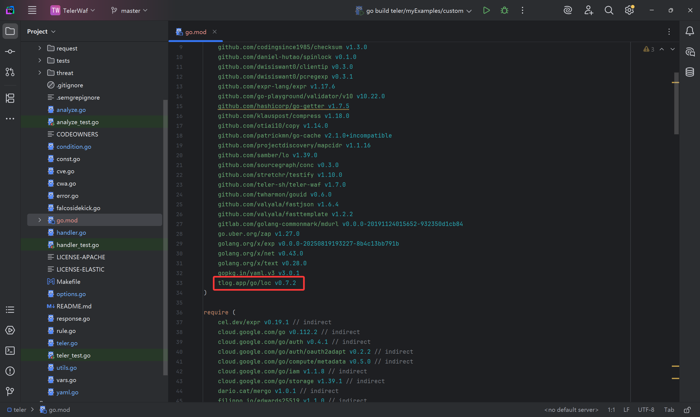
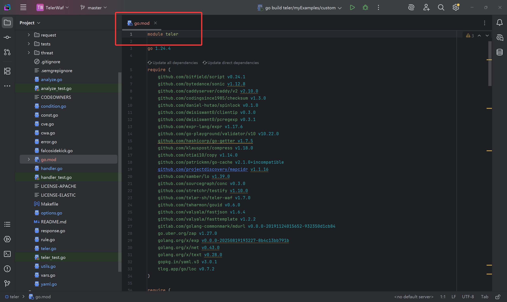
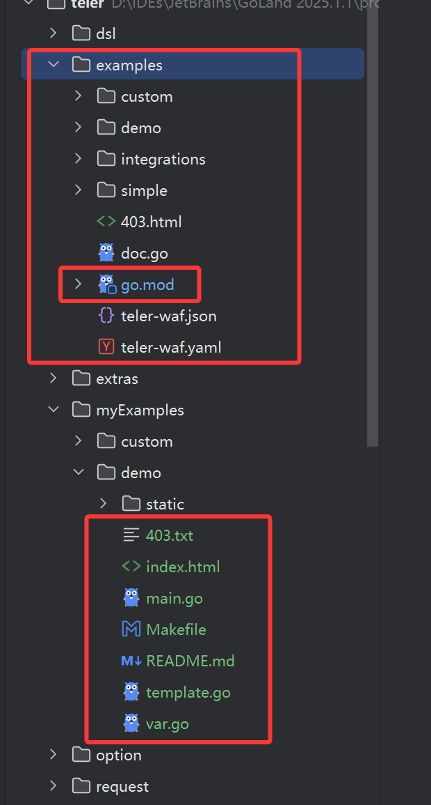
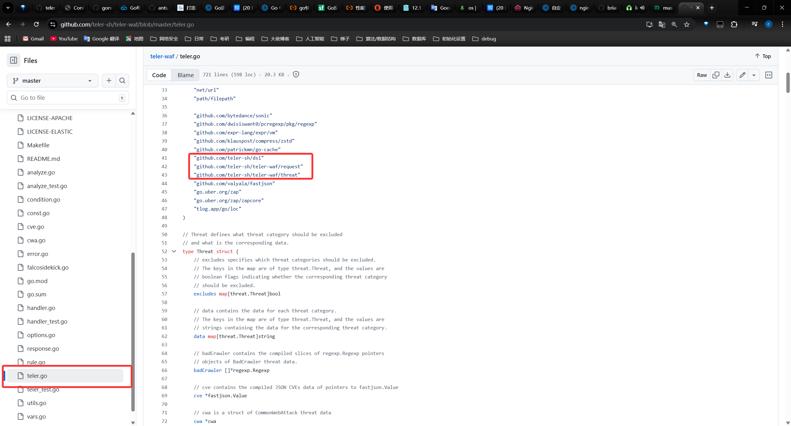
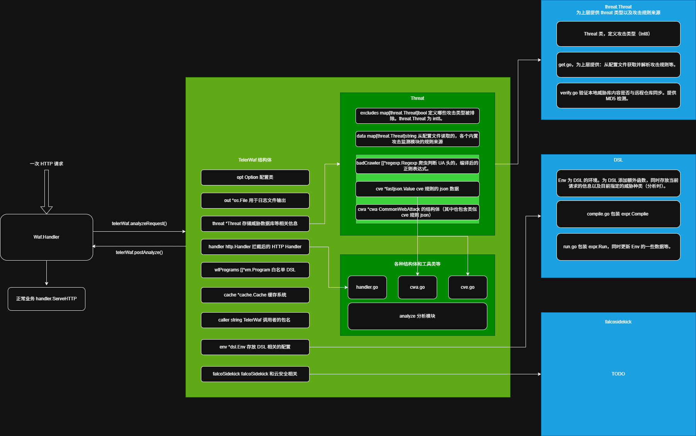

# TelerWaf 学习

## 1. 前言

1. 学完 Golang 的基础之后，考虑转安全开发，那么就想到写一些安全设备，例如 WAF 等。然后就是在 Github 和各种博客中寻找合适的项目，最后定位到 TelerWaf：

    > 项目地址：https://github.com/teler-sh/teler-waf

    如果是国内的项目的话，最想学习的是 [Janusec](https://github.com/Janusec/janusec)，但是该项目本人跑起来有点困难，还提了个 [issue](https://github.com/Janusec/janusec/issues/58)。这个项目是部署在硬件网关上，同时联动防火墙 nftables；同时还有多节点以及证书配置，总的来说比较全面，个人认为是一个很好的学习项目。

## 2. 运行项目的前置准备

1. 记得先看他项目的 README。

### 2.1 Goland 配置

1. 项目是运行在 Linux 下的，如果想在 Windows 下运行并调试该项目，则需要使用 Goland 的 SSH 并进行 build 配置。Goland 相关配置详见：

    > https://www.endlessshw.top/Golang/Bugs/Goland/

### 2.2 高版本 Go 下依赖报错问题

1. 高版本 Go 下，该项目依赖的库 -- tlog.app 在该项目下，在 go >= 1.23 下会出现无法编译的问题，需要升级 tlog 库的依赖版本，问题详见：

    > https://github.com/teler-sh/teler-waf/issues/207

    在写这篇文章时，clone 下来的项目后依赖版本并没有升级，因此需要手动修改：
    

### 2.3 库的依赖

1. 代码中项目自己写的库依赖都是通过 GitHub 仓库而不是项目内的代码。如果看代码时想做一些笔记，那么就需要把依赖改成项目内的，因此需要修改：
    
2. 同时，example 子文件夹中的 go.mod 优先级会大于项目本身的 go.mod，因此最简单的方法就是把子文件夹中的 go.mod 删掉就行：
    
3. 同时具体代码中，记得把远程的依赖改成该项目中的代码。例如：
    
    红框的这些依赖 clone 下来的项目中就有，改成本项目的就行（同时很多地方也需要相应修改)

## 3. 具体细节

### 3.1 项目的总体架构

1. 个人总结的项目架构图如下：
    
    工作原理主要是通过自定义的 `Handler` 来完成对一次请求的分析。
2. falcoSideKick 涉及到云安全相关的内容，后面补上 TODO。

### 3.2 各个模块

1. 日志模块：使用 zap 库
2. 白名单：通过 DSL 来制定过滤规则（和 WireShark 相似的逻辑表达式）
3. Cache：使用 [patrickmn](#https://github.com/patrickmn/go-cache) 的 Cache 库，key 为：`key := headers + uri + body`，基本上就是代表一次请求的所有内容了。
4. Analyze 分析模块：核心的判断威胁算法就是通过大量的正则表达式进行过滤。
5. falcoSideKick 云安全模块：TODO

