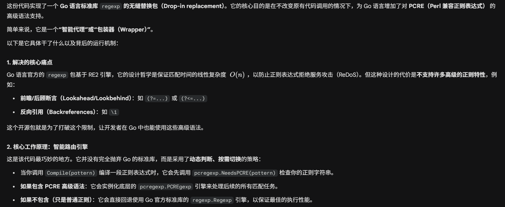
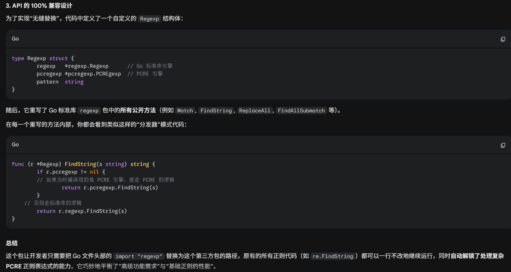
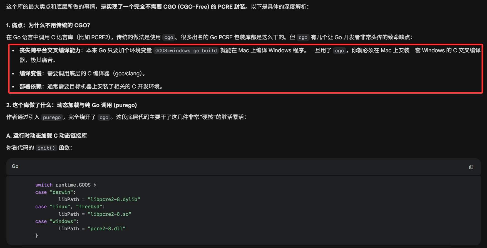
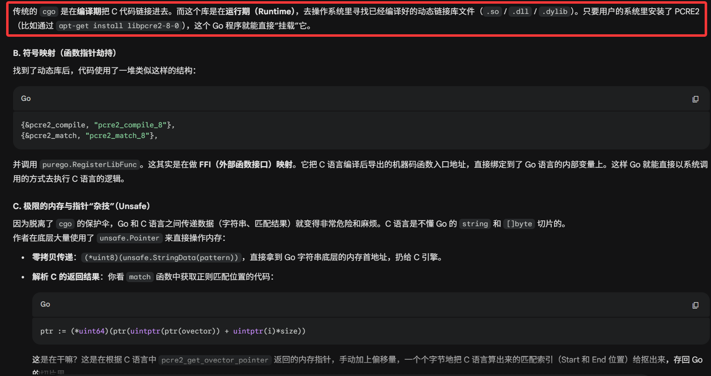
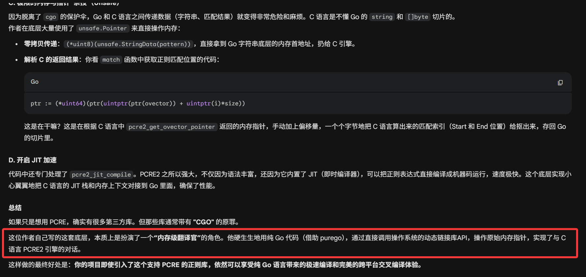
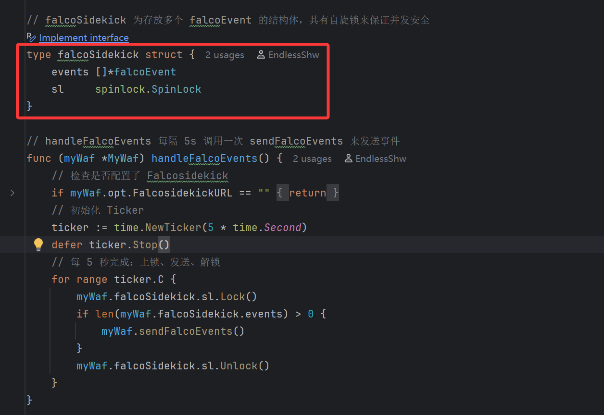
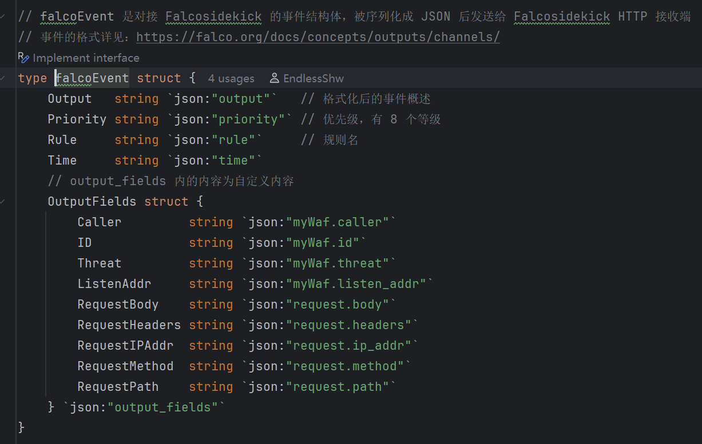
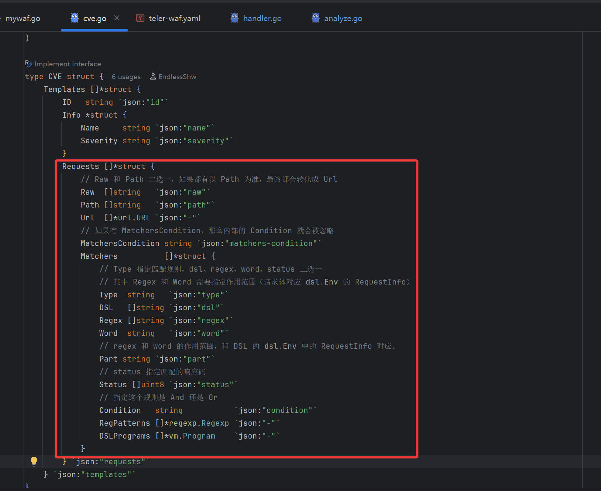

# MyWaf 和 MyIDS 面试准备

## MyWaf

### 1. DSL

1. 一个实例对应一个 `Env` 变量，其中含有存放 URI、Headers、Body、Method、IP 的 `Map`，存放函数名和对应方法的 `Map`，存放威胁类型。
2. 通过自旋锁来保证并发安全，因为执行传入的表达式会很快。

### 2. 正则表达式

1. https://github.com/dwisiswant0/pcregexp
    项目中所使用的正则表达式三方库：
    
    
    编译 `Compile()` 正则表达式时，根据不同的表达式，其返回的 `Regexp` 结构体中其中之一的引擎/对象被初始化。
2. 接着深入，这个库的 `PCRE` 引擎底层调用的官方 `PCRE2` 库，不过为了不用 `CGO`，引入 `purego` 库，通过在运行期更具不同 OS 挂载不同的库。
    
    
    

### 3. HTTP 解析

1. 通过 Go 的 `http.Request` 对象，获取元数据并转换成 URI、Headers、Body、Method、IP 等相关信息，同时做 URL 解码和实体字符转义。

### 4. FalcoSidekick

1. 学习官方 falco 事件的格式，定义对应的结构体，在 Waf 中是单独开了一个协程，批量发送 Falco 事件（其中有创建了一个协程池来并发发送事件）。
    
    

### 5. CVE 部分的识别

1. 直接看图
    

## MyIDS

### 1. 高并发

1. 使用 `ants` 协程池来完成分析、SSE 和 Prometheus 推送。
2. 通过调用 `automaxprocs` 库的方法，用于解决 Go 程序在**容器内**无法正确识别运行环境中 CPU 核心数的问题。
    https://blog.csdn.net/EDDYCJY/article/details/120984666

### 2. 云原生可观测

1. Prometheus：通过使用 Prometheus Golang 库，根据不同的攻击类型定义，参照 Prometheus 的指标类型，定义 `Counter` 和 `CounterVec`。
    通过原生 HTTP 注册服务，对 Prometheus 暴露 `/metrics` 接口。
2. FalcoSidekick 在 MyWaf 中。
3. ZincSearch：参照官方文档，将统计的数据发送到 ZincSearch 指定路径。

### 3. 配置解析

1. 通过结构体 + `validate` 关键字做配置解析。
